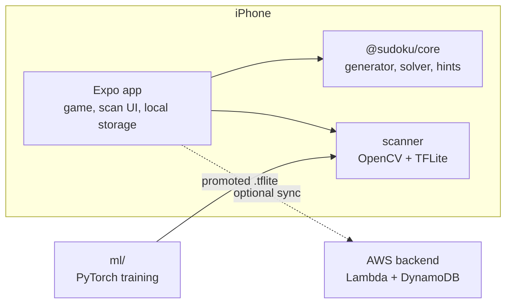

# Sudoku

An ad-free sudoku game for iOS. Play generated puzzles, or point the camera at a sudoku in a
newspaper or a puzzle book. The app reads the grid on the phone and loads it into the game.

No ads. No tracking. It works offline.

<!--
Screenshots: put the images in docs/screenshots/ and uncomment this table.

| Play | Hint | Scan | Check the scan | Stats |
| --- | --- | --- | --- | --- |
|  |  |  |  |  |
-->

## Features

### Play

- **Four levels:** easy, medium, hard and expert. The phone generates each puzzle and grades it
  by the techniques that it needs.
- **Everything you expect:** notes, undo, a timer, pause and mistake highlighting. Three
  mistakes end the game.
- **Hints that teach:** a hint first tells you where to look. Then it names the technique and
  explains it. Only at the end does it show the answer.
- **A technique guide:** every hint technique has its own page with an example board. The
  techniques go from singles to pairs and triples, fish and wings.
- **Stats:** the streak, the best and average times, the last wins and flawless games.
- **Your look:** three colour themes (Cobalt, Forest, Bordeaux), auto, light or colour
  appearance, haptics and assists that you can turn off. English and Dutch.

### Scan

- **Live lock-on:** the camera preview draws the outline of the grid and locks on when it is
  steady.
- **Curved pages:** after the capture, the app flattens each cell from the 100 grid
  intersections, so a bent book page still reads well.
- **Printed and handwritten digits:** an on-device model reads the digit of each cell and its
  kind: printed, handwritten or notes. A half-solved book puzzle loads with your own digits as
  yours.
- **Check before you play:** a review screen shows the result. Fix a digit or switch a cell
  between given and yours.
- **Solve or hint:** a scanned puzzle gets the same hints and solver as a generated one.

### Private by design

- The game and the scanner need no network.
- Camera frames and cell images stay on the phone. A scan photo leaves only through the setting
  "Help improve the app", which you can turn off.
- An optional account syncs your finished games across devices.

## How it is built

One monorepo with two toolchains: TypeScript for the app and the backend, Python for the model.
They share files only, never code.



| Part | Folder | Stack |
| --- | --- | --- |
| App | `mobile/` | React Native 0.86, Expo SDK 57, Expo Router, VisionCamera, Skia, Reanimated, Unistyles, expo-sqlite |
| Game logic | `shared/core/` | Pure TypeScript, no I/O |
| Cell classifier | `ml/` | Python (uv), PyTorch on Apple MPS, exported to TFLite |
| Backend | `backend/` | AWS Lambda, DynamoDB and API Gateway, deployed with SST. Sign-in with Clerk |
| Website | `web/` | Static site on Vercel: [sudoku.felixvandemaele.be](https://sudoku.felixvandemaele.be) |

### Highlights

- **A technique solver for hints.** The same solver grades each generated puzzle and builds each
  hint, so the level matches the techniques that the hints teach.
- **A live scan pipeline off the JS thread.** VisionCamera frame processors find the grid
  corners in native code. Capture then runs a per-cell flatten and one model call for 81 cells.
- **One model, two heads.** A small CNN predicts the digit and the kind of a cell. A gated
  promote step scores it on whole fixture grids, because one wrong digit breaks the puzzle.
- **A data loop.** Corrected scans become training data. A local labelling app checks the
  outlines, confirms each digit and kind, and ranks the doubtful labels first.
- **A backend below €10 a month.** One Lambda and one DynamoDB table. A kill switch stops a
  stage when it reaches its budget.
- **Documented decisions.** The architecture follows Arc42, with more than 30 ADRs.
  dependency-cruiser enforces the boundaries between the parts in CI.

## Run it

### Prerequisites

- Node 24 and pnpm
- [uv](https://docs.astral.sh/uv/) for Python
- [just](https://just.systems) as the command runner
- Xcode, for a build on an iPhone or the simulator
- Docker, for the backend tests against DynamoDB Local

### Commands

```bash
just setup          # install the TypeScript and Python dependencies
just test           # run every test: core, app, backend and ml
just lint           # oxlint, ruff and the boundary rules
just ios-simulator  # build the app for the iOS Simulator
just app            # start the Expo dev server
just --list         # show every command
```

The trained model is not in git, because it learned from photos that may not be published. A
fresh clone plays every game, but the scanner needs a model. Train one with `just train` and
install it with `just install-model`. See [ml/README.md](ml/README.md).

The backend has its own guide: [backend/infra/README.md](backend/infra/README.md).

## Repository layout

```
mobile/    Expo app: game, scan UI, scanner module, storage, account and sync
shared/    @sudoku/core, the sync contract, the model contract and test fixtures
ml/        dataset, training, evaluation, export and the labelling tools
backend/   sync API, kill switch and SST infrastructure
web/       home page and privacy policy
tools/     lint plugin, icon renderer, labelling app, layout and link checks
docs/      architecture (Arc42), operations runbook, privacy policy, research
```

## Documentation

| Read this | To learn |
| --- | --- |
| [Introduction and goals](docs/architecture/01-introduction-and-goals.md) | What the project builds and why |
| [Decisions and constraints](docs/architecture/00-DECISIONS.md) | Every rule and ADR, one line each |
| [Building blocks](docs/architecture/05-building-block-view.md) | The parts and their boundaries |
| [Scan pipeline](docs/architecture/00-concepts/scan-pipeline.md) | How a photo becomes a grid |
| [Model contract](docs/architecture/00-concepts/model-contract.md) | What the model accepts and returns |
| [Game screen](docs/architecture/00-concepts/game-screen.md) | How the game screen works |
| [History sync](docs/architecture/00-concepts/history-sync.md) | How finished games sync |
| [ML notebooks](ml/notebooks/README.md) | The scan extraction and the training, step by step |
| [Operations runbook](docs/operations/runbook.md) | What to do when a backend part breaks |

## Licence

The code is under the [MIT licence](LICENSE). The fonts in `ml/fonts/` and `mobile/assets/fonts/`
keep their own OFL licences.
