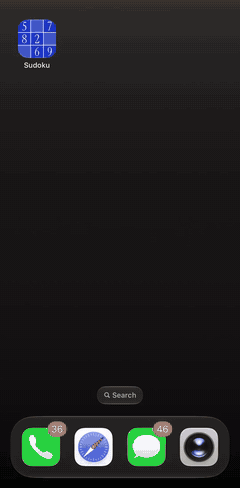
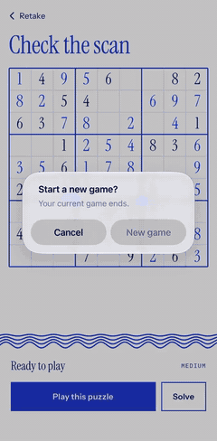
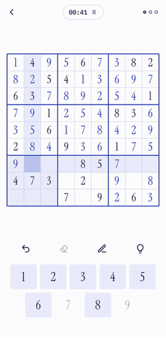
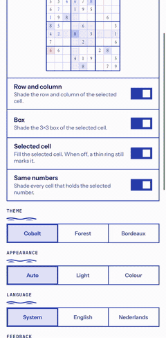

# Sudoku

An ad-free iOS sudoku game that can also read a paper puzzle. Play on the phone, or point the camera at a
newspaper or puzzle book to check your answers or to continue a half-solved page. The scan runs on the device. The app
works offline, has no ads and has no tracking.

| Scan a paper puzzle | Play | Get a hint | Themes |
| :---: | :---: | :---: | :---: |
|  |  |  |  |

## What it does

- **Scan.** A live outline snaps onto the grid. The app reads every cell, printed or handwritten, in about half a second.
  You correct any wrong digit, then check the grid or play on.
- **Play.** Generated puzzles at four levels, notes, undo, mistake highlighting, a timer, statistics and three themes.
  The app speaks English and Dutch.
- **Hints that teach.** A hint names the technique and shows an example, not only the answer.
- **Private.** A photo leaves the phone only if you turn on "Help improve the app". There are no ads and no analytics.

The app has a [home page](https://sudoku.felixvandemaele.be).

## How it works

A small convolutional network reads each of the 81 cells. It tells the digit and the kind: printed, handwritten or a
note. It reads 99.4% of the digits right on 5,711 real test cells. PyTorch trains it. TensorFlow Lite runs it on
the phone.

| Part | Folder | Stack |
| --- | --- | --- |
| App (game and scanner) | `mobile`, `shared/core` | React Native (Expo), VisionCamera, Skia, TypeScript |
| ML (cell classifier) | `ml/` | Python (uv), PyTorch, exported to TFLite |
| Backend (accounts, sync) | `backend/` | AWS (SST), Clerk |

The app and the ML part share files only. For the details, read
[the scan pipeline](docs/architecture/00-concepts/scan-pipeline.md).

## Use the repository

Prerequisites: Node 24, pnpm 12, [uv](https://docs.astral.sh/uv/) and [just](https://just.systems). To build the app, you
also need a Mac with Xcode. The app uses native modules, so Expo Go does not work.

```sh
just setup    # install the TypeScript and Python dependencies
just test     # all tests
just lint     # lint, boundary rules and ruff
just --list   # every command
```

**Run the app.** Build the development variant, then start the dev server:

```sh
just ios-simulator          # iOS Simulator, no code signing
just ios-dev <device-udid>  # a real iPhone. Find the UDID with: xcrun devicectl list devices
just app                    # Expo dev server
```

**The model.** The trained model is not in the repository, because it learned from private photos
(see [the decisions](docs/architecture/00-DECISIONS.md)). The scan needs
`mobile/assets/models/cell-classifier.tflite`. To make your own:

1. Copy `ml/configs/smoke.toml` to a new file. Keep `real_cells = false`. Raise `epochs` and `synthetic_per_class`.
2. Run `just train <config-name>`.
3. Run `just export artifacts/<run>`, then `just install-model artifacts/<run>`.

A model trained on synthetic digits reads real paper less well than the model of the app. The
[ML guide](ml/README.md) covers training, the dataset and the labelling app.

**The backend** is optional. The game and the scan work without it. Accounts and the history sync need your own AWS
account and Clerk instance. See [the backend guide](backend/infra/README.md).

## Documentation

The documentation follows Arc42.

- [Introduction and goals](docs/architecture/01-introduction-and-goals.md)
- [Decisions and constraints](docs/architecture/00-DECISIONS.md)
- [Scan pipeline](docs/architecture/00-concepts/scan-pipeline.md)
- [Model contract](docs/architecture/00-concepts/model-contract.md)
- [Game screen](docs/architecture/00-concepts/game-screen.md)
- [History sync](docs/architecture/00-concepts/history-sync.md)
- [Operations runbook](docs/operations/runbook.md)
- [Rules for coding agents](AGENTS.md)
