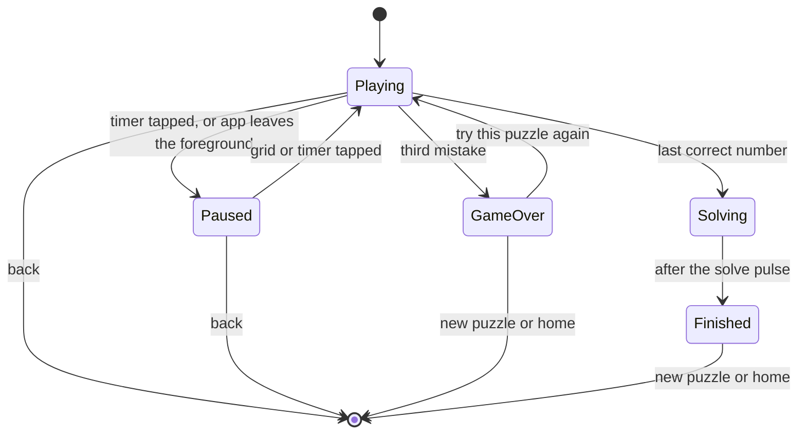

# Game screen

## Why

The game screen is where the player spends almost all of the time in the app. It must be calm,
fast and clear on a phone held in one hand. The screens only draw the state of the game.
Every rule lives in `@sudoku/core` (SUD-04), so Vitest tests the rules and the UI issues can
run in parallel.

The [design canvas](https://claude.ai/artifact/U23JHiGA1Pq3HJX6oMiBF4) holds the agreed
screens, in the Daylight and the Midnight theme. The app has since moved to the three Op-art
colourways (ADR-025). The canvas is still the reference for layout and states. Its colours are not. This concept says what the screen does. The canvas shows how it looks.

## What

The screen has four parts, from top to bottom:

| Part | Contents |
| --- | --- |
| Header | A back button to the home screen. The timer, which is also the pause button. Three dots. One dot fills for each mistake |
| Grid | 81 cells in nine boxes. A **given** is locked and drawn with `type.given`. An **entry** uses `type.entry`. **Notes** show as a 3 × 3 set of small digits with `type.note`. A wrong entry has the conflict colour |
| Tools | Undo, Erase, Notes and Hint. Undo and Erase are disabled when they cannot act. Notes is a toggle: in **notes mode** a number key toggles a note |
| Keypad | One key for each number 1 to 9. The key of a **complete number** is disabled and faded. While a hint is open, the **hint card** replaces it. After "I'll do it", the **hint strip** shows (see [hints](hints.md)) |

### Assists

An **assist** shades cells to help the player see the board. The player turns each assist on
or off in Settings. All four are on by default.

| Assist | When on | When off |
| --- | --- | --- |
| Row and column | Shades the row and the column of the selected cell | No shade |
| Box | Shades the 3 × 3 box of the selected cell | No shade |
| Selected cell | Fills the **selected cell** | A thin ring in the accent colour marks it |
| Same numbers | Shades every cell that holds the number of the selected cell | No shade |

A wrong entry keeps its conflict fill, whatever the assists are.

### States

Back returns to the home screen. The game stays saved, so the player can resume it.
ADR-016 decides how the app moves between the home, game, scan and settings screens.

| State | What the screen shows |
| --- | --- |
| Playing | The grid, the tools and the keypad. The timer counts |
| Paused | The grid hides every digit and note. A "Paused, tap to resume" layer covers it. The tools and the keypad are faded and do not act. The timer stops |
| Game over | The **game over sheet** rises from the bottom over a light scrim. It says "Out of mistakes". It shows how many cells were right and the time played. Its buttons: Try this puzzle again, New puzzle, Back to home |
| Solving | A short pause for the solve **pulse**. The controls do not act |
| Finished | The **finish card** over a scrim, with New puzzle and Back to home below it |

These are screen moments, not core statuses. The core has the game statuses playing, paused, lost and won. Game over shows a lost game. Solving and Finished show a won game.

### Pulses

A correct number can complete a row, a column, a box, all nine of a number, or the whole
grid. Each completion sends a **pulse**: a wave of the accent colour that starts at the cell
and spreads out, cell by cell. A digit in the wave grows for a moment. A key that becomes
complete plays a short animation, then fades. A haptic goes with each pulse. With Reduce
Motion on, the screen shows no pulse animation.

The correction screen plays the same pulse across the whole grid from the centre cell when a scanned grid verifies as solved.

### Feedback

Each move gives one **haptic** and, for some moves, one **cell mark**. One move never gives
two haptics, so two taps never blur together.

| Move | Haptic | Cell mark |
| --- | --- | --- |
| A correct number | tap | none |
| A note, a clear, an erase or an undo | tick | a flash on the cell that an undo restored |
| A hint | soft | a glow on the hinted cell |
| A wrong number | warning, or error for the third mistake | the digit shakes, and a mistake dot fills |
| A completed row, column, box or number | thud | the pulse |
| The solved grid | success | the solve pulse |

- The Notes tool, pause and resume also give a haptic: tick for Notes, soft for pause and resume.
- The finish card gives a thud when it lands with a "New best" badge.
- After the third mistake, the **lost hold** keeps the board in view for 400 ms. Then the game over
  sheet rises.
- Try this puzzle again and New puzzle let the sheet or the card sink before the new game shows.
- Try this puzzle again is a new game in progress with the same puzzle, a new id and the same seed. The lost game stays in the history.
- Every screen starts a game through the puzzle start. It asks before it replaces a game in progress. The game over sheet and the finish card do not ask, because their game is over.
- With Reduce Motion on, the fades stay. The slides, the scales and the shake go.
- The **haptics switch** in Settings turns every haptic off. Reduce Motion does not stop haptics.

### Finish card

The **finish card** shows the result of a solved puzzle:

- the level, for example "Solved · Medium",
- a "New best" badge when the time beats the best time of that level,
- the time,
- a small copy of the solved grid, with givens and entries in two styles,
- the mistakes (for example 1/3), the hints and the best time,
- the source: "Scanned from paper" with a scan icon, or the puzzle number,
- the date.

The card shows after the solve pulse. With Reduce Motion on, it shows at once.

- "New best" shows when the game counts toward the best time and its time is shorter than the
  stored best time of the level. Only a won generated game without hints counts (ADR-012). The
  first counted win at a level is a new best.
- The puzzle number is the seed of a generated puzzle (ADR-011).
- The card tilts a little with the movement of the phone, and a shine moves over it (ADR-017).
  With Reduce Motion on, it does not tilt.

### Game session

One **game session** holds the game in progress. It is plain TypeScript, so a test runs it without a React render. It owns four things:

- the **session reducer**, which maps each action of the player to the core rules,
- the **clock**, which counts the time played once a second while the game is playing,
- the **pause when the app leaves the foreground**,
- the **save snapshot**: when to save, and which game to save.

The session saves the game after each move that changes data a resume needs. A selection and a clock tick do not save. `needsSave` in `@sudoku/core` decides, next to `toSavedGame`, so a new `Game` field cannot be forgotten.

When the app leaves the foreground, the session does these steps in this order:

1. It counts the time since the last clock report.
2. It pauses the game.
3. It saves the paused game with the exact time played. The save is one write.

The hook `useGameSession` adds the one `AppState` listener of the game. It runs the clock while the screen shows. It saves the game when the screen closes (QR-11).

The three contexts of `GameProvider` split the session by how often it changes:

- The actions never change.
- The state changes on a move.
- The time changes once a second.

### Settings

The Settings screen has four groups:

- **Assists:** a switch for each of the four assists, with a small live preview of the grid.
- **Theme:** a choice of the three colourways: Cobalt, Forest or Bordeaux (ADR-025).
- **Appearance:** Auto, Light or Colour. Colour makes the accent the page and the selected cell white (ADR-026).
- **Feedback:** the haptics switch.

### Rules that the screen shows, not owns

`@sudoku/core` decides these rules. The screen only draws the result:

- A given cannot change.
- A placed number removes itself from the notes in its row, column and box.
- A wrong number counts as a **mistake**. Undo does not remove a mistake. The third mistake
  ends the game.
- A **hint** teaches the next step in rungs. It counts one hint when it shows the answer. See [hints](hints.md).
- A number is complete only when all nine are placed correctly. Wrong placements do not count.
- The timer does not count during a pause or after the game ends.

## Open questions

| Question | Decided by |
| --- | --- |
| The motion sensor that tilts the finish card | Decided: ADR-017 |
| Which cell a hint picks. V1 picks a random empty or wrong cell until the hint card ships (#196) | Decided: ADR-032 |
| An option to turn off the entry check | Issue #46, after this epic |
| VoiceOver labels for each cell and Dynamic Type sizes | Issue #44 |

## Constraints

| ID | Constraint |
| --- | --- |
| SUD-01 | The game and the scanner MUST work fully without a network connection. |
| SUD-04 | `@sudoku/core` MUST NOT depend on React Native, Expo or any I/O. |
| Touch target | Every button and key MUST have a touch target of 44 pt or more. The grid cells are the one exception: nine cells share about 358 pt on a 390 pt screen, so each cell is about 38 pt. |
