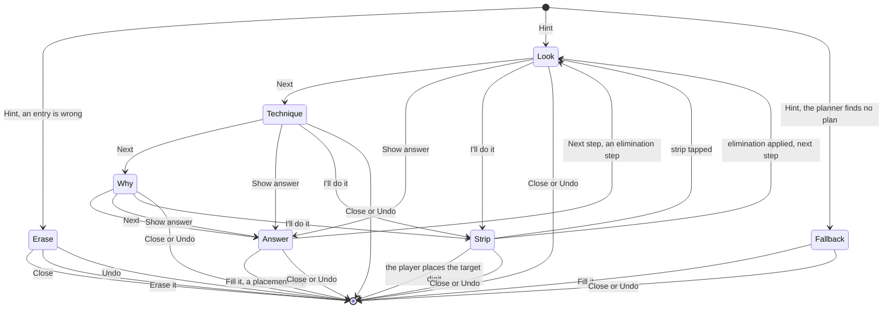

# Hints

## Why

The Hint tool must coach. A hint that only gives a digit teaches nothing. A good hint shows
where to look, names the technique and explains it. The digit comes last. The player can stop at
any rung and find the digit alone. This serves the learning goal of the project (F-07, quality
goal 5).

All rules live in `@sudoku/core` (SUD-04). The screen only draws them.
[ADR-032](../adr/adr-032-hints-that-teach.md) records the decision.

## What

### The hint plan

A **hint plan** is the list of steps that one hint shows. It starts at the board of the player
and ends at a placed digit. The technique solver builds it. Each step is a `Step` with the fields
`technique`, `placements`, `eliminations`, `units`, `pattern`, `support` and `digits`.

- A step with a placement ends the plan.
- An elimination step leads to the single that it unlocks. The plan has at most 6 steps.
- The solver finds candidates from the givens and the entries. It never reads the notes.
- The solver picks the technique that a person finds easiest (Sudoku Explainer order). At the
  same rank, the step nearest the selected cell wins. The same board gives the same plan.
- The hint plan passes `unique: true` to the solver. A game puzzle has exactly one solution.
  The unique rectangle needs this option.
- The plan keeps only the steps that the placement needs. The planner drops each elimination step
  that the rest of the plan can do without. The search may take more steps than 6. The pruned plan
  has at most 6.
- Only the techniques with hint text take part: tier 1 and tier 2. `HINT_TECHNIQUES` in
  `@sudoku/core` holds the text, and the planner reads its order from it. Tier 3 has no text, so
  a board that needs it gets the fallback.
- The Hint tool opens the hint card. The card leads the player through the rungs of each step.

### The planner API

| Function | Does |
| --- | --- |
| `planHint(game)` | Returns the plan: a mistake, 1 to 6 steps, or the fallback. Null on a full grid |
| `hintText(plan, stepIndex, rung)` | Returns the card text of one rung. At most two short sentences |
| `revealHint(game, answer, shown)` | Counts the hint, unless `shown` holds the same answer |
| `fillHint(game, plan, shown)` | Places the answer, counts as `revealHint` does and adds an undo step |

The app keeps `shown`, the answers that this game session showed. The saved game does not keep it.

### The rungs

Each step has four **rungs**. The player moves down one rung with each tap on "More help".

| Rung | The card says | Example |
| --- | --- | --- |
| Look | Where to look | "Look at row 2." |
| Technique | The name and a one-line definition | "Hidden single: a digit with one place in a unit." |
| Why | One or two sentences | "In row 2, only one cell can hold a 9." |
| Answer | The cell and the digit | "Put 9 in row 2, column 1." |

"Show answer" jumps to the answer of the last step. Cell names are plain words, such as "row 4,
column 9". A box has the name of its place, such as "the top-left box".

### The card and the strip

The **hint card** replaces the keypad. It has the same height, so the grid does not move. The
card is not modal. The player can still tap the grid.

"I'll do it" brings back the keypad. The **hint strip** then shows between the grid and the
tools. It reminds the player of the hint. A tap on the strip brings back the card.

The card has these parts:

- The top row: "Hint", or the technique name from rung 2 on. Then "Step 1 of 2" when the plan has more than
  one step, the four rung dots and a close button.
- The text of the rung. It scrolls under Dynamic Type. VoiceOver reads each new text.
- The buttons. They stay at the bottom and are at least 44 pt high.

| Card | Buttons |
| --- | --- |
| Rungs 1 to 3 | More help, Show answer, Try it |
| Rung 4 of an elimination step | Next step |
| Rung 4 of the last step | Fill it, I'll do it |
| A wrong entry | Erase it |
| The fallback | Fill it, I'll do it |

From rung 2 on, "Learn more" under the text opens the **technique page** of the step. The game
stays under the page, so Back returns to the game with the hint still open. The clock counts
while the page shows.

The card and the strip only fade, so Reduce Motion changes nothing. The open hint lives in the session
reducer of the app: the plan, the step, the rung and the view (card, strip or "Nice."). The saved game
does not keep it.

### Highlight roles

Each role is a shape plus a colour. The colour never carries the meaning alone.

| Role | What it marks |
| --- | --- |
| Focus unit | The row, column or box to look at |
| Pattern cell | A cell that forms the pattern, such as a cell of a pair |
| Support digit | A digit that the pattern uses to prove the step |
| Struck candidate | A candidate that the technique removes. It shows only on a note that the player wrote |
| Target cell | The cell that gets the digit |

The technique table, with the roles of each technique, is in ADR-032 decision 12.

The roles grow with the rungs, so the grid tells no more than the card:

| Rung | The grid adds |
| --- | --- |
| Look | The focus unit: the first unit of the step |
| Technique | The other units and the pattern cells |
| Why | The support digits and the struck candidates |
| Answer | The target cell |

The candidates that earlier steps struck stay struck. A wrong entry shows as a pattern cell. The
fallback shows only its target cell. The highlight stays while the strip shows.

The grid draws each role with these shapes. The colours are the `components.cell.hint*` tokens of the theme.

| Role | Shape |
| --- | --- |
| Focus unit | A tint, and a 2 pt outline around all the focus units together |
| Pattern cell | An inner outline and a small dot in the top-right corner |
| Support digit | A round ring around the digit |
| Struck candidate | A bar in the danger tone across the note digit |
| Target cell | A 3 pt outline and the digit as a ghost at 40 %. The outline pulses once. With Reduce Motion it stays still |

While a hint highlight shows, the assist shades step back: row and column, box and same numbers. The conflict fill and
the selected cell stay. The contrast test checks every role colour at 3 : 1 and every digit on the focus tint at
4.5 : 1, in all six themes.

### Technique pages

The **techniques screen** lists every technique with hint text in hint order: the name and the
definition. Settings opens it from the Learn section. Each **technique page** shows these parts:

- the definition of the hint text,
- an explanation of at most four short sentences,
- the first level where the technique appears, from `TECHNIQUE_LEVEL`,
- an example board with every highlight role of its step. VoiceOver reads the board as one text:
  the why and the answer of the step.

`TECHNIQUE_PAGES` in `@sudoku/core` holds the explanations and the example positions. Each example
is a position of a generated puzzle. The Vitest tests check that the finder of the technique finds
a step there. For all but the quads and the jellyfish, the hint plan of the position starts with
the technique. Those three are rare: an easier step always came first in the generated puzzles.
The screens track and send nothing (SUD-02).

### Special cases

- **A wrong entry.** The hint starts with one card: "Erase it first". The card has two
  buttons. "Erase it" erases the entry and ends the hint. Close ends the hint and leaves the
  entry. The player taps Hint again for the real hint. This card does not count.
- **The fallback.** The planner decides it before the card opens. It applies when no technique
  fits, or when no placement appears within 6 steps. The card says so. It reveals the empty cell
  with the fewest candidates. This hint counts once, when the fallback card shows.

### The count rule

A game counts a hint only when it shows an answer. `hintsUsed` then means "answers shown".

| Event | Counts |
| --- | --- |
| Rung 1, 2 or 3 | No |
| The answer rung opens | Once |
| The player taps "Fill it" | Once |
| The fallback shows | Once |
| The "Erase it first" card | No |
| The same answer again in one game session | No |
| Undo after a counted answer | The count stays |

Hints have no limit and no price. Nothing about them is tracked or sent (SUD-02).

### States of an open hint

Look, Technique, Why and Answer show the hint card. Strip shows the hint strip. A tap on the strip
returns the card at the rung where the player left it.

A hint ends in these cases:

- **Fill it, or the target digit placed.** The hint ends at a placed digit.
- **Close.** The player closes the card or the strip.
- **Undo.** Undo ends an open hint. Undo never changes the hints used, as it never changes the
  mistakes. A counted answer stays counted.
- **A pause.** A pause ends the hint. The game does not save a hint in progress. A new Hint
  builds a new plan.
- **A stale plan.** The player changes the board so that the plan no longer fits. The hint
  ends. A new Hint builds a new plan.
- **The game ends.** A lost or won game ends the hint.

Counting happens when the Answer rung opens, when the player taps "Fill it", and when the
fallback card shows. Close never counts. If the player places the target digit alone, the hint
counts only if the Answer rung was open.

An elimination step has no placement. At its Answer rung, "Next step" opens the Look rung of the
next step. The plan has at most 6 steps. If no placement appears within 6 steps, the planner
makes the fallback card before the hint opens.

## Open questions

| Question | Decided by |
| --- | --- |
| The shape and the colour of each role | Decided: the shape table under "Highlight roles" and the `components.cell.hint*` tokens |
| The text of each technique | Decided: `HINT_TECHNIQUES` in `@sudoku/core` |
| The layout of the card on a small phone | Issue #196 |
| Whether an edit of the notes alone makes a plan stale | Decided: no. The plan never reads the notes |
| VoiceOver reading of the card and the highlights | Not planned |

## Constraints

| ID | Constraint |
| --- | --- |
| SUD-01 | A hint MUST work without a network. |
| SUD-02 | The app MUST NOT track or send anything about a hint. |
| SUD-04 | The solver and the hint plan MUST live in `@sudoku/core`, without React Native or I/O. |
| Candidates | The solver MUST take candidates from the givens and the entries, never from the notes. |
| Count | A hint MUST count only when it shows the answer. Rungs 1 to 3 are free. |
| Clean room | The code MUST NOT copy from HoDoKu or SudokuWiki. |
