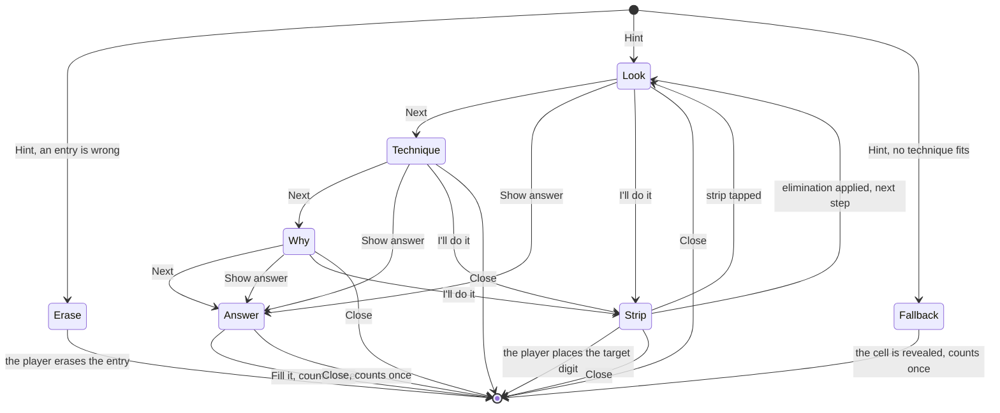

# Hints

## Why

The Hint tool must coach. A hint that only gives a digit teaches nothing. A good hint shows
where to look, names the technique and explains it. The digit comes last. The player can stop at
any rung and find the digit alone. This serves the learning goal of the project (F-07, quality
goal 5). All rules live in `@sudoku/core` (SUD-04). The screen only draws them.
[ADR-032](../adr/adr-032-hints-that-teach.md) records the decision.

## What

### The hint plan

A **hint plan** is the list of steps that one hint shows. It starts at the board of the player
and ends at a placed digit. The technique solver builds it. Each step is a `Step` with the fields
`technique`, `placements`, `eliminations`, `units`, `pattern`, `support` and `digits`.

- A step with a placement ends the plan.
- An elimination step leads to the single that it unlocks. The plan has at most 6 steps.
- The solver finds candidates from the givens and the entries. It never reads the notes.
- The solver picks the technique that a person finds easiest (Sudoku Explainer order). At the
  same rank, the step nearest the selected cell wins. The same board gives the same plan.

### The rungs

Each step has four **rungs**. The player moves down one rung with each tap on Next.

| Rung | The card says | Example |
| --- | --- | --- |
| Look | Where to look | "Look at row 2." |
| Technique | The name and a one-line definition | "Hidden single: a digit with one place in a unit." |
| Why | One or two sentences | "In row 2, only one cell can hold a 9." |
| Answer | The cell and the digit | "Put 9 in row 2, column 1." |

"Show answer" jumps to the answer of the last step. Cell names are plain words, such as "row 4,
column 9". A box has the name of its place, such as "the top-left box".

### The card and the strip

The **hint card** replaces the keypad. It has the same height, so the grid does not move. The
card is not modal. The player can still tap the grid.

"I'll do it" brings back the keypad. The **hint strip** then shows between the grid and the
tools. It reminds the player of the hint. A tap on the strip brings back the card.

### Highlight roles

Each role is a shape plus a colour. The colour never carries the meaning alone.

| Role | What it marks |
| --- | --- |
| Focus unit | The row, column or box to look at |
| Pattern cell | A cell that forms the pattern, such as a cell of a pair |
| Support digit | A digit that the pattern uses to prove the step |
| Struck candidate | A candidate that the technique removes. It shows only on a note that the player wrote |
| Target cell | The cell that gets the digit |

The technique table, with the roles of each technique, is in ADR-032 decision 12.

### Special cases

- **A wrong entry.** The hint starts with one card: "Erase it first". The player erases the
  entry. Then the player taps Hint again. This card does not count.
- **The fallback.** When no technique fits, the card says so. It reveals the empty cell with the
  fewest candidates. This hint counts once.

### The count rule

A game counts a hint only when it shows an answer. `hintsUsed` then means "answers shown".

| Event | Counts |
| --- | --- |
| Rung 1, 2 or 3 | No |
| The answer rung shows | Once |
| The player taps "Fill it" | Once |
| The fallback shows | Once |
| The "Erase it first" card | No |
| The same answer again in one game session | No |

Hints have no limit and no price. Nothing about them is tracked or sent (SUD-02).

### States of an open hint

Look, Technique, Why and Answer show the hint card. Strip shows the hint strip. A tap on the strip
returns the card at the rung where the player left it.

- A pause keeps the hint open. The timer stops.
- When the player changes the board so that the plan is stale, the hint closes. A new Hint
  builds a new plan.
- When the player places the target digit alone, the hint closes. It counts only if the answer
  rung was shown.

## Open questions

| Question | Decided by |
| --- | --- |
| The shape and the colour of each role | Issue #195 |
| The text of each technique | Issue #194 |
| The layout of the card on a small phone | Issue #196 |
| Whether an edit of the notes alone makes a plan stale | Issue #194 |
| VoiceOver reading of the card and the highlights | Issue #44 |

## Constraints

| ID | Constraint |
| --- | --- |
| SUD-01 | A hint MUST work without a network. |
| SUD-02 | The app MUST NOT track or send anything about a hint. |
| SUD-04 | The solver and the hint plan MUST live in `@sudoku/core`, without React Native or I/O. |
| Candidates | The solver MUST take candidates from the givens and the entries, never from the notes. |
| Count | A hint MUST count only when it shows the answer. Rungs 1 to 3 are free. |
| Clean room | The code MUST NOT copy from HoDoKu or SudokuWiki. |
