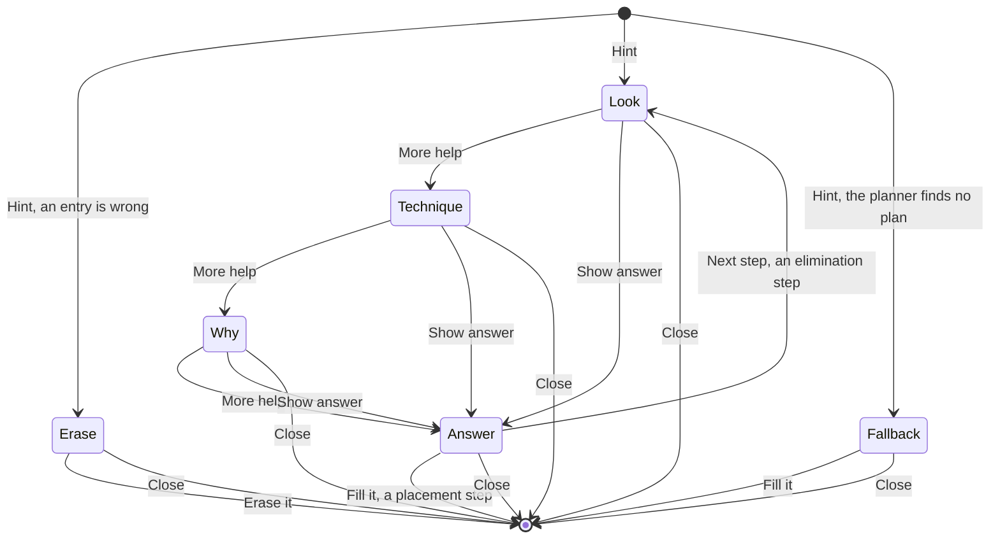

# Hints

## Why

The Hint tool must coach. A hint that only gives a digit teaches nothing. A good hint shows
where to look, names the technique and explains it. The digit comes last. The player can stop at
any rung and find the digit alone. This serves the learning goal of the project (F-07, quality
goal 5).

All rules live in `@sudoku/core` (SUD-04). The screen only draws them.
[ADR-032](../adr/adr-032-hints-that-teach.md) records the decision.

## What

### The hint plan

A **hint plan** is the list of steps that one hint shows. It starts at the board of the player
and ends at a placed digit. The technique solver builds it. Each step is a `Step` with the fields
`technique`, `placements`, `eliminations`, `units`, `pattern`, `support` and `digits`.

- A step with a placement ends the plan.
- An elimination step leads to the single that it unlocks. The plan has at most 6 steps.
- The solver finds candidates from the givens and the entries. It never reads the notes.
- The solver picks the technique that a person finds easiest (Sudoku Explainer order). At the
  same rank, the step nearest the selected cell wins. The same board gives the same plan.
- The hint plan passes `unique: true` to the solver. A game puzzle has exactly one solution.
  The unique rectangle needs this option.
- The plan keeps only the steps that the placement needs. The planner drops each elimination step
  that the rest of the plan can do without. The search may take more steps than 6. The pruned plan
  has at most 6.
- Only the techniques with hint messages take part: tier 1 and tier 2. `HINT_TECHNIQUES` in
  `@sudoku/core` builds the messages, and the planner reads its order from it. Tier 3 has no
  messages, so a board that needs it gets the fallback.
- The core holds no player text (ADR-033). A message is an id with values: digits and parts, such
  as a cell, a unit or a list of digits. The app writes each message and each part from its
  catalogues, in English and Dutch. The names, the definitions and the page texts of the
  techniques are in the catalogues too.
- The Hint tool opens the hint card. The card leads the player through the rungs of each step.

### The planner API

| Function | Does |
| --- | --- |
| `planHint(game)` | Returns the plan: a mistake, 1 to 6 steps, or the fallback. Null on a full grid |
| `hintMessage(plan, stepIndex, rung)` | Returns the message of one rung: an id from `HINT_MESSAGE_IDS` and its values. The app's `hintText` writes it as at most two short sentences |
| `revealHint(game, answer, shown)` | Counts the hint, unless `shown` holds the same answer |
| `fillHint(game, plan, shown)` | Places the answer, counts as `revealHint` does and adds an undo step |

The app keeps `shown`, the answers that this game session showed. The saved game does not keep it.

### The rungs

Each step has four **rungs**. The player moves down one rung with each tap on "More help".

| Rung | The card says | Example |
| --- | --- | --- |
| Look | Where to look | "Look at row 2." |
| Technique | The name and a one-line definition | "Hidden single: a digit with one place in a unit." |
| Why | One or two sentences | "In row 2, only one cell can hold a 9." |
| Answer | The cell and the digit | "Put 9 in row 2, column 1." |

"Show answer" jumps to the answer of the last step. Cell names are plain words, such as "row 4,
column 9". A box has the name of its place, such as "the top-left box".

### The card

The **hint card** replaces the tool row and the keypad. Both stay in the layout under the card, so
the grid does not move. The card covers the whole dock from edge to edge:

- It has the width of the grid and the same side margins.
- The gap between the grid and the card is the gap above the grid.
- Its height does not change between rungs.
- Its padding is the grid margin (16 pt).

The card is not modal. The player can still tap the grid.

The card has these parts:

- The top row: "Hint", or the technique name from rung 2 on. Then "Step 1 of 2" when the plan has more than
  one step, the four rung dots and a close button.
- The text of the rung, with a line height of about 1.45 times its size. From rung 2 on, "Learn more" is an inline
  link at the end of the text. The text scrolls only when Dynamic Type makes it taller than the card. VoiceOver reads
  each new text.
- The footer: at most one filled main button on the right and at most one text button on the left. Each button is at
  least 44 pt high, and no label wraps onto two lines.

| Card | Main button | Text button |
| --- | --- | --- |
| Rungs 1 to 3 | More help | Show answer |
| Rung 4 of an elimination step | Next step | |
| Rung 4 of the last step | Fill it | |
| A wrong entry | Erase it | |
| The fallback | Fill it | |

A hint has two ways out. Close (X) ends the hint and clears the highlight. The player then finds the
digit alone. "Fill it" places the answer.

"Learn more" opens the **technique page** of the step. The game stays under the page, so Back
returns to the game with the hint still open. The clock counts while the page shows.

The card moves with the motion of the game screen:

| Event | Motion | With Reduce Motion |
| --- | --- | --- |
| Open | The tool row and the keypad sink and fade. The card rises into their place | Fades only |
| Close | The card sinks and fades. The tool row and the keypad rise back | Fades only |
| Rung change | The text cross-fades. The rung dots fill in turn | The fades stay |

The open hint lives in the session reducer of the app: the plan, the step and the rung. The saved
game does not keep it.

### Highlight roles

The roles keep the look of the app: fills and the accent colour, no extra lines
([ADR-032](../adr/adr-032-hints-that-teach.md), amendment of 2026-10-22). The card text explains. The grid only points.

| Role | What it marks |
| --- | --- |
| Focus unit | The row, column or box to look at |
| Pattern cell | A cell that forms the pattern, such as a cell of a pair |
| Support digit | A digit that the pattern uses to prove the step |
| Struck candidate | A candidate that the technique removes. It shows only on a note that the player wrote |
| Target cell | The cell that gets the digit |

The technique table, with the roles of each technique, is in ADR-032 decision 12.

The roles grow with the rungs, so the grid tells no more than the card:

| Rung | The grid adds |
| --- | --- |
| Look | The focus unit: the first unit of the step |
| Technique | The other units and the pattern cells |
| Why | The support digits and the struck candidates |
| Answer | The target cell and its ghost digit |

The candidates that earlier steps struck stay struck. A wrong entry keeps its conflict fill and gets no hint fill. The
fallback shows only its target cell. The highlight goes when the hint ends.

The grid draws each role like this. The colours are the `components.cell.hint*` tokens of the theme.

| Role | Look |
| --- | --- |
| Focus unit | A soft tint, the step of the row and column assist. Two units that overlap give one tint |
| Pattern cell | A tint one step stronger than the focus unit |
| Support digit | The digit in the accent colour, on the focus tint |
| Struck candidate | A bar in the danger tone across the note digit: the only line-shaped mark |
| Target cell | The strongest tint, and the digit as a ghost at the answer rung |

A cell with more than one role takes the strongest fill: target, then pattern, then focus. A support cell takes the focus
tint too. The accent colour is close to the colour of an entry, and the Colour look draws both givens and the accent in
white. The fill marks the cell where the colour does not.

Each role has a **role entrance**: a fade of 150 ms in and out. A role that stays through a rung change does not fade
again. With Reduce Motion, a role shows and goes at once.

While a hint is open, the assist shades step back: row and column, box and same numbers. The selected fill and its ring
step back too. The conflict fill stays. The contrast test checks, in all six themes:

- every digit and note on each hint fill at 4.5 : 1, and the support digit on its fill at 4.5 : 1,
- the ghost digit on the target fill at 3 : 1 (a cell digit is large text),
- the strike on each fill at 3 : 1,
- each step of the fills (plain, focus, pattern, target) at a contrast ratio of 1.08 or more.

### Technique pages

The **techniques screen** lists every technique with hint text in hint order: the name and the
definition. Settings opens it from the Learn section. Each **technique page** shows these parts:

- the definition of the hint text,
- an explanation of at most four short sentences,
- the first level where the technique appears, from `TECHNIQUE_LEVEL`,
- an example board with every highlight role of its step. VoiceOver reads the board as one text:
  the why and the answer of the step.

`TECHNIQUE_PAGES` in `@sudoku/core` holds the example positions. The explanations are in the catalogues of the app, under
`technique.<id>.explanation`. Each example
is a position of a generated puzzle. The Vitest tests check that the finder of the technique finds
a step there. For all but the quads and the jellyfish, the hint plan of the position starts with
the technique. Those three are rare: an easier step always came first in the generated puzzles.
The screens track and send nothing (SUD-02).

### Special cases

- **A wrong entry.** The hint starts with one card: "Erase it first". "Erase it" erases the
  entry and ends the hint. Close ends the hint and leaves the entry. The player taps Hint again for the real hint. This card does not count.
- **The fallback.** The planner decides it before the card opens. It applies when no technique
  fits, or when no placement appears within 6 steps. The card says so. It reveals the empty cell
  with the fewest candidates. This hint counts once, when the fallback card shows.

### The count rule

A game counts a hint only when it shows an answer. `hintsUsed` then means "answers shown".

| Event | Counts |
| --- | --- |
| Rung 1, 2 or 3 | No |
| The answer rung opens | Once |
| The player taps "Fill it" | Once |
| The fallback shows | Once |
| The "Erase it first" card | No |
| The same answer again in one game session | No |
| Undo after a counted answer | The count stays |

Hints have no limit and no price. Nothing about them is tracked or sent (SUD-02).

### States of an open hint

Every state shows the hint card.

A hint ends in these cases:

- **Fill it.** The hint ends at a placed digit.
- **Close.** The player closes the card, and then finds the digit alone.
- **A pause.** A pause ends the hint. The game does not save a hint in progress. A new Hint
  builds a new plan.
- **The game ends.** A lost or won game ends the hint.

The card covers the tool row and the keypad, so the player cannot enter, erase or undo while it
shows. The reducer still ends the hint on an entry, an erase or an undo, as decision 14 of ADR-032
says. A selection on the grid keeps the hint open.

Counting happens when the Answer rung opens, when the player taps "Fill it", and when the
fallback card shows. Close never counts. A close at the answer rung keeps the count that the answer
rung made. A digit that the player places after a close does not count.

An elimination step has no placement. At its Answer rung, "Next step" opens the Look rung of the
next step. The plan has at most 6 steps. If no placement appears within 6 steps, the planner
makes the fallback card before the hint opens.

## Open questions

| Question | Decided by |
| --- | --- |
| The look of each role | Decided: the fills under "Highlight roles" and the `components.cell.hint*` tokens (ADR-032, amendment of 2026-10-22) |
| The text of each technique | Decided: the messages of `HINT_TECHNIQUES` in `@sudoku/core`, written from the catalogues of the app (ADR-033) |
| The layout of the card on a small phone | Decided: the card covers the dock from edge to edge. The text scrolls when it is taller (ADR-032, amendment "calm highlights with fills only") |
| Whether an edit of the notes alone makes a plan stale | Decided: no. The plan never reads the notes |
| VoiceOver reading of the card and the highlights | Not planned |

## Constraints

| ID | Constraint |
| --- | --- |
| SUD-01 | A hint MUST work without a network. |
| SUD-02 | The app MUST NOT track or send anything about a hint. |
| SUD-04 | The solver and the hint plan MUST live in `@sudoku/core`, without React Native or I/O. |
| Candidates | The solver MUST take candidates from the givens and the entries, never from the notes. |
| Count | A hint MUST count only when it shows the answer. Rungs 1 to 3 are free. |
| Clean room | The code MUST NOT copy from HoDoKu or SudokuWiki. |
