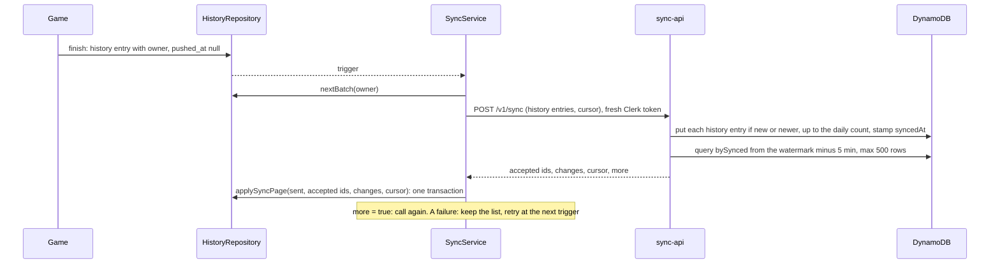
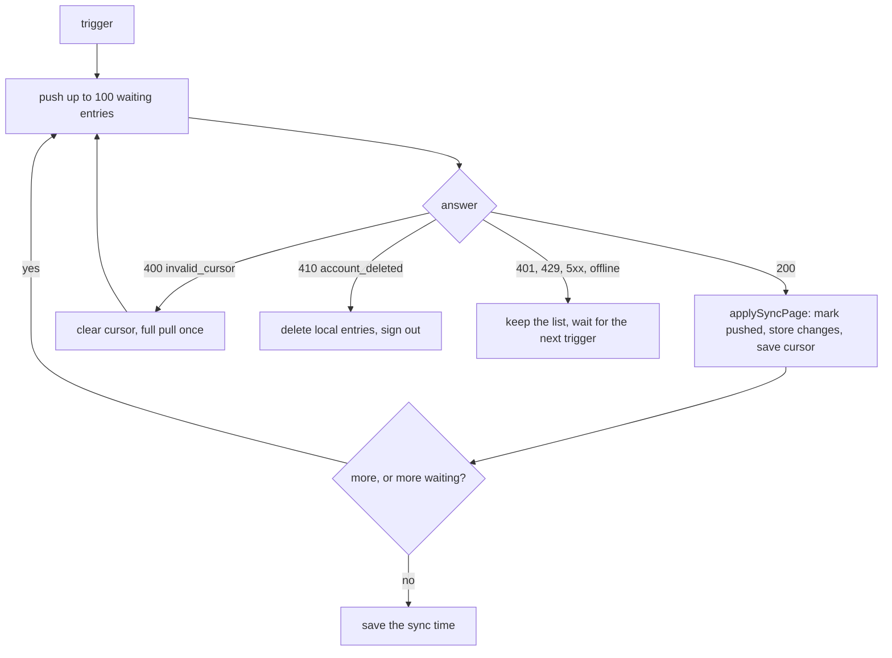
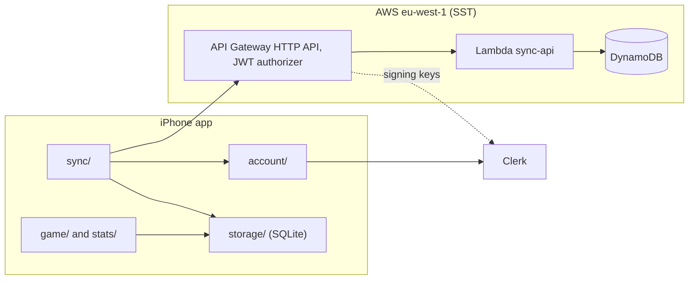

# History sync

## Why

A player wants a backup of the finished games. A player with two iPhones
wants the same history and the same stats everywhere. The phone must still work alone: play and
the stats never wait for a network (SUD-01).

The [architecture page](https://claude.ai/artifact/H4bYEsdcyTmHtWbwQZrN5F) shows the backend,
the sync and the spending cap on one page. This concept and ADR-027 and ADR-028 are the
source of truth. The page is an overview.

## What

The phone stays the **source of truth**. The cloud holds a copy of every finished game of every
player. Each device downloads the games of its other devices and counts the stats itself.

| Data | Lives on | Syncs |
| --- | --- | --- |
| The game in progress | The phone (SQLite) | No |
| The settings | The phone (SQLite) | No |
| The history | The phone and DynamoDB | Yes, after sign-in |
| The personal stats | Counted on each device from the history | No, they are counted again |
| The leaderboard (later) | Counted in the cloud | — |

An account is optional. A player who is signed out plays as normal, and nothing uploads.

**The sync is quiet.** When the player is signed in, the stats screen shows one small, muted line
at the bottom, such as "Synced 5 min ago". It shows no banner, no spinner and no error. When the
player is signed out, the line is not there.

**The sync run.** The service runs one sync at a time. A trigger during a run asks for one more
run. A run pushes batches of 100 and pulls every page. It saves the cursor after each stored
page. After a failure, a trigger acts only after a wait of 30 seconds, doubled for each failure,
at most 15 minutes. No timer retries.

**The sync.** One call, `POST /v1/sync`, pushes the games on the waiting list and pulls the
changes since the cursor. The app syncs when a game ends, when the app comes to the foreground,
when the network comes back while the app is open, and after sign-in.

**The cursor.** The server alone makes the cursor. The app stores it as an opaque string. It
holds the watermark (the highest `syncedAt` pulled) and, while a pull pages, the
`LastEvaluatedKey` of DynamoDB. Each call reads from 5 minutes before the watermark, at most
500 rows. `more: true` means "call again". A page that stops at exactly 500 rows still gives
`more: true`. The next call reads no rows and takes the watermark from the key of that page. The
full rules are decision 6 of [ADR-028](../adr/adr-028-history-sync.md).

**The waiting list.** A history entry waits for the server while its `pushed_at` is null or
differs from its `updated_at`. `pushed_at` holds the `updatedAt` that the server accepted, never a
clock time. The server accepts an id when it stores the history entry, or when it already holds an
equal or newer `updatedAt` for that id. So a lost response is harmless.

**The page.** `HistoryRepository.applySyncPage` applies one answer of the server in one transaction. It marks the pushed
entries, writes the downloaded entries and saves the cursor. It drops a downloaded entry that breaks the sync contract
or a CHECK. `nextBatch` reads the waiting list and leaves out the entries that break the contract. The sync run
keeps the network, the retries and the pause. The details are in the amendment of 2026-10-21 in
[ADR-028](../adr/adr-028-history-sync.md).

**The sync contract.** The zod schemas in `shared/sync-contract/` define every body of
`POST /v1/sync`. The app and the `sync-api` Lambda import them. The package depends only on zod.

| Schema | Holds | Limits |
| --- | --- | --- |
| History entry | `schemaVersion`, `id`, `level`, `source`, `result`, `seed`, `playedMs`, `mistakes`, `hintsUsed`, `finishedAt`, `createdAt`, `updatedAt`, `deletedAt` | `schemaVersion` is `1`. `id` is a UUID. Numbers are integers, 0 or more. `seed` is null or at most 4294967295. Times are UTC ISO 8601 with 3 decimals |
| Sync request | `entries`, `cursor` | At most 100 history entries. The cursor is null or 1 to 1024 characters |
| Sync response | `acceptedIds`, `changes`, `cursor`, `more` | At most 100 accepted ids and 500 changes |
| Error body | `code`, `message` | The message has 1 to 500 characters. It never repeats the request or personal data |

The owner and `syncedAt` are not on the wire. The server takes the player from the token and
stamps `syncedAt` itself. The error codes come from decision 8 of ADR-028:

| Status | Code |
| --- | --- |
| 400 | `invalid_request` |
| 400 | `invalid_cursor` |
| 410 | `account_deleted` |

API Gateway sends its own body for a 401 and a 429. So the app reads the status code first.

**The daily count.** The server stores at most 200 history entries per player per day. At the cap
it stores what fits and still runs the pull. The other history entries wait for the next day. A
429 comes only from the API throttle or the kill switch.

**The adopt prompt.** At sign-in, the app counts the live games without an owner. If there are
some, it asks "Add the games on this phone to your account?" once for each account. "Add games"
gives them the owner. "Not now" leaves them without an owner, and the app does not ask again for
that account. No request goes out before the answer. The adopt of the entries of an old owner
after a provider switch is deferred ([ADR-028](../adr/adr-028-history-sync.md)).

**The errors in the app.** A 400 `invalid_cursor` clears the cursor and makes one full pull. A 410
`account_deleted` deletes the local entries of the owner, clears the state of that owner, signs
out and shows one alert. Every other failure is silent.

**Accounts on one phone.** Every history entry has an owner: the Clerk user ID of the player. The
app knows it at sign-in, also offline. A game finished while signed out has no owner. The first sign-in asks to add those games to the account. A sign-out hides the
games of the account and stops the sync. A second account never sees or uploads the games of
the first. When the server answers 410 `account_deleted`, the app signs out and keeps nothing of
that account. The full rules are in [ADR-028](../adr/adr-028-history-sync.md).

**The rows.** One DynamoDB table holds three kinds of row (ADR-028 decision 9). `expiresAt` is
the one TTL attribute of the table, in epoch seconds.

| Row | pk | sk | Fields besides the key |
| --- | --- | --- | --- |
| Identity | `IDENTITY#clerk#` | `IDENTITY` | `userId`, `createdAt`. A tombstone keeps both and adds `deletedAt` and `expiresAt` |
| Game | `USER#<userId>` | `GAME#<id>` | The history entry without `id`, and `syncedAt` |
| Daily count | `USER#<userId>` | `COUNT#<yyyy-mm-dd>` | `writes`, `expiresAt` (the start of the UTC day plus 2 days) |

Only game rows have `syncedAt`, so the index `bySynced` holds only game rows. The Lambda is in
[`backend/api/`](../../../backend/api/README.md).

**Delete the account.** `DELETE /v1/account` runs three steps in this order: turn the identity row into a tombstone,
delete every row of the partition `USER#<userId>`, delete the Clerk user. A failed step leaves the
tombstone, so a sync answers 410 until a retry succeeds.
The answer is 204, also for a second call. After it, a sync with the same `sub` gets 410
`account_deleted`. The details are in the amendment "delete the account" of
[ADR-027](../adr/adr-027-backend-platform.md).

**The cloud side.** Clerk signs the player in. The API Gateway checks the Clerk token. The Lambda
maps the Clerk user ID to our own user ID and reads and writes one DynamoDB table
([ADR-027](../adr/adr-027-backend-platform.md)).

## Open questions

| Question | Decided by |
| --- | --- |
| Does AWS bill requests that the throttle turns away? If yes, the kill switch deletes the stage instead | Issue #108, at the first deploy of the kill switch |
| Does the new AWS account allow a reserved concurrency of 2? If not, ask for a higher quota | Issue #108, at the first deploy |
| The leaderboard: best-time rows, a global index and display names | A later ADR |
| Shared scans for training: an upload link to a private S3 bucket, an explicit tap per scan (SUD-02) | A later ADR |

## Constraints

| ID | Constraint |
| --- | --- |
| SUD-01 | Play and the stats MUST NOT wait for the network or an account. |
| SUD-02 | The sync MUST NOT carry camera frames, photos or cell images. |
| SUD-11 | The AWS bill MUST stay below €10 a month. A kill switch stops every stage at the budget. |
| Owner | The sync and the stats MUST use only the history entries of the signed-in owner, or of no owner when signed out. |
| Player from the token | The Lambda MUST take the player from the verified token, never from the path or the body. |
| Boundaries | `game/` and `stats/` MUST NOT import `account/` or `sync/`. |
