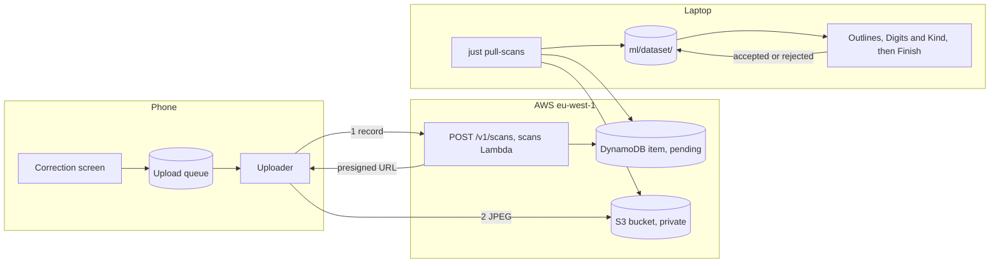

# Scan collection

## Why

The cell classifier learns from real photos. Hand-labelling is slow. The player already corrects the model on the
correction screen. Each correction is a label. The app can send the scan with its corrections, so the developer
retrains with little hand-labelling. The decision is in [ADR-030](../adr/adr-030-scan-collection.md).

## What

A **scan record** holds one finished scan. The app builds it when the player leaves the correction screen by any
route except Retake. The setting "Help improve the app" must be on. A scan of an imported image never makes a record
(ADR-030, amendment 2026-10-22).

| Part | Content |
| --- | --- |
| Photo | A JPEG of the grid plus a margin, cropped from the 1600 px upright photo. It has no EXIF |
| Corners | Four corner points in the photo |
| Model answers | The digit and its probabilities for each of the 81 cells |
| Final grid | The 81 digits after the correction |
| `edited` | One flag for each cell. It is true when the player changed the model's answer |
| IDs | The `scanId`, the contributor ID and, for a signed-in player, the user ID |

The flow has five steps.

1. The app adds the record to a local SQLite queue.
2. The uploader runs when the phone is online. It sends `POST /v1/scans` and receives a presigned URL.
3. The uploader sends the JPEG to S3 with `PUT`. It retries with backoff. The `scanId` makes a repeat safe.
4. `just pull-scans` downloads the scans with `pending` set. It writes the photos to `ml/dataset/images/sudoku-photos/`.
5. The developer checks the outline of each scan in the **Outlines step** of the labelling app. Then the developer
   confirms the digit of each open cell in the **Digits step**, and its kind in the **Kind step**. The **Fetch new scans**
   step runs step 4 from the app (ADR-034).

The **label provenance** of a cell has three values.

| Value | Meaning |
| --- | --- |
| `app-edited` | The player changed the model's answer |
| `app-unedited` | The player left the model's answer |
| `verified` | The developer confirmed the label in the labelling app |

### The outline check

`just pull-scans` stores each scan with the status `unchecked`. A wrong outline cuts part of each digit, or the wrong
grid on a page with several sudokus. Then every cell label of the scan is wrong. So a person checks the outline of each
scan first. Training leaves out every cell of a scan whose outline is not `accepted`.

The Outlines step shows a gallery of the unchecked scans and imported photos, with the outline drawn. The **outline fit** sets the
order: the lowest fit comes first. It is the share of the 20 grid lines found inside the outline, less for a line that
is off its 9 × 9 place. `ml/dataset/work/outline-scores.json` caches it per corners.

| Action | Result |
| --- | --- |
| Enter in the gallery | Every scan without a mark is approved. The marked scans open large |
| Drag the corners, then Enter | The cells are cut again. A new cell keeps the digit, the kind and the label provenance of the old cell at its place. The old cells move to `discarded/` |
| R | The scan is a **rejected scan**. All of its cells move to `discarded/` |
| Z | The last action is undone, files included. The scan shows again |

An imported photo goes through the same gallery. Its approval or rejection writes `sudoku-photos.csv` at once, so Z
cannot reverse it. Its cells land in `unlabeled/` with the model's guess, and the Digits step labels them.

Each action on an uploaded scan is one action in the journal. The journal holds the outline as an `outline` line. Finish writes the status
and the corners into `sudoku-photos.csv`. A move of the Outlines step never makes a cell `verified`: no person looked
at the cells.

### The Digits and Kind steps

An **open digit cell** is an open cell of a scan with an accepted outline, or a loose cell. The **Digits step** shows
the open digit cells in one gallery per tab: Empty, 1 to 9 and No guess. A cell sits in the tab of its label. For an
uploaded scan this is the label of the player. For an imported photo or a loose cell it is the guess of the model.

The server runs the latest model at its start, after a fetch and after each approved outline. It stores the
probabilities of the 10 digits and the 4 kinds of each open cell in `ml/dataset/work/prelabels.json`. A cell in
`empty/` gets them too, because a player can leave a digit empty.

**The doubt score** sets the order in both steps: the highest doubt comes first. A person still checks every cell. The
score adds the signals. Each signal keeps its evidence, so the app can name it.

| Signal | When it fires | Digits step | Kind step |
| --- | --- | --- | --- |
| `low-p` | The model's probability of the label is below 90 % | `1 − p` | `1 − p` |
| `model-differs` | The model's top digit, or kind, is not the label | + 0.5 | + 0.5 |
| `edited` | The player changed the label | + 0.3 | |
| `rule-break` | The digit is twice in a row, a column or a box of a scan that holds the cell | + 0.2 | |
| `not-unique` | The printed givens of the scan have more than one solution. It marks the empty cells of the scan | + 0.1 | |
| `no-guess` | The cell has no probabilities. The score is 1 | 1 | 1 |

The score is at most 1. The kind probability is renormalised over printed and handwritten. The sudoku signals only
nudge the order. They never block a cell, because some photos do not give a solvable grid. A small solution counter in
`ml/src/sudoku_ml/doubt.py` stops at 2 solutions. `ml/dataset/work/doubt-sudoku.json` caches the cut and the signals of
each scan, keyed by the corners and the labels. The score is not in `cells.csv`.

**Confirm the sure ones** confirms every sure cell of one tab as one action. The model must read the label with at
least the **threshold**: 98 % in the Digits step and 95 % in the Kind step. A cell that the player changed or that
breaks a rule is not sure in the Digits step. A cell without probabilities is never sure.

An **open kind cell** is a cell in 1 to 9 whose digit a person confirmed in the journal and that has no kind line of a
person after it. It is also a cell in 1 to 9 without any kind. A cell that still waits for its digit is not open yet.

The **cell detail** beside the gallery shows the whole sudoku of a cell with the cell marked: the other digits of the
grid tell a 1 from a 7. A loose cell has no photo, so its detail says so. Z undoes the last action. Finish then
writes `verified`.

A cell with the same pixels as a cell of another scan is stored once, with the source of the first scan. It needs one
label and one check, so it shows once in the gallery.

Training takes only the `verified` cells and the legacy cells without a label provenance. No `app-edited` or
`app-unedited` cell trains before a person verifies it. The dev split is by photo, so the cells of one scan stay on one
side.

## Open questions

| Question | Decided by |
| --- | --- |
| The table keys and the sparse index for `pending` | The plan for the backend issue |
| The crop margin and the JPEG quality | The plan for the app issue, against a real scan |
| The App Store privacy label values for photos and the device ID | Before the first App Store submission |
| App Attest, to stop junk uploads | A new ADR, when abuse appears |

## Constraints

| ID | Constraint |
| --- | --- |
| SUD-01 | A failed upload MUST NOT block play or scanning. |
| SUD-02 | A photo MUST leave the device only through the setting "Help improve the app". Camera frames and cell images MUST NOT leave the device. An imported image MUST NOT leave the device. |
| SUD-08 | Scan photos MUST NOT be committed. |
| SUD-10 | Fixture cells MUST NOT appear in any training dataset. Scan cells never become fixtures. |
| SUD-11 | The AWS bill MUST stay below €10 a month. The scans route has its own throttle. The shared app key is not a secret. |
| Idempotence | A repeated `POST /v1/scans` with the same `scanId` MUST make no second item. |
