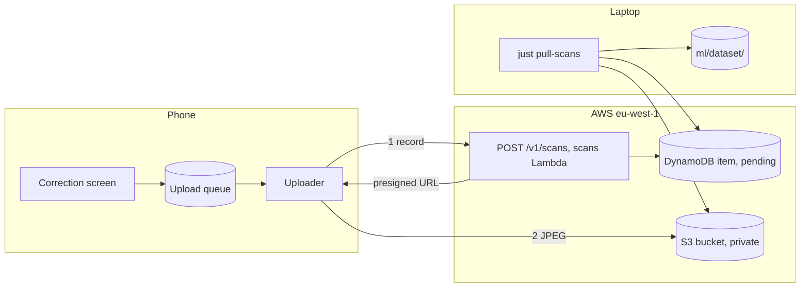

# Scan collection

## Why

The cell classifier learns from real photos. Hand-labelling is slow. The player already corrects the model on the
correction screen. Each correction is a label. The app can send the scan with its corrections, so the developer
retrains with little hand-labelling. The decision is in [ADR-030](../adr/adr-030-scan-collection.md).

## What

A **scan record** holds one finished scan. The app builds it when the player leaves the correction screen by any
route except Retake. The setting "Help improve the app" must be on. A scan of an imported image never makes a record
(ADR-030, amendment 2026-10-22).

| Part | Content |
| --- | --- |
| Photo | A JPEG of the grid plus a margin, cropped from the 1600 px upright photo. It has no EXIF |
| Corners | Four corner points in the photo |
| Model answers | The digit and its probabilities for each of the 81 cells |
| Final grid | The 81 digits after the correction |
| `edited` | One flag for each cell. It is true when the player changed the model's answer |
| IDs | The `scanId`, the contributor ID and, for a signed-in player, the user ID |

The flow has four steps.

1. The app adds the record to a local SQLite queue.
2. The uploader runs when the phone is online. It sends `POST /v1/scans` and receives a presigned URL.
3. The uploader sends the JPEG to S3 with `PUT`. It retries with backoff. The `scanId` makes a repeat safe.
4. `just pull-scans` downloads the scans with `pending` set. It writes the photos to `ml/dataset/images/sudoku-photos/`.

The **label provenance** of a cell has three values.

| Value | Meaning |
| --- | --- |
| `app-edited` | The player changed the model's answer |
| `app-unedited` | The player left the model's answer |
| `verified` | The developer confirmed the label on the labelling page |

Training takes `verified` and `app-edited` cells by default. `app-unedited` cells need a flag. The dev split is by
photo, so the cells of one scan stay on one side.

## Open questions

| Question | Decided by |
| --- | --- |
| The table keys and the sparse index for `pending` | The plan for the backend issue |
| The crop margin and the JPEG quality | The plan for the app issue, against a real scan |
| The App Store privacy label values for photos and the device ID | Before the first App Store submission |
| App Attest, to stop junk uploads | A new ADR, when abuse appears |

## Constraints

| ID | Constraint |
| --- | --- |
| SUD-01 | A failed upload MUST NOT block play or scanning. |
| SUD-02 | A photo MUST leave the device only through the setting "Help improve the app". Camera frames and cell images MUST NOT leave the device. An imported image MUST NOT leave the device. |
| SUD-08 | Scan photos MUST NOT be committed. |
| SUD-10 | Fixture cells MUST NOT appear in any training dataset. Scan cells never become fixtures. |
| SUD-11 | The AWS bill MUST stay below €10 a month. The scans route has its own throttle. The shared app key is not a secret. |
| Idempotence | A repeated `POST /v1/scans` with the same `scanId` MUST make no second item. |
