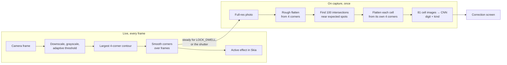

# Scan pipeline

## Why

Scanning is the feature that makes this more than a sudoku game, and it is judged in the first
second: does the live overlay snap onto the grid, and does the grid that comes out look right. Fixing
a bad still photo after the fact takes a lot of code. A live camera lets the user fix most of
that by holding the phone better, so the pipeline can be simpler
and still handle a curved book page to some degree.

## What

Two stages. The **live** stage runs on every frame and only finds the four outer corners. It is
cheap and drives the live overlay. When the grid has been steady for a short while, the scan
**locks on** and captures a full-resolution photo. The **capture** stage then does the expensive
work once: it finds the 100 grid intersections, flattens every cell from its own four corners,
and classifies the 81 cells. Flattening per cell corrects a curved page piece by piece, with
simple maths.

## Block diagram

## Stages

| Stage | Where it runs | Budget | Notes |
| --- | --- | --- | --- |
| Grid detection | Frame processor (ADR-002) | ≤ 15 ms per frame | On a frame downscaled to about 640 px. Returns `null` when no plausible quad is found |
| Corner smoothing | Scan UI, UI thread | negligible | A filter over recent frames, so the dots do not jitter. Tuned in the walking skeleton |
| Live overlay | Scan UI, UI thread | ≤ 4 ms per frame for the scene and one effect | The active effect draws from the scene, which the engine computes once per frame from the smoothed corners. The default effect is Gathering dots. A development build switches effects with the dev pill (ADR-014). See the [effect lab design](../../superpowers/specs/2026-10-11-effect-lab-design.md) |
| Lock-on | Scan UI, UI thread | — | Automatic: the grid stays steady for `LOCK_DWELL` (0.7 s to start). Steady means `motion < STEADY_MOTION`, with `STEADY_SPEED` = 30 pt/s. The lock-on progress resets when the grid is lost, found again or jumps. The gathered dots show the progress: they settle and brighten. A shutter button captures at any time. See the [capture flow design](../../superpowers/specs/2026-10-11-capture-flow-design.md) |
| Rough flatten | scanner, on capture | ≤ 30 ms | Perspective transform from the 4 corners to a square |
| Intersections | scanner, on capture | ≤ 50 ms | Classical first: search each of the 100 expected points in a small window. fast-opencv has no `cornerSubPix`, so the refinement is our own code. An ML keypoint model replaces this only if book pages need it (F-12) |
| Per-cell flatten | scanner, on capture | ≤ 30 ms | 81 small perspective transforms. Falls back to the rough flatten for a cell whose intersections were not found |
| Classification | scanner, on capture | ≤ 100 ms for 81 cells | Preprocessing in plain TypeScript, then one batched call on the CPU, see [model-contract](model-contract.md) |

## Threads and coordinates

| Concern | Rule |
| --- | --- |
| Frame to OpenCV | `react-native-vision-camera-resizer` turns each frame and scales the whole frame to 360 × 640 RGB on the GPU. It applies the frame orientation and mirroring. Version 5.2.3 turns a `left` or `right` frame the wrong way, so the image is upside down. `useGridDetector` turns the quad back by 180°. It does not make grayscale, so fast-opencv does that |
| Frame processor to UI thread | Detected corners are written to a Reanimated shared value from the frame processor (`react-native-worklets`). The UI thread reads it, smooths it, steps the scene and Skia draws the active effect. No live corner passes through the JS thread. At lock-on, one normalised quad goes to the JS thread once, to start the capture |
| Coordinates | The live stage reports the quad in **normalised, upright coordinates**: `x` and `y` in `[0, 1]` of the frame after applying its orientation. This survives the different resolution, aspect ratio and orientation of the capture |
| Capture source | On lock-on, VisionCamera takes a full-resolution photo (`capturePhoto()`, then `toImageAsync()` and its raw pixels into a Mat). `recognise()` maps the normalised quad onto the photo after applying its EXIF orientation, then **re-detects the corners** in a small window around each mapped corner, because the phone may have moved a little |
| Capture thread | `recognise()` runs on the scanner runtime, a worklet runtime made with `createWorkletRuntime`, so the transition animation keeps running while it works |

VisionCamera 5 with `react-native-worklets` is the starting point (ADR-002). The walking skeleton
pins the exact versions.

## The transition

The transition starts at lock-on. The photo flattens into the grid square, the grid lines grow
through the gathered dots and the digits appear. A filled correction screen shows within the QR-07
budget of 1.5 s. `recognise()` still supplies the flattened image, the 100 intersections and the 81
results. See the [scan experience
design](../../superpowers/specs/2026-10-11-scan-experience-design.md).

## Loading the result

| Cell result | Loads as |
| --- | --- |
| digit, kind `printed` | Given (locked) |
| digit, kind `handwritten` | Player entry (editable). Kept even if it conflicts with the solution, and flagged |
| kind `notes` | Empty. Reading the notes is out of scope (F-15) |
| empty | Empty |

The givens alone must have exactly one solution, checked by `@sudoku/core` before the puzzle
loads. If they have none or several, the correction screen says so and does not load.

## Open questions

| Question | Decided by |
| --- | --- |
| Smoothing filter and its parameters (moving average, One Euro filter, …) | Walking skeleton (M0), against QR-06 |
| Lock-on rule: final values of `LOCK_DWELL`, `STEADY_SPEED` and `STEADY_MOTION` | Issue #6, on the device |
| Window size for the intersection search, and when a cell falls back to the rough flatten | First book-page fixtures |
| Confidence threshold for "review this cell" | First real fixture set |

## Constraints

| ID | Constraint |
| --- | --- |
| SUD-02 | Camera frames, photos and cell images MUST NOT leave the device without an explicit user action for each export. |
| SUD-05 | The app MUST reach the scanner only through `src/scanner/index.ts`. |
