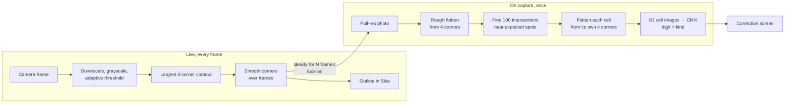

# Scan pipeline

## Why

Scanning is the feature that makes this more than a sudoku game, and it is judged in the first
second: does the outline snap onto the grid, and does the grid that comes out look right. Fixing
a bad still photo after the fact takes a lot of code. A live camera lets the user fix most of
that by holding the phone better, so the pipeline can be simpler
and still handle a curved book page to some degree.

## What

Two stages. The **live** stage runs on every frame and only finds the four outer corners. It is
cheap and drives the outline. When the outline has been steady for a short while, the scan
**locks on** and captures a full-resolution photo. The **capture** stage then does the expensive
work once: it finds the 100 grid intersections, flattens every cell from its own four corners,
and classifies the 81 cells. Flattening per cell corrects a curved page piece by piece, with
simple maths.

## Block diagram

## Stages

| Stage | Where it runs | Budget | Notes |
| --- | --- | --- | --- |
| Grid detection | Frame processor (ADR-002) | ≤ 15 ms per frame | On a frame downscaled to about 640 px. Returns `null` when no plausible quad is found |
| Corner smoothing | Scan UI, UI thread | negligible | A filter over recent frames, so the outline does not jitter. Tuned in the walking skeleton |
| Lock-on | Scan UI | — | Corners move less than a threshold for N consecutive frames. N and the threshold are tuned in the walking skeleton |
| Rough flatten | scanner, on capture | ≤ 30 ms | Perspective transform from the 4 corners to a square |
| Intersections | scanner, on capture | ≤ 50 ms | Classical first: search each of the 100 expected points in a small window. fast-opencv has no `cornerSubPix`, so the refinement is our own code. An ML keypoint model replaces this only if book pages need it (F-12) |
| Per-cell flatten | scanner, on capture | ≤ 30 ms | 81 small perspective transforms. Falls back to the rough flatten for a cell whose intersections were not found |
| Classification | scanner, on capture | ≤ 100 ms for 81 cells | Preprocessing in plain TypeScript, then one batched call on the CPU, see [model-contract](model-contract.md) |

## Threads and coordinates

| Concern | Rule |
| --- | --- |
| Frame to OpenCV | Each frame is converted and downscaled with `react-native-vision-camera-resizer` before fast-opencv sees it. The resizer can crop but does not rotate or make grayscale |
| Frame processor to UI thread | Detected corners are written to a Reanimated shared value from the frame processor (`react-native-worklets`). The UI thread reads it, smooths it and Skia draws the outline. No corner passes through the JS thread |
| Coordinates | The live stage reports the quad in **normalised, upright coordinates**: `x` and `y` in `[0, 1]` of the frame after applying its orientation. This survives the different resolution, aspect ratio and orientation of the capture |
| Capture source | On lock-on, VisionCamera takes a full-resolution photo (`capturePhoto()`, then `toImageAsync()` and its raw pixels into a Mat). `recognise()` maps the normalised quad onto the photo after applying its EXIF orientation, then **re-detects the corners** in a small window around each mapped corner, because the phone may have moved a little |
| Capture thread | `recognise()` runs off the JS thread (an async worklet or a native thread, settled in the walking skeleton), so the transition animation keeps running while it works |

VisionCamera 5 with `react-native-worklets` is the starting point (ADR-002). The walking skeleton
pins the exact versions.

## The transition

The animation is in the Scan UI and needs three things from `recognise()`: the flattened image,
the 100 intersections and the 81 results.

1. The captured frame freezes under the locked outline.
2. The photo is drawn with a perspective transform interpolated from the detected quad to a
   square, so the paper visibly flattens.
3. Grid lines fade in on the intersections. Digits appear cell by cell, printed digits as givens
   and handwritten ones in the "mine" style. Cells below the confidence threshold are marked for
   review.
4. The correction screen takes over. A rule conflict (a duplicate in a row, column or box) marks
   the cells involved.

## Loading the result

| Cell result | Loads as |
| --- | --- |
| digit, kind `printed` | Given (locked) |
| digit, kind `handwritten` | Player entry (editable). Kept even if it conflicts with the solution, and flagged |
| kind `notes` | Empty. Reading the notes is out of scope (F-15) |
| empty | Empty |

The givens alone must have exactly one solution, checked by `@sudoku/core` before the puzzle
loads. If they have none or several, the correction screen says so and does not load.

## Open questions

| Question | Decided by |
| --- | --- |
| Smoothing filter and its parameters (moving average, One Euro filter, …) | Walking skeleton (M0), against QR-06 |
| Lock-on rule: N frames and the movement threshold | Walking skeleton (M0) |
| Window size for the intersection search, and when a cell falls back to the rough flatten | First book-page fixtures |
| Confidence threshold for "review this cell" | First real fixture set |

## Constraints

| ID | Constraint |
| --- | --- |
| SUD-02 | Camera frames, photos and cell images MUST NOT leave the device without an explicit user action for each export. |
| SUD-05 | The app MUST reach the scanner only through `src/scanner/index.ts`. |
