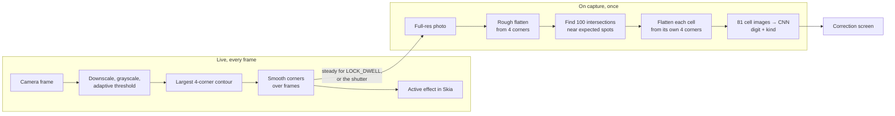
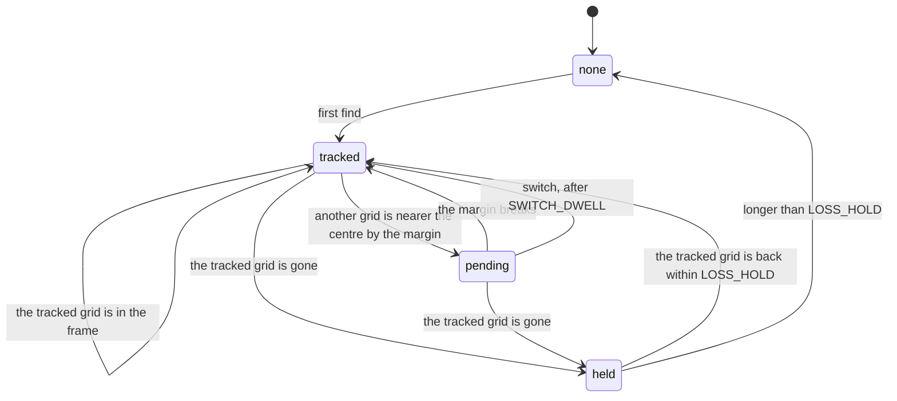
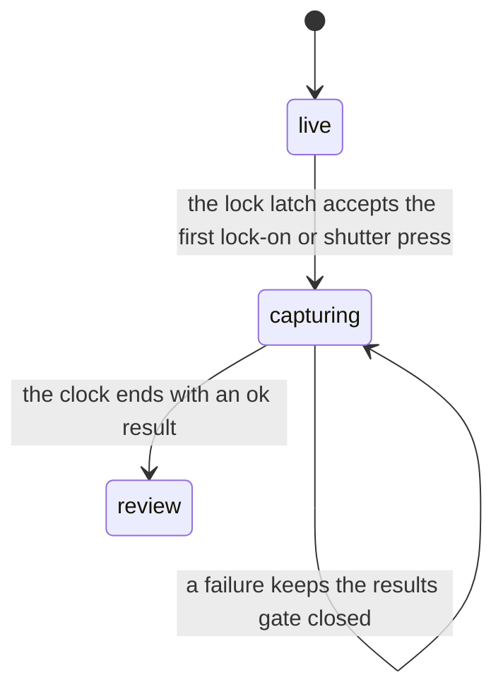
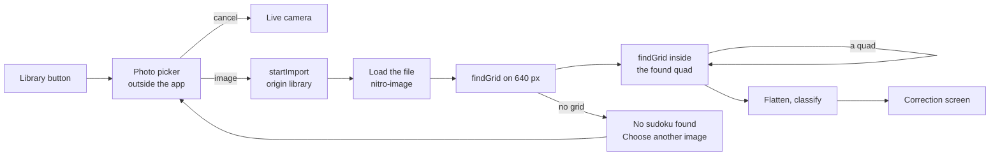
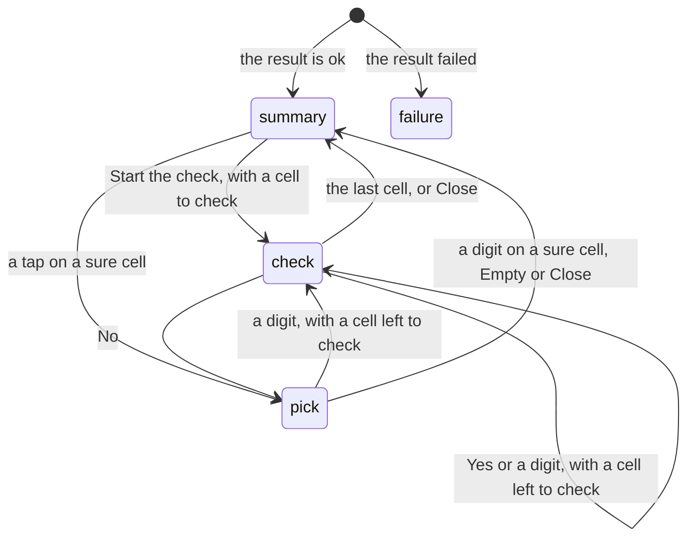

# Scan pipeline

## Why

Scanning is the feature that makes this more than a sudoku game, and it is judged in the first
second: does the live overlay snap onto the grid, and does the grid that comes out look right. Fixing
a bad still photo after the fact takes a lot of code. A live camera lets the user fix most of
that by holding the phone better, so the pipeline can be simpler
and still handle a curved book page to some degree.

## What

Two stages. The **live** stage runs on every frame and only finds the four outer corners. It is
cheap and drives the live overlay. When the grid has been steady for a short while, the scan
**locks on** and captures a full-resolution photo. The **capture** stage then does the expensive
work once: it finds the 100 grid intersections, flattens every cell from its own four corners,
and classifies the 81 cells. Flattening per cell corrects a curved page piece by piece, with
simple maths.

## Block diagram

## Stages

| Stage | Where it runs | Budget | Notes |
| --- | --- | --- | --- |
| Grid detection | Frame processor (ADR-002) | ≤ 15 ms per frame | On a frame downscaled to about 640 px. `findGrids` gives every plausible quad. The grid chooser picks one, or `null` (see "Choosing the grid") |
| Corner smoothing | Scan UI, UI thread | negligible | A filter over recent frames, so the dots do not jitter. Tuned in the walking skeleton |
| Live overlay | Scan UI, UI thread | ≤ 4 ms per frame for the scene and one effect | The active effect draws from the scene, which the engine computes once per frame from the smoothed corners. The default effect is Gathering dots. A development build switches effects with the dev pill (ADR-014). See the [effect lab design](../../superpowers/specs/2026-10-11-effect-lab-design.md) |
| Lock-on | Scan UI, UI thread | — | The lock-on tracker owns the rule (`src/scan/utils/lockOn.utils.ts`). The engine gives it the grid of each frame. The scene and the effects get only the lock-on progress and the lock time. The tracker fires once, in the frame of lock-on. A shutter press can come in the same moment, so the lock latch of the capture session starts the scan for the first source only. Automatic: the same grid stays in view for `LOCK_DWELL` = 1.0 s, and the phone does not clearly move (ADR-019). A clear move is a drift above `DRIFT_LIMIT` = 150 pt/s. The drift is the largest net corner move over the last `DRIFT_WINDOW` = 0.3 s, measured in every frame. Noise and tremor cancel over the window, a pan does not. Lock-on happens only when the user means it. (1) The scene is older than `WARMUP` = 1.0 s. A Retake starts a new scene, so the warm-up runs again. (2) The grid is at least `MIN_GRID_WIDTH` = 0.35 of the view width (the mean of the top and bottom edges). A big grid stays big down to 0.32 (`GRID_WIDTH_HYSTERESIS` = 0.03). The dwell counts from the latest of the found time, the last clear move, the end of the warm-up and the time the grid became big enough. The lock-on progress resets when the grid is lost, found again or jumps. The gathered dots show the progress: they settle and brighten. A shutter button captures at any time. The steady values drive the overlay only. A hand-held iPhone gave a median step speed of 28.8 pt/s, so steady failed as a lock-on rule (issue #72). The other values are as built, to tune on the device. See the [capture flow design](../../superpowers/specs/2026-10-11-capture-flow-design.md) |
| Rough flatten | scanner, on capture | ≤ 30 ms | Perspective transform from the 4 corners to a square, 576 × 576 px. The app computes the homography in TypeScript, because fast-opencv 1.0.1 cannot fill a `Point2fVector` (ADR-002). Measured on the iPhone 17 Pro: 129 to 137 ms |
| Intersections | scanner, on capture | ≤ 50 ms | Classical first: search each of the 100 expected points in a small window. fast-opencv has no `cornerSubPix`, so the refinement is our own code. An ML keypoint model replaces this only if book pages need it (F-12) |
| Per-cell flatten | scanner, on capture | ≤ 30 ms | 81 small perspective transforms. Falls back to the rough flatten for a cell whose intersections were not found |
| Classification | scanner, on capture | ≤ 100 ms for 81 cells | Preprocessing in plain TypeScript, then one batched call on the CPU, see [model-contract](model-contract.md). Measured on the iPhone 17 Pro: 76 to 87 ms. The model call alone takes 29 to 51 ms. The whole capture, lock-on to result view, takes 512 to 539 ms |

## Choosing the grid

A page can hold several sudokus of almost the same size. The player chooses one by aiming at it. The grid chooser
(`chooseGrid` in `src/scanner/chooseGrid.ts`) applies the rule in the frame processor, once per frame. Its state stays on the
camera thread, so no corner goes through the JS thread.

| Rule | What the chooser does |
| --- | --- |
| Size | A grid smaller than `MIN_AREA_SHARE` = 0.6 of the area of the largest grid of the frame never counts, such as last week's solution |
| First find | The grid nearest the frame centre, of the grids that count. The view shows the frame with a centred cover mapping, so the frame centre is the view centre. Distances are shares of the frame width |
| Tracking | The tracked grid is the grid of the frame nearest it, within `TRACK_TOLERANCE` = 0.5 of the grid side. It stays chosen, also when another grid is about as near the centre |
| Switch | Another grid must be nearer the centre by `SWITCH_MARGIN` = 0.15 of the frame width, for `SWITCH_DWELL` = 0.3 s. A break in the margin starts the dwell again |
| Loss | A frame without the tracked grid gives no grid, so the outline does not jump to a neighbour. After `LOSS_HOLD` = 0.25 s, the next detection is a first find. The hold counts camera time, so a stall of the frame processor longer than the hold also ends the track |

A switch counts as lost and found. The detection carries a count of the switches, not a flag, because the UI thread can skip
a frame under load. When the count changes, `useFrameTracking` starts the corner smoothing new. The outline jumps in one frame.
Two grids that do not overlap lie about one side apart, far above `JUMP`, so the scene gives `found`. The dots gather on the
new grid. There is no extra UI.

A still image and a shutter press without a grid have no aim. They use only the first find (`firstFind`).

## Threads and coordinates

| Concern | Rule |
| --- | --- |
| Frame to OpenCV | `react-native-vision-camera-resizer` turns each frame and scales the whole frame to 360 × 640 RGB on the GPU. It applies the frame orientation and mirroring. Version 5.2.3 turns a `left` or `right` frame the wrong way, so the image is upside down. `useGridDetector` turns the quad back by 180°. It does not make grayscale, so fast-opencv does that |
| Frame processor to UI thread | Detected corners are written to a Reanimated shared value from the frame processor (`react-native-worklets`). The UI thread reads it, smooths it, steps the scene and Skia draws the active effect. No live corner passes through the JS thread. At lock-on, one normalised quad goes to the JS thread once, to start the capture |
| Coordinates | The live stage reports the quad in **normalised, upright coordinates**: `x` and `y` in `[0, 1]` of the frame after applying its orientation. This survives the different resolution, aspect ratio and orientation of the capture |
| Capture source | On lock-on, VisionCamera takes a full-resolution photo (`capturePhoto()`). On the scanner runtime, `photo.toImage()` gives an upright image. `resize()` scales it to 640 px for the re-detection. `resize()` to the full size gives the upright pixels, because `toRawPixelData()` gives the sensor buffer. `recognise()` maps the normalised quad onto the photo. It then **re-detects the corners** in the photo, because the phone can move between lock-on and the photo. The corners always come from the photo. The locked quad only chooses the grid: the grid in the photo nearest the locked quad, first in a window around the quad, then in the whole photo. A grid farther than `MATCH_TOLERANCE` = 0.5 of the grid side is another grid. If the photo has no grid near the locked quad, the scan fails, and the user retakes the photo. The photo and the video frames have the same field of view at 16:9, so no crop mapping is needed. If the upright aspects of the photo and the frame differ by more than 1 %, the app drops the locked quad. `recognise()` then searches the whole photo, and the transition cross-fades. The app computes the homography in TypeScript. `warpPerspective` flattens the grid |
| Capture thread | `recognise()` runs on the scanner runtime, a worklet runtime made with `createWorkletRuntime`, so the transition animation keeps running while it works |

VisionCamera 5 with `react-native-worklets` is the starting point (ADR-002). The walking skeleton
pins the exact versions.

## The transition

Lock-on, or a shutter press, starts the transition at once. The photo flattens into the grid square.
The grid lines grow through the gathered dots. The digits appear. A clock on the UI thread drives
every layer. `recognise()` still supplies the flattened image, the 100 intersections and the 81
results. See the [capture flow design](../../superpowers/specs/2026-10-11-capture-flow-design.md).

### The capture session

One module, the capture session (`useCaptureSession`), owns the state from lock-on to the review. It holds the capture attempt
and its generation, the two gates, the transition clock, the plan with the cross-fade rule, the phase and the photo image.
The camera screen, the overlay, the transition canvas and the correction screen read the session. They do not pass clock
values to each other.

The session has four parts. Each part has one file:

| Part | File | What it owns |
| --- | --- | --- |
| Attempt | `captureAttempt.ts` | The pure reducer of the attempt, the cross-fade rule and the two gates |
| Pipelines | `captureRun.ts` | The capture and the import pipelines. One `fail()` helper settles each failure |
| Clock | `useTransitionClock` | The UI-thread shared values and the step worklet |
| Frame maths | `transition.utils.ts` | The worklets `frameStep`, `stepClockState` and `frameAt` |

| Rule | What the session does |
| --- | --- |
| One attempt | The lock latch refuses a second start. A Retake mounts a new camera screen, so a new session starts |
| Stale attempt | An unmount makes the attempt stale. A stale attempt writes no state. It disposes an image that arrives late |
| Image lifetime | The UI thread lets go of the photo image first. The JS thread disposes it after that |
| Flat image | The session does not dispose the flattened grid image. It has no dispose call and goes with the result. A canvas that is still leaving may draw it |
| Gates | The session opens the photo gate and the results gate from the attempt. The clock writes the arrival time of the results once |
| Plan | The plan changes with the layout, the locked grid and the cross-fade rule. The clock publishes the frame again when the plan changes |
| Clock order | The overlay calls `stepClock` first in each UI frame. The step publishes the frame that the overlay then draws |
| Result | The session turns the flattened grid into a Skia image, and keeps the photo file. The scanner result has neither |

### Gates

The clock holds at two gates.

| Gate | At (s) | Opens when | While closed |
| --- | --- | --- | --- |
| Photo | 0.05 | The photo is a Skia image: `photo.toImageAsync()`, then a nitro-image `resize` to a long side of 1600 px (it also makes the pixels upright), then `Skia.Image.MakeImage` | The preview stays visible |
| Results | 0.70 | `recognise()` returns ok | A spinner shows after 1 s. On a failure the gate stays closed. The panel slides up with the failure and Retake |

### Layers

The layers are listed from the bottom to the top.

| Layer | Content |
| --- | --- |
| Camera preview | Stops when the photo draws |
| Transition canvas | Light background, the photo warped by a homography from the locked quad to a quad that moves into the grid square, the white cells, the growing lines |
| Overlay, capture phase | The gathered dots ride the same quad, pulse, turn to ink and shrink into the crossings. The free dots drift 40 pt out and fade. The dim fades |
| Correction screen views | Title, digits, rings and panel, driven by the clock |
| Flash | A white flash |

### Sweep shift

The digit sweep, the rings and the panel start later by the wait for the results:
shift = max(0, the clock time when the results arrived − 0.55 s). The lines still finish while the
results gate holds. A slow `recognise()` ends the transition later than 1.5 s by the wait. The
title fades in at 0.20–0.50 s. This follows the prototype. The spec table has no title row.

### Cross-fade path

The cross-fade path has no movement. It runs with Reduce Motion, after a shutter press without a
grid, after an import, and when the photo conversion fails. The dots and the free dots fade in place. The photo fades
out with the preview mapping. The correction screen fades in over 0.3 s once both gates are open.

### The end

At the end the phase of the capture session becomes `review`. The `CorrectionScreen` of the transition stays mounted and
becomes the static screen. The camera and the transition layers unmount. A new Skia canvas is blank
until a later display frame. The board and the lines therefore mount hidden with the transition, and
the end only shows them. Retake remounts the camera screen. The overlay gets a new scene, so the
lock-on latch and the warm-up start new.

The QR-07 budget is 1.5 s from lock-on to a filled screen. The time to the photo gate probably
misses it: the photo takes about 120 ms, and the conversion follows. The code logs
`[scan] transition done in N ms`. The measure on the iPhone is still open.

## Still images

The player can scan an imported image: a photo from earlier or a screenshot of a digital sudoku. The library button on the
camera screen opens the photo picker of iOS. The camera screens for a denied or missing camera offer it too, because an import
needs no camera. One path serves photos and screenshots.

| Step | What happens |
| --- | --- |
| Pick | `useImageImport` opens `PHPickerViewController` through `expo-image-picker`. The picker runs outside the app, so the app gets only the picked image. The app asks for no photo library permission. The picker copies the original file to the cache folder without a new encode. The camera stops while the picker is open, so the lock-on cannot fire behind it |
| Start | `startImport` of the capture session. The lock latch takes `import` as a third source. The attempt has the origin `library` and no locked quad, so the transition takes the cross-fade path |
| Load | nitro-image loads the file on the JS thread. The scanner runtime gets the image. A resize draws it upright, as for a camera photo, so an EXIF orientation reads right. The full read caps the long side at `STILL_MAX_SIDE` = 4032 px, because a library image can have 48 MP. The transition does not draw an import, so the session makes no Skia image of it. One decoded copy exists at a time |
| Detect | `recogniseStill` calls `locateStill`. It runs the same `findGrids` on the 640 px image, and the first find of the grid chooser picks a grid. `findGrids` keeps only the outer contours, so a photo of a whole page finds the page. The search goes on inside each found quad while it finds one: the bounding box shrinks by `INNER_INSET` = 0.03 on each side, at most `MAX_DEPTH` = 3 times. Each level takes the grid nearest the centre, so a page of several sudokus gives the middle one. Inside a grid the cut goes through the grid lines, so the search stops there |
| Flatten, classify | The same steps as for a camera photo |
| No grid | The failure panel says "No sudoku found" and offers "Choose another image". It mounts a new camera screen, which opens the picker. Every other failure of an import shows its reason and offers the same button |
| End | The session disposes the image and deletes the cache copy. An imported scan never uploads (ADR-030, amendment 2026-10-22) |

A picked file that does not load, for example a photo that is only in iCloud while the phone is offline, gives an alert.
The camera stays live.

## Loading the result

| Cell result | Loads as |
| --- | --- |
| digit, kind `printed` | Given (locked) |
| digit, kind `handwritten` | Player entry (editable). Kept even if it conflicts with the solution, and flagged |
| kind `notes` | Empty. Reading the notes is out of scope (F-15) |
| empty | Empty |

The givens alone must have exactly one solution, checked by `@sudoku/core` before the puzzle
loads. The correction screen turns "Play this puzzle" on only when this play gate passes:

| Situation | Blocks Play | The correction screen says |
| --- | --- | --- |
| Uncertain cells | No. The ring is a hint | Nothing more |
| Two givens break a rule | Yes | The conflict chip and the marks |
| The givens have no solution | Yes | "This puzzle has no solution. Check the marked cells." |
| The givens have more than one solution | Yes | "A given is missing or wrong." |
| The givens and the entries fill the grid | Yes. The panel offers Check | "Grid is full" |
| A handwritten entry is wrong | No. It loads as a wrong entry, not a mistake | Nothing |

A scanned game takes the level of its grade, with `beyond` as expert, and the source `scanned`
(ADR-011, amendment "a level for scanned puzzles by technique").

A full grid has nothing to play, so the correction screen verifies it. The player taps Check the grid. `verifyGrid` in `@sudoku/core` trusts the printed digits and judges the handwritten digits.

| Result | When | The screen shows |
| --- | --- | --- |
| Solved | Every row, column and box holds 1 to 9 | The title "Solved" and the solved pulse. The buttons are Scan another and Home |
| Wrong | The printed digits have one solution, and an entry differs | The conflict fill on each wrong entry, with the solution digit small in the corner. The status counts the cells |
| Clash | The printed digits have no unique solution, and cells share a digit in a unit | The conflict fill on those cells. The status counts the cells |

After the first tap, each edit updates the result. An edit that empties a cell brings back Play and Solve.

### The correction session

One module, the correction session (`useCorrectionSession`), owns the state of the correction screen. It reads the capture session
for the phase and the result. It combines the edits (`useCorrectionEdits`), the verdict (`useVerify`) and the solved pulse
(`useSolvedPulse`). The screen renders its view. It sends the intents of the player to the session.

The session has three helper hooks. `useCorrectionCues` plays the haptic cues of the state. `useExitReport` reports the final grid
when the screen unmounts. `useSaveState` runs the save of the dev menu. The result of the session groups the fields of the play gate
in `play` and the fields of the dev menu in `dev`.

The session returns `timing` once. It holds the clock, the results time and the `crossFade` flag. The cells, the rings and the panel
read it. Without a clock (the review), every layer shows and nothing waits. Only the session writes this rule.

The screen composes the pieces. `CorrectionBar`, `CorrectionPanel` and `FailurePanel` draw the bar, the panel and the failure.
`useCorrectionBoard`, `useDigitSizes`, `useCorrectionMotion` and `useDevOverlay` hold the Skia pictures, the digit sizes, the
animated styles of the transition and the switches of the dev menu. `failureCopy` picks the words of the failure panel.

| Rule | What the session does |
| --- | --- |
| Editable | The player edits only the review phase of an ok result. During the transition the cells are inert and show no marks |
| Play gate | The session runs the solver only when the panel shows the summary, never per key and never during the transition |
| Verdict | After the first tap on Check, the verdict follows every edit. A grid with an empty cell has none |
| Celebration | The solved pulse and its haptic start once the open cell closes. They stay on until the verdict changes |
| Haptic cues | The session plays them: tick for Yes and No, tap for a digit and Empty, thud for Play, success for a solved grid, for a scan that turns playable after a check and for the results gate, warning for the failure panel |
| Retake order | `retake` marks the scan as not accepted, then calls `onRetake`. The unmount that follows does not call `onExit`. Scan another does not mark: it accepts the scan. It calls `onScanAnother`, and `ScanFlow` keeps the photo. The unmount calls `onExit`, and the queue step deletes the photo after it reads it. Only Retake deletes the photo at once |
| Exit | `onExit` gets the final grid when the screen unmounts after the player could edit it, by any route except `retake`. The scan is final |

The final grid is the one definition of a scan after the edits: `finalGrid` in `src/scan/utils/finalGrid.utils.ts`. The development
scan log (`buildScanRecord`) and the upload record (`buildRecord`, ADR-030) both read it. `src/scanShare/` does not import the scan UI.
It reads only the `FinalGrid` type in `src/utils/`.

## Open questions

| Question | Decided by |
| --- | --- |
| Smoothing filter and its parameters (moving average, One Euro filter, …) | Walking skeleton (M0), against QR-06 |
| Lock-on rule: final values of `LOCK_DWELL`, `DRIFT_WINDOW` and `DRIFT_LIMIT` | The developer, on the device. Issue #6 decided steady at 30 pt/s and 0.5, and issue #19 raised `LOCK_DWELL` to 1.0 s. Issue #72 replaced steady with the drift (ADR-019) |
| Lock-on intent: final values of `WARMUP` and `MIN_GRID_WIDTH` | The developer, on the device |
| Window size for the intersection search, and when a cell falls back to the rough flatten | First book-page fixtures |
| Confidence threshold for "review this cell" | First real fixture set |
| QR-07 budget (lock-on to a filled screen in 1.5 s) against the time to the photo gate. Options: a faster photo path, a compressed timeline, or a revised budget | The developer, after the iPhone measure |
| Rough flatten budget: 30 ms, measured 129 to 137 ms. Options: crop the upright photo to the grid before the pixel read, or a revised budget | The developer, after the iPhone measure |
| How well the classifier reads digital fonts. It learned from paper cells | The developer, with screenshots, before a retrain |
| A home screen entry and the share sheet ("Open in Sudoku") for an import | A later issue |
| Peak memory per scan: two full-size reads of the photo run at the same time (about 33 to 40 MB of pixels). Options: crop before the pixel read | The developer, after the iPhone measure |

## Constraints

| ID | Constraint |
| --- | --- |
| SUD-02 | Camera frames and cell images MUST NOT leave the device. A photo MUST leave only through the setting "Help improve the app". An imported image MUST NOT leave the device. |
| SUD-05 | The app MUST reach the scanner only through `src/scanner/index.ts`. |
