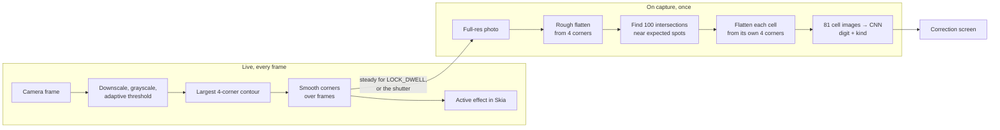

# Scan pipeline

## Why

Scanning is the feature that makes this more than a sudoku game, and it is judged in the first
second: does the live overlay snap onto the grid, and does the grid that comes out look right. Fixing
a bad still photo after the fact takes a lot of code. A live camera lets the user fix most of
that by holding the phone better, so the pipeline can be simpler
and still handle a curved book page to some degree.

## What

Two stages. The **live** stage runs on every frame and only finds the four outer corners. It is
cheap and drives the live overlay. When the grid has been steady for a short while, the scan
**locks on** and captures a full-resolution photo. The **capture** stage then does the expensive
work once: it finds the 100 grid intersections, flattens every cell from its own four corners,
and classifies the 81 cells. Flattening per cell corrects a curved page piece by piece, with
simple maths.

## Block diagram

## Stages

| Stage | Where it runs | Budget | Notes |
| --- | --- | --- | --- |
| Grid detection | Frame processor (ADR-002) | ≤ 15 ms per frame | On a frame downscaled to about 640 px. Returns `null` when no plausible quad is found |
| Corner smoothing | Scan UI, UI thread | negligible | A filter over recent frames, so the dots do not jitter. Tuned in the walking skeleton |
| Live overlay | Scan UI, UI thread | ≤ 4 ms per frame for the scene and one effect | The active effect draws from the scene, which the engine computes once per frame from the smoothed corners. The default effect is Gathering dots. A development build switches effects with the dev pill (ADR-014). See the [effect lab design](../../superpowers/specs/2026-10-11-effect-lab-design.md) |
| Lock-on | Scan UI, UI thread | — | Automatic: the grid stays steady for `LOCK_DWELL` = 1.0 s. Steady means `motion < STEADY_MOTION`, with `STEADY_SPEED` = 30 pt/s. Lock-on happens only when the user means it: (1) the scene is armed: the first scene after the app opens is armed, a scene after a Retake arms after `REARM_LOST` = 0.5 s without a grid or when the grid jumps; (2) the scene is older than `WARMUP` = 1.0 s; (3) the grid is at least `MIN_GRID_WIDTH` = 0.35 of the view width (the mean of the top and bottom edges). The dwell counts from the latest of the steady time, the found time, the end of the warm-up and the time the grid became big enough. The lock-on progress resets when the grid is lost, found again or jumps. The gathered dots show the progress: they settle and brighten. A shutter button captures at any time. Steady values passed the test on the iPhone without tuning (ADR-002). The other values are as built, to tune on the device. See the [capture flow design](../../superpowers/specs/2026-10-11-capture-flow-design.md) |
| Rough flatten | scanner, on capture | ≤ 30 ms | Perspective transform from the 4 corners to a square, 576 × 576 px. The app computes the homography in TypeScript, because fast-opencv 1.0.1 cannot fill a `Point2fVector` (ADR-002). Measured on the iPhone 17 Pro: 129 to 137 ms |
| Intersections | scanner, on capture | ≤ 50 ms | Classical first: search each of the 100 expected points in a small window. fast-opencv has no `cornerSubPix`, so the refinement is our own code. An ML keypoint model replaces this only if book pages need it (F-12) |
| Per-cell flatten | scanner, on capture | ≤ 30 ms | 81 small perspective transforms. Falls back to the rough flatten for a cell whose intersections were not found |
| Classification | scanner, on capture | ≤ 100 ms for 81 cells | Preprocessing in plain TypeScript, then one batched call on the CPU, see [model-contract](model-contract.md). Measured on the iPhone 17 Pro: 76 to 87 ms. The model call alone takes 29 to 51 ms. The whole capture, lock-on to result view, takes 512 to 539 ms |

## Threads and coordinates

| Concern | Rule |
| --- | --- |
| Frame to OpenCV | `react-native-vision-camera-resizer` turns each frame and scales the whole frame to 360 × 640 RGB on the GPU. It applies the frame orientation and mirroring. Version 5.2.3 turns a `left` or `right` frame the wrong way, so the image is upside down. `useGridDetector` turns the quad back by 180°. It does not make grayscale, so fast-opencv does that |
| Frame processor to UI thread | Detected corners are written to a Reanimated shared value from the frame processor (`react-native-worklets`). The UI thread reads it, smooths it, steps the scene and Skia draws the active effect. No live corner passes through the JS thread. At lock-on, one normalised quad goes to the JS thread once, to start the capture |
| Coordinates | The live stage reports the quad in **normalised, upright coordinates**: `x` and `y` in `[0, 1]` of the frame after applying its orientation. This survives the different resolution, aspect ratio and orientation of the capture |
| Capture source | On lock-on, VisionCamera takes a full-resolution photo (`capturePhoto()`). On the scanner runtime, `photo.toImage()` gives an upright image. `resize()` scales it to 640 px for the re-detection. `resize()` to the full size gives the upright pixels, because `toRawPixelData()` gives the sensor buffer. `recognise()` maps the normalised quad onto the photo, then **re-detects the corners** in a window around the quad, because the phone may have moved a little. The photo and the video frames have the same field of view at 16:9, so no crop mapping is needed. The app computes the homography in TypeScript. `warpPerspective` flattens the grid |
| Capture thread | `recognise()` runs on the scanner runtime, a worklet runtime made with `createWorkletRuntime`, so the transition animation keeps running while it works |

VisionCamera 5 with `react-native-worklets` is the starting point (ADR-002). The walking skeleton
pins the exact versions.

## The transition

Lock-on, or a shutter press, starts the transition at once. The photo flattens into the grid square.
The grid lines grow through the gathered dots. The digits appear. A clock on the UI thread drives
every layer. `recognise()` still supplies the flattened image, the 100 intersections and the 81
results. See the [capture flow design](../../superpowers/specs/2026-10-11-capture-flow-design.md).

### Gates

The clock holds at two gates.

| Gate | At (s) | Opens when | While closed |
| --- | --- | --- | --- |
| Photo | 0.05 | The photo is a Skia image: `photo.toImageAsync()`, then a nitro-image `resize` to a long side of 1600 px (it also makes the pixels upright), then `Skia.Image.MakeImage` | The preview stays visible |
| Results | 0.70 | `recognise()` returns ok | A spinner shows after 1 s. On a failure the gate stays closed. The panel slides up with the failure and Retake |

### Layers

The layers are listed from the bottom to the top.

| Layer | Content |
| --- | --- |
| Camera preview | Stops when the photo draws |
| Transition canvas | Light background, the photo warped by a homography from the locked quad to a quad that moves into the grid square, the white cells, the growing lines |
| Overlay, capture phase | The gathered dots ride the same quad, pulse, turn to ink and shrink into the crossings. The free dots drift 40 pt out and fade. The dim fades |
| Correction screen views | Title, digits, rings and panel, driven by the clock |
| Flash | A white flash |

### Sweep shift

The digit sweep, the rings and the panel start later by the wait for the results:
shift = max(0, the clock time when the results arrived − 0.55 s). The lines still finish while the
results gate holds. A slow `recognise()` ends the transition later than 1.5 s by the wait. The
title fades in at 0.20–0.50 s. This follows the prototype. The spec table has no title row.

### Cross-fade path

The cross-fade path has no movement. It runs with Reduce Motion, after a shutter press without a
grid, and when the photo conversion fails. The dots and the free dots fade in place. The photo fades
out with the preview mapping. The correction screen fades in over 0.3 s once both gates are open.

### The end

At the end the phase becomes `review`. `ScanFlow` shows the static `CorrectionScreen` with the same
`correctionLayout`. Retake remounts the camera screen. The overlay gets a new scene, so the
lock-on latch is fresh.

The QR-07 budget is 1.5 s from lock-on to a filled screen. The time to the photo gate probably
misses it: the photo takes about 120 ms, and the conversion follows. The code logs
`[scan] transition done in N ms`. The measure on the iPhone is still open.

## Loading the result

| Cell result | Loads as |
| --- | --- |
| digit, kind `printed` | Given (locked) |
| digit, kind `handwritten` | Player entry (editable). Kept even if it conflicts with the solution, and flagged |
| kind `notes` | Empty. Reading the notes is out of scope (F-15) |
| empty | Empty |

The givens alone must have exactly one solution, checked by `@sudoku/core` before the puzzle
loads. If they have none or several, the correction screen says so and does not load.

## Open questions

| Question | Decided by |
| --- | --- |
| Smoothing filter and its parameters (moving average, One Euro filter, …) | Walking skeleton (M0), against QR-06 |
| Lock-on rule: final values of `LOCK_DWELL`, `STEADY_SPEED` and `STEADY_MOTION` | Decided in issue #6: 0.7 s, 30 pt/s and 0.5. No tuning was needed. Issue #19 raised `LOCK_DWELL` to 1.0 s, with the re-arm, warm-up and minimum size rules |
| Lock-on intent: final values of `REARM_LOST`, `WARMUP` and `MIN_GRID_WIDTH` | The developer, on the device |
| Window size for the intersection search, and when a cell falls back to the rough flatten | First book-page fixtures |
| Confidence threshold for "review this cell" | First real fixture set |
| QR-07 budget (lock-on to a filled screen in 1.5 s) against the time to the photo gate. Options: a faster photo path, a compressed timeline, or a revised budget | The developer, after the iPhone measure |

## Constraints

| ID | Constraint |
| --- | --- |
| SUD-02 | Camera frames, photos and cell images MUST NOT leave the device without an explicit user action for each export. |
| SUD-05 | The app MUST reach the scanner only through `src/scanner/index.ts`. |
