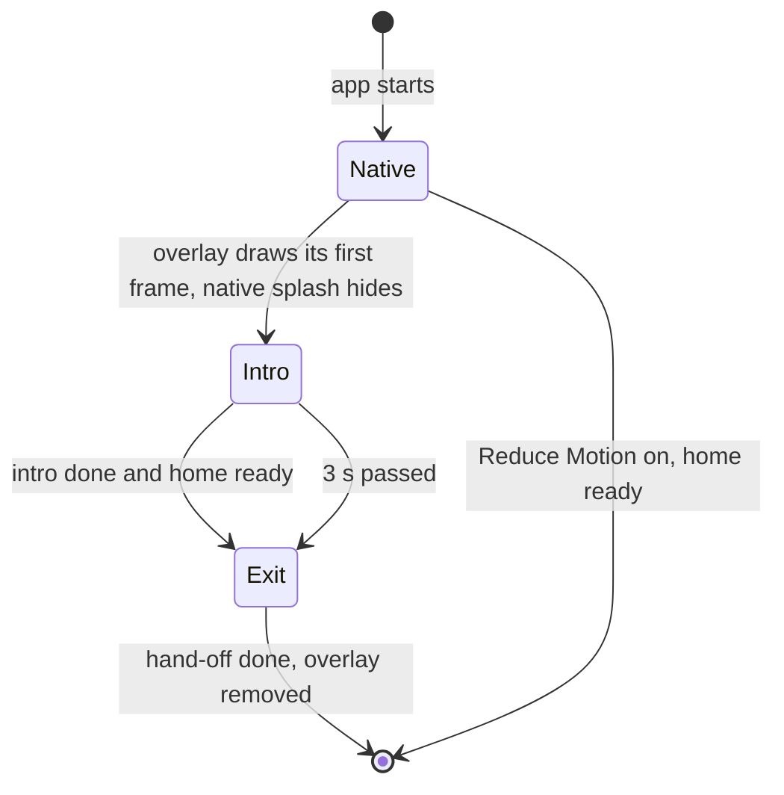

# Splash screen

## Why

The splash screen is the first thing the player sees. The old splash was a still image of the app
icon. It looked like a logo, and it ended with a jump to the home screen. The new splash is a short
animation in the style of the app. It ends on the home screen without a jump.

## What

The native splash shows only the **splash ground**: white in light mode, near black in dark mode.
The native layer cannot read the saved theme, so the splash ground follows the system appearance.

A **splash overlay** above the app draws the same ground. Its first frame equals the native splash.
The overlay then plays the animation "Soft wave, softer".

| Part | Time | What the player sees |
| --- | --- | --- |
| Hold | 0 to 250 ms | The plain ground |
| Letters | 250 to 925 ms | The six letters of "Sudoku" rise in, 45 ms apart, in the title font of the theme |
| Wave | exit 0 to about 1320 ms | A wave of aligned cells rises from the bottom row to the top row. A cell glows for 600 ms and then clears. The start of each cell is up to 120 ms off its row |
| Glide | exit 150 to 900 ms | The word glides up and shrinks to half its size, onto the title of the home screen. Its colour changes to the title colour of the theme |
| Ground | exit 100 to 800 ms | The ground fades and shows the home screen |
| Hand-off | exit 1350 to 1450 ms | The word fades out. The real title is under it, at the same place |

The **intro** is the hold and the letters. It runs at once. The **exit** is the wave, the glide, the
ground fade and the hand-off. It starts when the intro is done and the home screen is ready. It also
starts after 3 seconds if no screen is ready. The overlay passes every touch to the screen below.

The cells are the cells of the game grid: 9 columns across the width of the window. A cell has the
tint of the finish pulse and the pale cell lines. It has no box lines.

With Reduce Motion on, the app draws no overlay. The native splash hides when the first screen is
ready.

## Open questions

| Question | Decided by |
| --- | --- |
| The intro adds about 0.9 s on a fast phone. Is that acceptable? The hold of 250 ms is the first part to cut | The developer, after the iPhone check of #93 |
| Android 12 and later draw the app icon on a splash with no image. A transparent image may be needed | The first Android build |
| Should the menu items rise one by one as the wave passes? The menu fades in today | The developer, after the iPhone check of #93 |

## Constraints

| ID | Constraint |
| --- | --- |
| Never holds back | The overlay MUST NOT take a touch. The exit MUST start after 3 s without the home. |
| Reduce Motion | With Reduce Motion on, the app MUST show no splash animation. |
| First frame | The first frame of the overlay MUST equal the native splash. |
| Colour | A colour value MUST live in `src/theme/` (ADR-015). |
