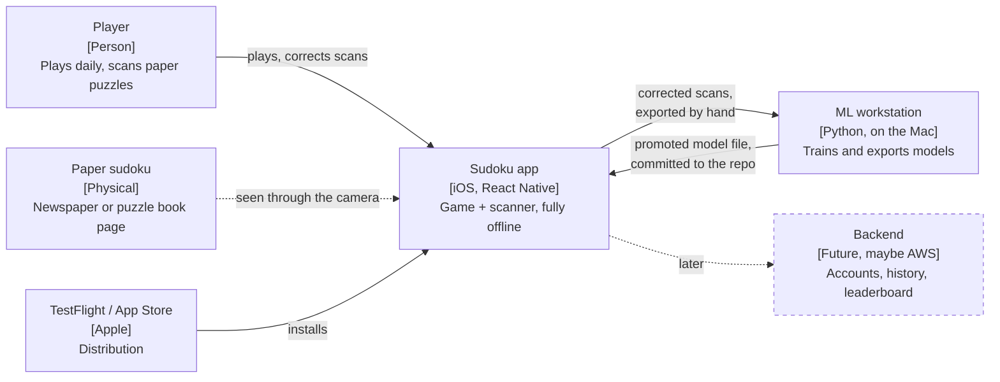
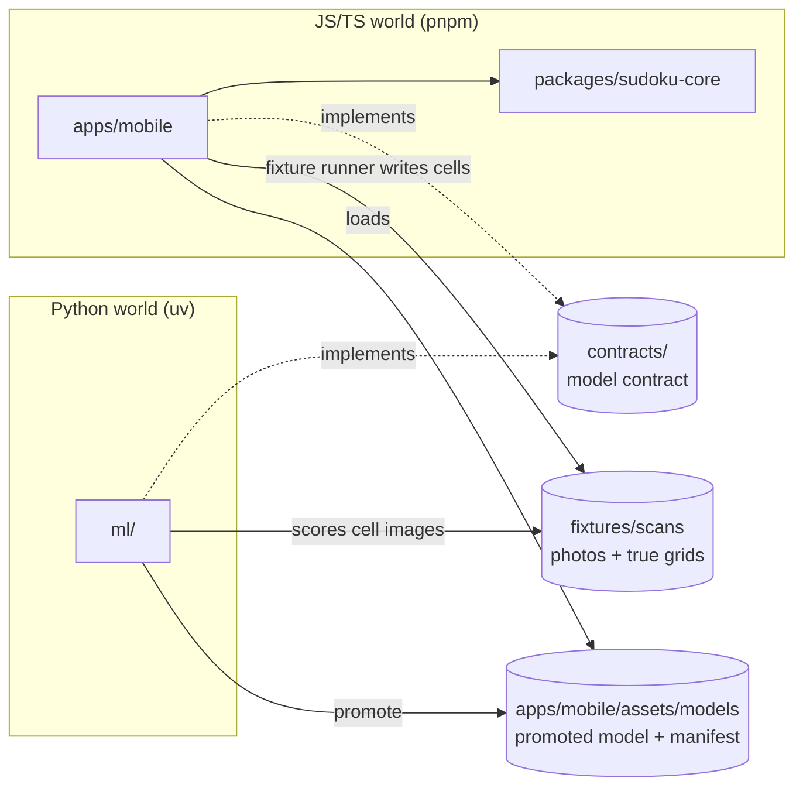

# 3. System Scope and Context

## 3.1 Business Context

| Neighbour | Exchanges with the system | Channel |
| --- | --- | --- |
| Player | Plays puzzles, scans paper puzzles, corrects recognised digits | Touch UI, camera |
| Paper sudoku | Is seen. The photo, flattened grid and cell images stay on the phone | Camera frames |
| ML workstation | Delivers model files to the app. Receives corrected scans as training data | The repository (promote step), the iOS share sheet |
| TestFlight / App Store | Distributes builds | Xcode / EAS build |
| Backend (future) | Not designed. The app must be able to add sync later without restructuring | — |

## 3.2 Technical Context

The repository holds two separate toolchains that never import each other. They share files only.

| Interface | Producer | Consumer | Format |
| --- | --- | --- | --- |
| Model contract | written by hand | `ml/` and the app's scanner module | Markdown spec, see [model-contract](00-concepts/model-contract.md) |
| Promoted model | `ml/` via `just promote-model` | the app's scanner module | `.tflite` + `manifest.json` |
| Fixture scans | taken by hand, labelled once, cell images written by the fixture runner | promote gate (cell images), fixture runner (photos) | photo + `truth.json` + 81 cell images, see [ADR-007](adr/adr-007-model-promotion.md) |
| Training-data export | the app's correction screen | `ml/` dataset | cell images + labels, see the model contract. Only on an explicit user action (SUD-02) |
