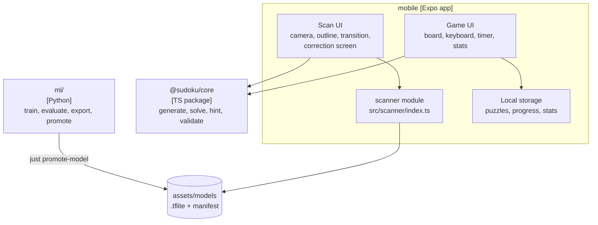

# 5. Building Block View

## 5.1 Repository layout

```
sudoku/
├── mobile/                  # Expo / React Native app: game UI, scan UI, local storage
│   ├── src/app/             # routes (Expo Router, ADR-016): each file renders one screen
│   ├── src/home/            # home UI: the levels, Continue, Scan and Settings
│   ├── src/game/            # game UI: screens/, components/, hooks/, utils/, constants/
│   ├── src/settings/        # settings UI, SettingsRepository and the setting store: assists, theme
│   ├── src/scan/            # scan UI: screens/, components/, hooks/, utils/, constants/, effects/
│   ├── src/scanner/         # scanner module, entered only through src/scanner/index.ts
│   ├── src/storage/         # game storage: PuzzleRepository, HistoryRepository (ADR-012)
│   ├── src/account/         # sign-in, sign-out and delete account with Clerk (ADR-027)
│   ├── src/sync/            # SyncService: pushes and pulls the history (ADR-028)
│   ├── src/utils/           # code that more than one feature uses: geometry, homography, logs
│   └── assets/models/       # promoted model files + manifest.json (committed)
├── ml/                      # Python (uv): training, evaluation, export, promote
│   ├── src/
│   ├── dataset/             # the real dataset (ADR-018)
│   │   ├── cells.csv            # one row per cell: digit, kind, source (in git)
│   │   ├── sudoku-photos.csv    # one row per sudoku photo: source, licence, status, corners (in git)
│   │   ├── kind-checks.jsonl    # blind check answers (in git)
│   │   ├── STATUS.md            # summary that Finish writes (in git)
│   │   ├── images/              # cells/ and sudoku-photos/, NOT in git, or SUDOKU_IMAGES
│   │   └── work/                # journal and derived files of the labelling tool, NOT in git
│   └── artifacts/           # one folder per training run, gitignored
├── backend/
│   ├── api/                 # Lambda: POST /v1/sync, DELETE /v1/account (ADR-027). test/: unit and DynamoDB Local
│   ├── kill-switch/         # Lambda that stops a stage at the budget (ADR-027)
│   └── infra/               # SST infrastructure, one file per area (ADR-027)
├── web/                     # static site on Vercel: home page, privacy policy
├── shared/
│   ├── core/                # @sudoku/core: board, rules, generator, solver, hints. Pure TS
│   ├── sync-contract/       # zod schemas of the sync API, shared by the app and the Lambda
│   ├── model-contract/      # model contract and data formats shared by ml/ and the app (plain files)
│   └── fixtures/            # plain files that Python and TypeScript both read
│       ├── scans/           # public-safe photos + true grids + the app's cell images (ADR-007, ADR-013)
│       └── preprocess/      # reference cell images for preprocessing parity (model contract)
├── tools/                   # oxlint plugin, icon renderer, link check, layout check
├── docs/                    # this documentation
├── sst.config.ts            # SST app: stages, defaults, imports backend/infra/
├── package.json             # pnpm workspaces
└── justfile                 # one command list for both toolchains
```

## 5.2 Level 1



## 5.3 Building blocks

| Block | Responsibility | Depends on | Must not depend on |
| --- | --- | --- | --- |
| **@sudoku/core** | Board model, rule checks, a backtracking solver (uniqueness), a technique solver (grading and hints), the generator ([ADR-011](adr/adr-011-puzzle-generation-and-hints.md)), the streak, the counted-game rule for the best time and the clock format ([ADR-023](adr/adr-023-player-stats.md)) | nothing | React Native, Expo, any I/O (SUD-04) |
| **Game UI** | Playing: input, notes, undo, timer, mistake highlighting, stats screens. One game session (`createGameSession`) holds the game in progress: the reducer, the clock, the pause and the saves. One puzzle start (`createPuzzleStart`) starts every game: from a level, from a scan, a new puzzle and a retry | @sudoku/core, local storage | the scanner (SUD-03), account, sync (ADR-028) |
| **Scan UI** | Camera screen, live outline, lock-on, capture, transition animation, correction screen | scanner module, @sudoku/core (to validate and solve the corrected grid) | scanner internals |
| **scanner module** | Frame → corners (live). Photo + corners → 81 recognised cells (on capture). Loads the promoted model | VisionCamera, fast-opencv, fast-tflite (ADR-002), the promoted model | the game UI, local storage |
| **Shared utils** (`src/utils/`) | Geometry types, the one homography implementation, development logs. Code that more than one feature uses | nothing in the app | React, React Native, any feature folder |
| **Local storage** | Puzzles, progress, puzzle pool, history, settings in expo-sqlite, behind repository interfaces so a sync layer can be added later ([ADR-012](adr/adr-012-local-persistence.md)). Holds the sync state. Applies each sync page, the adopt and the owner delete in one transaction each. Tells the sync about a finished game | expo-sqlite, sync contract (the check of each history entry) | — |
| **Account** (`src/account/`) | Sign-in, sign-out and delete account with Clerk. Gives a fresh token for each request ([ADR-027](adr/adr-027-backend-platform.md)) | `@clerk/expo` | the game UI |
| **Sync** (`src/sync/`) | Pushes the waiting list and pulls the changes on each trigger. Silent on failure ([ADR-028](adr/adr-028-history-sync.md)) | local storage, account, sync contract, `expo-network` | the game UI, the stats UI |
| **Sync contract** (`shared/sync-contract/`) | The zod schemas of the requests and responses | zod | React Native, AWS SDK |
| **sync-api** (`backend/api/`) | The Lambda: maps the token to our own user ID, stores and returns history entries, deletes an account, counts writes for SUD-11 | sync contract, AWS SDK | the app, `backend/infra/` |
| **Fixture runner** | Development builds only. Runs the real scanner on fixture photos, writes cell images, reports scores ([ADR-010](adr/adr-010-testing-and-ci.md)) | scanner module | — |
| **ml/** | Dataset assembly, synthetic data, training, evaluation on fixtures, export, promote | shared/model-contract/, shared/fixtures/ | anything in mobile/ or shared/core/ |

## 5.4 The scanner interface

The game and Scan UI see only this. `Point` and `Quad` come from `src/utils/geometry.utils.ts`, because the scanner and
the Scan UI both use them. Whether a step runs in fast-opencv or in a Swift plugin is
invisible behind it (ADR-002). The types below are illustrative, not final.

```ts
type Point = { x: number; y: number }     // normalised: 0..1 of the upright image
type Quad = [Point, Point, Point, Point]  // TL, TR, BR, BL

// Live. The hook gives the frame processor a detector once the frame resizer is ready.
// score: the share of the frame that the quad covers, 0..1.
useGridDetector(): ((frame: Frame) => { quad: Quad; score: number } | null) | undefined

// Once, after lock-on and capture. Runs off the JS thread.
// Maps the quad onto the photo (EXIF orientation applied) and re-detects corners near it.
recognise(photo: Photo, quad: Quad): Promise<{
  cells: Array<{
    digit: 0 | 1 | 2 | 3 | 4 | 5 | 6 | 7 | 8 | 9  // 0 = empty
    kind: 'none' | 'printed' | 'handwritten' | 'notes'
    confidence: number                           // min of both heads
    cell: Uri                                    // 64 × 64 cell image: correction screen, export, fixtures
  }>                                             // 81 cells, row-major
  flattened: Uri                                 // for the transition animation
  intersections: Point[]                         // 100 points, used by the animation
  modelVersion: string
}>
```

Smoothing the live corners, the lock-on rule and the animation live in the Scan UI, not in the
scanner. See [scan-pipeline](00-concepts/scan-pipeline.md).

## Backend boundaries

dependency-cruiser enforces these rules in `just boundaries` ([ADR-027](adr/adr-027-backend-platform.md)):

| Rule | Forbids |
| --- | --- |
| `adr-027-app-does-not-import-infra` | `mobile/` and `shared/` import `backend/infra/` or `sst.config.ts` |
| `adr-027-app-does-not-import-services` | `mobile/` and `shared/` import `backend/api/` or `backend/kill-switch/` |
| `adr-027-services-do-not-import-the-app` | `backend/api/` or `backend/kill-switch/` imports `mobile/` |
| `adr-027-services-do-not-import-infra` | `backend/api/` or `backend/kill-switch/` imports `backend/infra/` or `sst.config.ts` |
| `adr-027-infra-reads-only-the-table-design` | `backend/infra/` and `sst.config.ts` import a file of `backend/api/` or `backend/kill-switch/` other than `backend/api/src/tableDesign.ts` |
