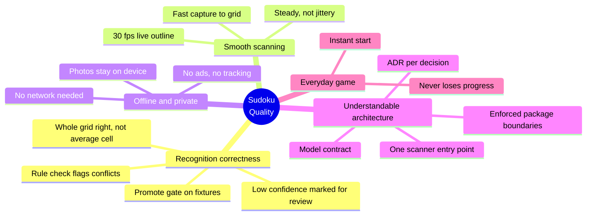

# 10. Quality Requirements

## 10.1 Quality Tree

## 10.2 Quality Scenarios

The reference device is the developer's iPhone. The spike records its model in ADR-002.

| ID | Quality | Scenario | Target |
| --- | --- | --- | --- |
| QR-01 | Correctness | A fixture scan of a newspaper puzzle is recognised | ≥ 95 % of newspaper fixtures have all 81 cells right (digit and kind) |
| QR-02 | Correctness | A fixture scan of a curved book page is recognised | ≥ 85 % of book-page fixtures fully right. Below that, F-12 starts (ADR-004) |
| QR-03 | Correctness | Any single cell on the fixture set | Digit accuracy ≥ 99.9 %, kind accuracy ≥ 99 % |
| QR-04 | Correctness | A misread digit makes the givens invalid | The correction screen flags the conflict before loading, every time |
| QR-05 | Smoothness | The camera points at a sudoku | Outline appears within 300 ms, live detection sustains ≥ 30 fps |
| QR-06 | Smoothness | The phone is held still over a page | Outline corners move by less than 2 px between frames |
| QR-07 | Smoothness | Lock-on to a filled correction screen | ≤ 1.5 s including the animation. Recognition itself ≤ 100 ms |
| QR-08 | Smoothness | Scanning for 5 minutes | No memory growth, no thermal throttling warning |
| QR-09 | Offline | Airplane mode, every feature | All of F-01 to F-11 work |
| QR-10 | Privacy | Network inspection during a scan | No requests at all |
| QR-11 | Everyday game | App killed mid-puzzle | Puzzle resumes at the last move, timer included |
| QR-12 | Everyday game | Cold start to a playable board | ≤ 2 s |
| QR-13 | Size | Bundled models | ≤ 1 MB in v1 |
