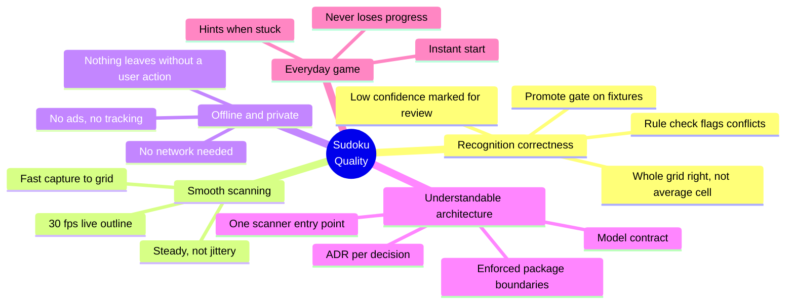

# 10. Quality Requirements

## 10.1 Quality Tree

## 10.2 How correctness targets relate

One wrong digit breaks a puzzle, so the targets are set on **whole grids** and the per-cell
targets are derived from them: a per-cell accuracy `p` gives about `p⁸¹` fully-correct grids.

| Per-cell accuracy | Grids fully right |
| --- | --- |
| 99 % | 44 % |
| 99.9 % | 92 % |
| 99.94 % | 95 % |

The **digit** is what makes a puzzle right or wrong, so the grid targets count digits only.
A **kind** mistake only changes whether a cell is editable, and the player toggles it in one tap
([ADR-006](adr/adr-006-two-head-cell-classifier.md)). Kind is measured per cell and reported, but
it does not have a whole-grid target.

Targets apply only once the fixture set is big enough for a percentage to mean something:
**at least 40 newspaper scans and 20 book-page scans** in the dev split. Below that, the numbers
are reported but do not gate.

## 10.3 Quality Scenarios

The reference device is the developer's iPhone. The walking skeleton records its model in ADR-002.

| ID | Quality | Scenario | Target |
| --- | --- | --- | --- |
| QR-01 | Correctness | Newspaper fixture scans are recognised | ≥ 95 % have all 81 **digits** right |
| QR-02 | Correctness | Curved book-page fixture scans are recognised | ≥ 85 % have all 81 digits right. Below that, F-12 starts (ADR-004) |
| QR-03 | Correctness | Any single cell on the fixture set | Digit ≥ 99.94 % (follows from QR-01). Kind ≥ 99 % |
| QR-04 | Correctness | A misread digit makes the givens invalid | The correction screen flags the conflict before loading, every time |
| QR-05 | Smoothness | The camera points at a sudoku | Outline appears within 300 ms, live detection sustains ≥ 30 fps |
| QR-06 | Smoothness | The phone is held still over a page | Each drawn outline corner moves less than 2 screen points between frames, measured by logging the smoothed corners for 5 s |
| QR-07 | Smoothness | Lock-on to a filled correction screen | ≤ 1.5 s including the animation. Recognition itself ≤ 100 ms |
| QR-08 | Smoothness | Scanning for 5 minutes | No memory growth, no thermal throttling warning |
| QR-09 | Offline | Airplane mode, every feature | All of F-01 to F-11 work |
| QR-10 | Privacy | Network inspection during a scan | No requests at all |
| QR-11 | Everyday game | App killed mid-puzzle | Puzzle resumes at the last move, timer included |
| QR-12 | Everyday game | Cold start to a playable board, any difficulty | ≤ 2 s, served from the puzzle pool ([ADR-011](adr/adr-011-puzzle-generation-and-hints.md)) |
| QR-13 | Size | Bundled models | ≤ 1 MB in v1 |

## 10.4 First measurement

Research before M0 trained the planned network on the real cells (digit only, see the
[research record](../research/2026-10-09-cell-classifier-research.md)):

| Measure | Value |
| --- | --- |
| Per-cell digit accuracy | 98.7 % |
| Accuracy when the 1 %, 2 % or 5 % least certain cells go to review | 99.1 %, 99.3 %, 99.7 % |
| Wrong labels in the data | about 0.6 %. Every accuracy above counts them as model errors |

These numbers are optimistic: 13 % of the validation cells had a near-identical cell in training.
QR-03 (99.94 %) needs clean labels, handwriting data and the review step together. The review
step is part of the design: the correction screen marks the least certain cells.

The trained two-head model (ADR-006) gives these numbers on 1,550 real test cells. They are from
before the label check. The labels are not reviewed yet.

| Measure | Value |
| --- | --- |
| Per-cell digit accuracy | 98.71 % |
| Accuracy when the 1 %, 2 % or 5 % least certain cells go to review | 99.02 %, 99.14 %, 99.46 % |
| Expected calibration error (ECE) | 0.63 % |
| Wrong labels in the data | `just suspects` ranks 150 cells. 89 get under 5 % probability for their label |

The split is by group: 16,206 labelled cells in 14,899 near-duplicate groups, 80/10/10.
