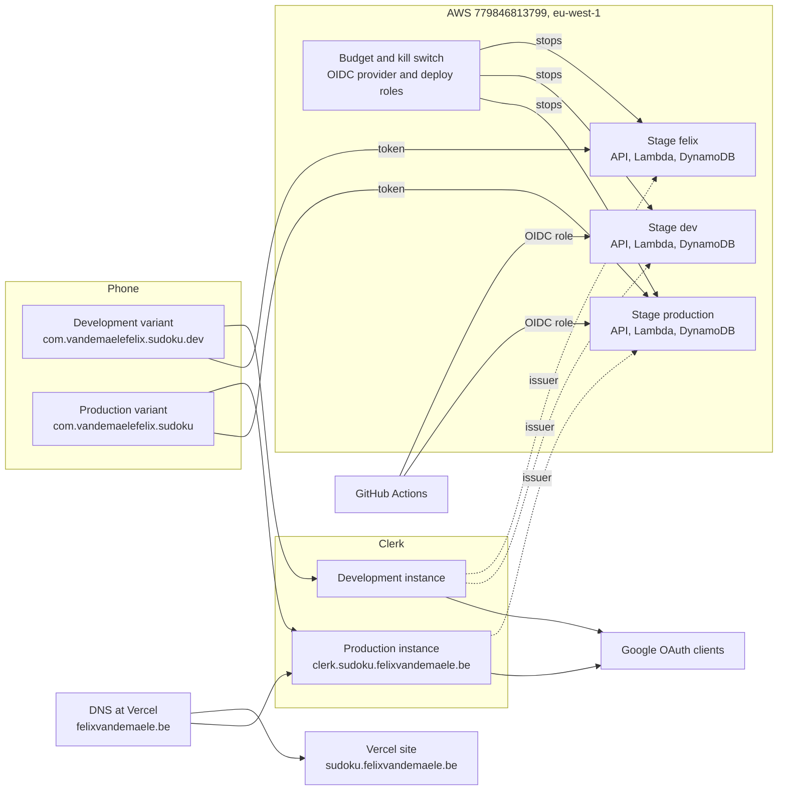

# Operations runbook

This runbook is the entry point for the backend and its services. It says where each part lives,
how the parts connect, and what to do when a part breaks or must change. It links to the source
for the details. It holds no secret value.

State of the facts: the developer checked the account, the stages, the DNS records and the
GitHub settings on 2026-10-15. A fact that the developer could not check is marked
**Unverified**.

## 1. Overview



How a request flows: the app asks Clerk for an API token of the JWT template `sudoku-api`. The
app sends the token to `POST /v1/sync` or `DELETE /v1/account`. The API Gateway JWT authorizer
checks the issuer and the audience. The Lambda `SyncApiFunction` reads and writes the DynamoDB
table. See [ADR-027](../architecture/adr/adr-027-backend-platform.md) and
[ADR-028](../architecture/adr/adr-028-history-sync.md).

| Part | Read |
| --- | --- |
| The platform and its reasons | [ADR-027](../architecture/adr/adr-027-backend-platform.md) |
| The sync protocol | [ADR-028](../architecture/adr/adr-028-history-sync.md), [History sync](../architecture/00-concepts/history-sync.md) |
| CI and the deploy workflows | [ADR-010](../architecture/adr/adr-010-testing-and-ci.md) |
| Data and privacy rules | [ADR-013](../architecture/adr/adr-013-fixtures-and-data-licensing.md), [privacy policy](../privacy/privacy-policy.md) |
| The deployment nodes | [Deployment view](../architecture/07-deployment-view.md) |
| The AWS setup, the guard, the budget, the kill switch | [`infra/README.md`](../../infra/README.md) |
| The website | [`site/README.md`](../../site/README.md) |
| The sync Lambda | [`services/sync-api/README.md`](../../services/sync-api/README.md) |
| The app variants | [ADR-022](../architecture/adr/adr-022-app-variants.md), [`apps/mobile/AGENTS.md`](../../apps/mobile/AGENTS.md) |

## 2. Inventory

Only the developer changes these items. Every ID in this chapter is public.

### 2.1 AWS

| What | Where | Value | Stage |
| --- | --- | --- | --- |
| Account | Personal account, one project only | `779846813799`, region `eu-west-1` | All |
| Human user | IAM, MFA on, `AdministratorAccess`, no access key | `felix-admin` | All |
| Root user | MFA on, no access key | Use it only for billing settings | All |
| Local profiles | `~/.aws/config` | `sudoku-login` (filled by `aws login`), `sudoku` (`credential_process`, SST uses it) | All |
| Forbidden profiles | `~/.aws/config` | `appstrakt` and `dyna` belong to employers. Never use them here | None |
| SST app | [`sst.config.ts`](../../sst.config.ts) | `sudoku`, SST 4.17.2 | All |
| SST state bucket | S3 | `sst-state-fsukxmarmhvk` | All |
| SST asset bucket | S3 | `sst-asset-fsukxmarmhvk` | All |
| Stage secrets | `s3://sst-state-fsukxmarmhvk/secret/sudoku/<stage>.json`, encrypted | See chapter 3 | Per stage |
| Secret passphrases | SSM parameters `/sst/passphrase/sudoku/<stage>` | One per stage | Per stage |
| API `felix` | API Gateway HTTP API `hd381htgth` | `https://hd381htgth.execute-api.eu-west-1.amazonaws.com` | `felix` |
| API `dev` | API Gateway HTTP API `a9lvlf2za2` | `https://a9lvlf2za2.execute-api.eu-west-1.amazonaws.com` | `dev` |
| API `production` | API Gateway HTTP API `dfdhsxd374` | `https://dfdhsxd374.execute-api.eu-west-1.amazonaws.com` | `production` |
| Routes | Each API | `POST /v1/sync`, `DELETE /v1/account`. Throttle 1 request per second, burst 10 | All |
| Lambda | `sudoku-<stage>-SyncApiFunction...` | 30 s timeout, linked to the table and `ClerkSecretKey` | Per stage |
| Table | DynamoDB `sudoku-<stage>-SyncTableTable-...` | Point-in-time recovery and deletion protection only on `production` | Per stage |
| Budget | AWS Budgets | `sudoku-monthly-cost`, $10 | Account |
| Kill switch topics | SNS | `sudoku-production-KillSwitchTopicTopic-...`, `sudoku-production-KillSwitchAlertTopicTopic-...` | Account |
| Kill switch Lambda | Lambda | `pro-KillSwitchTopicSubscriberKillSwitchFunctionFunction-...` (SST shortens the name) | Account |
| Kill-switch flags | SSM parameters `/sudoku/kill-switch/<stage>` | None exist while all stages run | Per stage |
| OIDC provider | IAM | `token.actions.githubusercontent.com` | Account |
| Deploy roles | IAM | `arn:aws:iam::779846813799:role/sudoku-github-dev`, `arn:aws:iam::779846813799:role/sudoku-github-production` | `dev`, `production` |

The account-wide items exist once. Only the stage `production` creates them (the account stage).
The `dev` API ID comes from `aws apigatewayv2 get-apis`. The Lambda and table names end in a
random suffix. Find them with the commands in chapter 4.

### 2.2 Clerk

The Clerk application is `Sudoku`. Email with password and an email code is on. Google is on.
Apple is off. Both instances have the JWT template `sudoku-api` (audience `sudoku-api`, 60 s).

| What | Development instance | Production instance |
| --- | --- | --- |
| Used by | Stages `felix` and `dev`, the development variant | Stage `production`, the production variant |
| Issuer | `https://free-leopard-5298.clerk.accounts.dev` | `https://clerk.sudoku.felixvandemaele.be` |
| Publishable key | `pk_test_ZnJlZS1sZW9wYXJkLTUyOTguY2xlcmsuYWNjb3VudHMuZGV2JA` | `pk_live_Y2xlcmsuc3Vkb2t1LmZlbGl4dmFuZGVtYWVsZS5iZSQ` |
| Bundle ID | `com.vandemaelefelix.sudoku.dev` | `com.vandemaelefelix.sudoku` |
| Apple Team ID | `575384CG4F` | `575384CG4F` |
| Plan | Development instance | Hobby, fixed 7-day sessions |
| Config in the repository | `CLERK_ISSUER` in [`infra/config.ts`](../../infra/config.ts), `app.config.ts` | Same files, `PRODUCTION_BACKEND` in `app.config.ts` |

The production instance is a copy of the development instance. The dashboard steps are in
[`infra/README.md`](../../infra/README.md#clerk).

### 2.3 Google Cloud

One Google Cloud project holds the OAuth clients. Google sign-in in Clerk uses our own clients.

| Client | Type | Client ID | Used by |
| --- | --- | --- | --- |
| Sudoku Dev Clerk | Web | `579798513006-h8h46s2ongqtrr412kkanflb7f6upjjk` | Clerk development instance |
| Sudoku Dev iOS | iOS | `579798513006-s2jpt2fc7ohah7kcu3s7jg968evv5s8n` | Development variant |
| Sudoku Production Clerk | Web | `579798513006-n4jlbj4c7tsa4987btou7ilp4jf7ro62` | Clerk production instance. Its redirect URI comes from Clerk |
| Sudoku Production iOS | iOS | `579798513006-3j8bts21f938o7pp100nv0tujpjfer7i` | Production variant |

The client IDs end in `.apps.googleusercontent.com`. The iOS IDs are also in
[`apps/mobile/app.config.ts`](../../apps/mobile/app.config.ts).

| Consent screen setting | Value |
| --- | --- |
| App name | Sudoku |
| Support email | `vandemaelefelix@gmail.com` |
| Authorised domains | `accounts.dev`, `felixvandemaele.be` |
| Home page and privacy URLs | Set (see 2.4) |
| Logo | None. A logo forces Google verification |
| Publishing status | **Unverified.** Publishing to production was in progress. Check **Google Auth Platform, Audience** |

### 2.4 Vercel, DNS and the website

| What | Value |
| --- | --- |
| Vercel team | Personal team `felix-vandemaeles-projects`. It owns the domain `felixvandemaele.be` |
| Project | `sudoku-site`, repository `vandemaelefelix/sudoku`, Root Directory `site` |
| Settings | Include files outside the root: on. Framework: `Other`. Install, build and output: see [`site/README.md`](../../site/README.md) and `site/vercel.json`. Variable `ENABLE_EXPERIMENTAL_COREPACK=1` |
| Production branch | **Unverified.** `site/README.md` says `develop`. Check **Settings, Git** in Vercel |
| URLs | `https://sudoku.felixvandemaele.be`, `https://sudoku.felixvandemaele.be/privacy`. Fallback: `sudoku-site-mauve.vercel.app` |
| Privacy page source | [`docs/privacy/privacy-policy.md`](../privacy/privacy-policy.md). The build renders it |
| Registrar | GoDaddy holds the registration only |
| Nameservers | `ns1.vercel-dns.com`, `ns2.vercel-dns.com`. Do not change the nameservers at GoDaddy |

DNS records of `felixvandemaele.be` for this project. The developer checked all of them with `dig` on 2026-10-15.

| Name | Type | Target | Purpose |
| --- | --- | --- | --- |
| `sudoku` | ALIAS or CNAME | `b9f60ee4052bc771.vercel-dns-017.com` | The site |
| `clerk.sudoku` | CNAME | `frontend-api.clerk.services` | Clerk Frontend API (the issuer) |
| `accounts.sudoku` | CNAME | `accounts.clerk.services` | Clerk account pages |
| `clkmail.sudoku` | CNAME | `mail.polx86xxf0v7.clerk.services` | Clerk email |
| `clk._domainkey.sudoku` | CNAME | `dkim1.polx86xxf0v7.clerk.services` | Clerk DKIM |
| `clk2._domainkey.sudoku` | CNAME | `dkim2.polx86xxf0v7.clerk.services` | Clerk DKIM |

The zone has a `*` wildcard. A specific record overrides the wildcard for `sudoku.*`. So every
new name under `sudoku.` needs its own record. The CAA records allow `letsencrypt.org`,
`sectigo.com` and `pki.goog`.

### 2.5 GitHub

| What | Value |
| --- | --- |
| Repository | `vandemaelefelix/sudoku`, private, Free plan. Default branch `develop` |
| Workflows | `deploy-api-dev.yml`, `deploy-api-production.yml`, `ci-ts.yml`, `ci-ml.yml`, `ci-docs.yml`, `ci-workflows.yml` |
| Repository variables | `AWS_ROLE_ARN_DEV`, `AWS_ROLE_ARN_PRODUCTION` (the role ARNs in 2.1) |
| OIDC subject | Immutable: `repo:vandemaelefelix@32290789/sudoku@1412094169`. The claim `job_workflow_ref` names the workflow file |
| `dev` deploy | Runs on a push to `develop` that changes a backend file |
| `production` deploy | Runs on a manual start (`workflow_dispatch`) from `develop`. It has no reviewer gate, because a private repository on the Free plan has none |

The trust policy is in [`infra/github-oidc-policy.ts`](../../infra/github-oidc-policy.ts). The details are in
[`infra/README.md`](../../infra/README.md#deploys-from-github-actions).

## 3. Secrets

Never put a secret in git, in a chat, in `.env` or in a shell history. A secret starts with
`sk_test_`, `sk_live_`, or is a Google client secret or a passphrase. Do not run `sst secret list`
in a session with an agent. It prints the values.

| Secret | Lives in | Used by |
| --- | --- | --- |
| `ClerkSecretKey` | SST secret of `felix`, `dev` and `production` | The Lambda, for `DELETE /v1/account` |
| `BudgetEmail` | SST secret of `production` | The budget alerts and the kill switch email |
| SST secret passphrase | SSM `/sst/passphrase/sudoku/<stage>` | SST, to encrypt the stage secrets |
| Google web client secret | Only in the Clerk dashboard, in the SSO connection of Google | Clerk |
| AWS session | `~/.aws/login/cache/`, 12 hours | The laptop |

Set or rotate an SST secret with the clipboard. Run `just aws-login` first:

```sh
pbpaste | env -u AWS_ACCESS_KEY_ID -u AWS_SECRET_ACCESS_KEY -u AWS_SESSION_TOKEN AWS_PROFILE=sudoku pnpm exec sst secret set <Name> --stage <stage>
pbcopy < /dev/null
```

| Rotate | Steps |
| --- | --- |
| `ClerkSecretKey` | Roll the key in the Clerk dashboard, **API keys**. Copy the new key. Set the secret for each stage of that instance. Run `just deploy-api <stage>`, or start the deploy workflow. The Lambda reads the new value only after a deploy. `felix` and `dev` share the development instance, so set both |
| `BudgetEmail` | Set the secret on `production`. Deploy `production`. Confirm the new SNS subscription mail |
| Google web client secret | Create a new secret in Google Cloud, **Credentials**. Paste it in the Google connection of the Clerk instance. Test a Google sign-in. Delete the old secret |
| SST passphrase | Do not rotate it. A changed passphrase makes the stage secrets unreadable |

## 4. Daily operations

All commands run in the repository root. Run `just aws-login` once every 12 hours.

| You want to | Command |
| --- | --- |
| Sign in to AWS | `just aws-login` |
| Check who you are | `aws sts get-caller-identity --profile sudoku`. The `Arn` must end with `user/felix-admin` |
| See what a deploy changes | `just diff-api <stage>` |
| Deploy `felix` | `just deploy-api felix` |
| Deploy `dev` | Merge a backend change to `develop`. The workflow `deploy-api-dev.yml` runs |
| Deploy `production` | In GitHub, **Actions**, run `deploy-api-production` from `develop`. Or: `gh workflow run deploy-api-production.yml --ref develop` |
| Turn a stopped stage on | `just api-on <stage>` |
| Test a deployed stage | `just smoke-api <stage> <user id>` |
| Build the development variant | `just ios-dev <UDID>` |
| Build the production variant | `just ios-release <UDID>` |
| Find the device UDID | `xcrun devicectl list devices` |

Read-only checks of the live state. They need `--profile sudoku --region eu-west-1`:

```sh
aws apigatewayv2 get-apis --query 'Items[].[Name,ApiId]' --output text
aws apigatewayv2 get-stage --api-id <api id> --stage-name '$default' --query DefaultRouteSettings
aws ssm get-parameters-by-path --path /sudoku/kill-switch --query 'Parameters[].Name'
aws lambda list-functions --query 'Functions[].FunctionName' --output text
aws budgets describe-budgets --account-id 779846813799
```

After a deploy, `DefaultRouteSettings` must show rate 1 and burst 10. A request without a token
must return 401: `curl -i -X POST <apiUrl>/v1/sync`.

### iPhone builds

1. Export the Xcode path: `export DEVELOPER_DIR=/Applications/Xcode-27.0.0.app/Contents/Developer`. `xcode-select` points to
   the Command Line Tools, so the build fails without it. Or run `sudo xcode-select -s` once.
2. Check port 8081: `lsof -nP -iTCP:8081 -sTCP:LISTEN`. Metro of another worktree can hold it.
3. A new worktree needs the private model: `just install-model <run>`. The model is not in git (SUD-08).
4. Run `just ios-dev <UDID>` or `just ios-release <UDID>`.

The Clerk session survives a delete of the app, because it lives in the iOS Keychain.

## 5. Common changes

### Add a stage

1. Add the name to `STAGES` and the issuer to `CLERK_ISSUER` in [`infra/config.ts`](../../infra/config.ts).
2. Add the stage to the trust policy and the workflows only if CI deploys it.
3. Set `ClerkSecretKey` for the stage (chapter 3).
4. Run `just deploy-api <stage>`.

A stage with no issuer fails the deploy, except `production`. Write an ADR first if the change alters ADR-027.

### Change the budget

Edit [`infra/budget-alerts.ts`](../../infra/budget-alerts.ts). The limit is a rule: SUD-11 caps the bill. Amend the ADR first, then deploy `production`.
Only `production` owns the budget.

### Rotate a key

See chapter 3.

### Change the domain

1. Add the domain to a Vercel team. Vercel needs a team to own a domain.
2. Make a new Clerk production instance, or move the domain of the existing one. The issuer changes.
3. Change `CLERK_PRODUCTION_ISSUER` in `infra/config.ts` and `PRODUCTION_BACKEND` in `app.config.ts`.
4. Update the Google authorised domains and the privacy and home page URLs.
5. Deploy `production`. Build a new production app.

### Add a DNS record under `sudoku.`

Add the record in the Vercel dashboard, **Domains, felixvandemaele.be, DNS Records**. Use the dashboard, not the
claude.ai Vercel connector, because the connector has no team scope. Add an explicit record
for every name, because the wildcard does not apply. Check it with `dig +short CNAME <name>.sudoku.felixvandemaele.be`.

### Use a new bundle ID

1. Add the iOS app (Team ID and bundle ID) in Clerk, **Native applications**, of the right instance.
2. Make a new iOS OAuth client in Google Cloud for the new bundle ID.
3. Put the client ID in `app.config.ts`.
4. Read [ADR-022](../architecture/adr/adr-022-app-variants.md).

### Remove a stage

`just remove-api <stage>`. SST refuses `production` (`protect`). A removed stage deletes its table.

## 6. Troubleshooting

Start with the account check. `aws sts get-caller-identity --profile sudoku` must show `felix-admin`.

| Symptom | Cause | Fix |
| --- | --- | --- |
| `just deploy-api` says the session expired, or `credential_process` fails | The 12 hour session ended | `just aws-login` |
| A deploy fails with "Unexpected error occurred" | SST hides the message | Add `--print-logs`. Read the lines above the error |
| A deploy refuses with "stopped by the kill switch" | The flag `/sudoku/kill-switch/<stage>` exists | Check the bill. Run `just api-on <stage>`. See [the kill switch](../../infra/README.md#the-kill-switch) |
| A deploy says it needs `AWS_PROFILE` unset | The shell has an employer profile or access keys | Use `just deploy-api`. It clears the variables. Never use `appstrakt` or `dyna` |
| The deploy workflow fails with "Could not assume role" | The variable is wrong, or the workflow file or branch does not match the trust policy | Check the repository variables. Check `job_workflow_ref` and the `develop` branch. See [`infra/README.md`](../../infra/README.md#deploys-from-github-actions) |
| A deploy hangs on a lock | A deploy stopped half way | `AWS_PROFILE=sudoku pnpm exec sst unlock --stage <stage>` |
| The app gets 401 on every call | The issuer does not match, the audience is wrong, or the app uses the wrong instance | Check the issuer with `curl` (see [`infra/README.md`](../../infra/README.md#check-the-issuer-and-the-publishable-key)). Check the JWT template `sudoku-api` |
| `curl` without a token gets 401 on a stopped stage | The authorizer answers before the throttle | This is normal. Only a request with a valid token shows 429 |
| The app gets 429 | The throttle (1 per second, burst 10), or a stopped stage | Check `get-stage` and the flag |
| The kill switch ran, but only some steps worked | An earlier bug in the Lambda | The Lambda now logs each step and the reason. Read its CloudWatch log. Fix the step. Then run `just api-on <stage>` |
| The throttle call fails with `Insufficient permissions to enable logging` | The Lambda lacks `logs:` log delivery permissions | Already fixed in `kill-switch.ts`. Deploy `production` |
| The app crashes on start with a react error | `react` and `react-dom` versions differ | Pin `react-dom` to the version of `react`. A guard test checks it. Run `just test-ts` |
| An iPhone build says "Xcode not installed" | `xcode-select` points to the Command Line Tools | Export `DEVELOPER_DIR` (chapter 4) |
| The app loads the code of another worktree | Metro of another worktree holds port 8081 | `lsof -nP -iTCP:8081 -sTCP:LISTEN`. Stop the other Metro |
| Vercel shows "Invalid Configuration" for the site | The wildcard override hides the record | Add the explicit `sudoku` record (see 2.4). Check with `dig` |
| Vercel will not add the domain | The domain is not in a team | Move the domain to the team `felix-vandemaeles-projects` |
| The Vercel connector in claude.ai cannot see the project | It has no team scope | Use the Vercel dashboard |
| Google "Publish app" is disabled | The home page or the privacy URL is missing | Set both in **Branding**. See 2.3 |
| Clerk email does not arrive | DKIM or the mail CNAME is missing | Check `clkmail.sudoku` and the two `_domainkey` records with `dig` |
| The privacy page is out of date | Vercel did not rebuild | Edit `docs/privacy/privacy-policy.md`, merge, and check the Vercel deploy |

## 7. Costs and limits

| Item | Value |
| --- | --- |
| Monthly cap | $10 (SUD-11) |
| Budget alerts | Email at $3 forecast and at $6 actual. Credits and refunds do not count |
| Kill switch | At $9 actual it stops every stage. The last test passed on 2026-10-15 |
| API throttle | 1 request per second, burst 10, each route |
| Lambda concurrency | The account limit is 10. A reserved concurrency of 0 works. A reserved value above 0 needs a limit of 102 or more |
| Log retention | 1 month |
| Clerk Hobby | Free, up to 50,000 monthly retained users, fixed 7-day sessions |
| AWS plan | Check the Free plan end date: it ends after 6 months or when credits run out |

After the kill switch stops a stage, the $9 alert does not fire again in the same month. Watch
the bill by hand after `just api-on`.

## 8. Open items

| Item | Next step |
| --- | --- |
| App Store release | Join the Apple Developer Program. Check guideline 4.8 (Sign in with Apple). Fill the App Store privacy labels ([ADR-013](../architecture/adr/adr-013-fixtures-and-data-licensing.md)) |
| Throttled request billing | Check in Cost Explorer whether AWS bills a throttled request. Steps are in [`infra/README.md`](../../infra/README.md#test-the-kill-switch-on-felix-developer-only) |
| Clerk Hobby or Pro | Decide before the release. Pro allows a custom session lifetime |
| Google publishing status | **Unverified.** Check **Google Auth Platform, Audience** |
| Vercel production branch | **Unverified.** Check **Settings, Git** |
| Production deploy gate | A paid plan or a public repository allows a required reviewer. Then add `environment: production` to the workflow |
