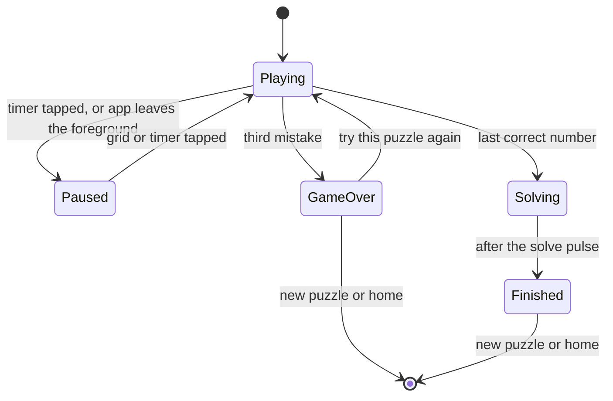

# Epic #34 docs Implementation Plan

> **For agentic workers:** REQUIRED SUB-SKILL: Use superpowers:subagent-driven-development (recommended) or superpowers:executing-plans to implement this plan task-by-task. Steps use checkbox (`- [ ]`) syntax for tracking.

**Goal:** Meet the first three acceptance criteria of epic #34: an epic template that AGENTS.md names, a game screen concept, and the glossary terms of the game.

**Architecture:** Documentation only. One new concept file, one new issue template, small edits to AGENTS.md, the glossary and the two places that list concepts. No code.

**Tech Stack:** Markdown, Mermaid, `just docs-check` (`scripts/check_links.py`).

**Spec:** Epic #34 (`gh issue view 34`), "Acceptance criteria", the first three items. The design canvas: https://claude.ai/artifact/U23JHiGA1Pq3HJX6oMiBF4 (artboards Game screen, Last move, Finish card, Game over, Settings, each in Daylight and Midnight).

## Global Constraints

- Branch `docs/34-epic-docs` from `origin/develop`, in its own worktree. Pull request against `develop`.
- The pull request body says `Part of #34`. Do NOT write `Closes #34`. The epic stays open until every sub-issue is closed.
- All prose follows "Writing style: Simplified Technical English, light" in `AGENTS.md`: sentences of 25 words or fewer, active voice, one meaning per word.
- Every new term goes in `docs/architecture/12-glossary.md`.
- `just docs-check` passes. Every relative link resolves.
- Commit messages follow Conventional Commits and end with `(#34)`.
- The label `type: epic` already exists (checked with `gh label list` on 2026-10-12). Do not create it again.
- Files owned by this plan, and no others:
  - `.github/ISSUE_TEMPLATE/epic.md` (new)
  - `AGENTS.md` (root)
  - `README.md` (root, the "Architecture docs" list only)
  - `docs/architecture/00-concepts/game-screen.md` (new)
  - `docs/architecture/08-cross-cutting-concepts.md`
  - `docs/architecture/12-glossary.md`

## Review Focus

1. A term in `game-screen.md` that the glossary does not define, or defines with another meaning (for example "notes" for the scan kind versus the player's pencil marks). Task 3 checks every bold term against the glossary.
2. Durable text that names an issue number outside the "Open questions" table. Existing concepts name issues only in "Open questions", in the "Decided by" column. Task 2 follows that and Task 3 greps for it.
3. A relative link in the new concept that does not resolve (ADR paths, `12-glossary.md`). Task 3 runs `just docs-check`.
4. A Mermaid diagram that does not render on GitHub (quotes, `<br>`, parentheses inside labels). Task 2 uses only the syntax that `scan-pipeline.md` already uses.
5. The template front matter: a wrong `labels` value makes GitHub drop the label silently. Task 1 copies the exact label name `type: epic`.

---

### Task 1: Epic template and AGENTS.md

**Files:**
- Create: `.github/ISSUE_TEMPLATE/epic.md`
- Modify: `AGENTS.md` (section "Work tracking", rules 2 and 3)

**Interfaces:**
- Consumes: the label `type: epic` (exists).
- Produces: the template name `Epic` with title prefix `Epic: `.

- [ ] **Step 1: Write the template**

Create `.github/ISSUE_TEMPLATE/epic.md` with exactly this content. It matches the form of `feature.md` and `decision.md`:

```markdown
---
name: Epic
about: A group of issues that together deliver one player goal
title: "Epic: "
labels: ["type: epic"]
---

## What and why

<!-- One short paragraph. What the player can do when the epic is done, and why it matters. -->

## Order of work

<!-- Agents pick up any issue whose blockers are closed. GitHub shows the blockers on each issue ("blocked by"). -->

| Wave | Issues | Blocked by |
| --- | --- | --- |
| 1 |  | none |

## Acceptance criteria

- [ ] Every sub-issue is closed

## Decisions for v1

<!-- Optional: scope choices that the sub-issues must follow. Link the ADR when one exists. -->

## Not in this epic

<!-- The related issues that come later. -->

## References

<!-- Requirements, constraints and decisions this touches: F-xx, QR-xx, SUD-xx, ADR-xxx. -->
```

- [ ] **Step 2: Name the template and the label in AGENTS.md**

In `AGENTS.md`, section "Work tracking", replace rules 2 and 3:

```markdown
2. Each issue has one `type:` label, one `area:` label and a milestone (`M0` to `M3`).
3. Use the templates in `.github/ISSUE_TEMPLATE/`. Acceptance criteria are a checklist.
```

with:

```markdown
2. Each issue has one `type:` label, one `area:` label and a milestone (`M0` to `M3`).
3. Use the templates in `.github/ISSUE_TEMPLATE/`. Acceptance criteria are a checklist.
4. An epic groups the issues of one player goal. It uses the `epic.md` template and the label
   `type: epic`. Each issue of the epic is a GitHub sub-issue, with "blocked by" links for its
   order.
5. A pull request for the docs of an epic says `Part of #<epic>`. Only the last sub-issue
   closes an epic.
```

Renumber the following rules of the list: the old 4 becomes 6, and so on up to the old 9, which becomes 11. Check that no other file refers to these rules by number:

Run: `grep -rn "Work tracking" --include=*.md . | grep -v node_modules`
Expected: only the heading in `AGENTS.md`. If a file cites a rule number, update it.

- [ ] **Step 3: Check the links**

Run: `just docs-check`
Expected: exit 0.

- [ ] **Step 4: Commit**

```bash
git add .github/ISSUE_TEMPLATE/epic.md AGENTS.md
git commit -m "docs: epic issue template and the epic rules in AGENTS.md (#34)"
```

---

### Task 2: Game screen concept and its index entries

**Files:**
- Create: `docs/architecture/00-concepts/game-screen.md`
- Modify: `docs/architecture/08-cross-cutting-concepts.md` (concept table)
- Modify: `README.md` (list "Architecture docs")
- Modify: `AGENTS.md` (table "Where to look first")

**Interfaces:**
- Consumes: the glossary terms of Task 3 (assist, finish card, pulse, hint, mistake, notes mode, complete number, selected cell, game over sheet). Task 3 runs after this task and checks them.
- Produces: the concept `game-screen`, which the wave 3 and wave 4 issues read.

- [ ] **Step 1: Write the concept**

Create `docs/architecture/00-concepts/game-screen.md` with exactly this content:

````markdown
---
status: DRAFT
concept: game-screen
---

# Game screen

## Why

The game screen is where the player spends almost all of the time in the app. It must be calm,
fast and clear on a phone held in one hand. The screens only draw the state of the game.
Every rule lives in `@sudoku/core` (SUD-04), so Vitest tests the rules and the UI issues can
run in parallel.

The [design canvas](https://claude.ai/artifact/U23JHiGA1Pq3HJX6oMiBF4) holds the agreed
screens, in the Daylight and the Midnight theme. It is the reference for layout, states and
tokens. This concept says what the screen does. The canvas shows how it looks.

## What

The screen has four parts, from top to bottom:

| Part | Contents |
| --- | --- |
| Header | A back button to the home screen. The timer, which is also the pause button. Three dots that show the mistakes, filled one per mistake |
| Grid | 81 cells in nine boxes. A **given** is locked and drawn with `type.given`. An **entry** uses `type.entry`. **Notes** show as a 3 × 3 set of small digits with `type.note`. A wrong entry has the conflict colour |
| Tools | Undo, Erase, Notes and Hint. Undo and Erase are disabled when they cannot act. Notes is a toggle: in **notes mode** a number key toggles a note |
| Keypad | One key for each number 1 to 9. The key of a **complete number** is disabled and faded |

### Assists

An **assist** shades cells to help the player see the board. The player turns each assist on
or off in Settings. All four are on by default.

| Assist | When on | When off |
| --- | --- | --- |
| Row and column | Shades the row and the column of the selected cell | No shade |
| Box | Shades the 3 × 3 box of the selected cell | No shade |
| Selected cell | Fills the **selected cell** | A thin ring in the accent colour marks it |
| Same numbers | Shades every cell that holds the number of the selected cell | No shade |

A wrong entry keeps its conflict fill, whatever the assists are.

### States



| State | What the screen shows |
| --- | --- |
| Playing | The grid, the tools and the keypad. The timer counts |
| Paused | The grid hides every digit and note. A "Paused, tap to resume" layer covers it. The tools and the keypad are faded and do not act. The timer stops |
| Game over | The **game over sheet** rises from the bottom over a light scrim. It says "Out of mistakes" and how many cells were right, at what time. Its buttons: Try this puzzle again, New puzzle, Back to home |
| Solving | A short pause for the solve **pulse**. The controls do not act |
| Finished | The **finish card** over a scrim, with New puzzle and Back to home below it |

### Pulses

A correct number can complete a row, a column, a box, all nine of a number, or the whole
grid. Each completion sends a **pulse**: a wave of the accent colour that starts at the cell
and spreads out, cell by cell. A digit in the wave grows for a moment. A key that becomes
complete plays a short animation, then fades. A haptic tap goes with each pulse. With Reduce
Motion on, the screen shows no pulse animation.

### Finish card

The **finish card** shows the result of a solved puzzle:

- the level, for example "Solved · Medium",
- a "New best" badge when the time beats the best time of that level,
- the time,
- a small copy of the solved grid, with givens and entries in two styles,
- the mistakes (for example 1/3), the hints and the best time,
- the source: "Scanned from paper" with a scan icon, or the puzzle number,
- the date.

The card tilts a little with the movement of the phone. An ADR decides the motion sensor
before the card is built.

### Settings

The Settings screen has two groups:

- **Assists:** a switch for each of the four assists, with a small live preview of the grid.
- **Theme:** a choice of System, Daylight or Midnight. System follows the setting of the
  iPhone (ADR-015).

### Rules that the screen shows, not owns

`@sudoku/core` decides these rules. The screen only draws the result:

- A given cannot change.
- A placed number removes itself from the notes in its row, column and box.
- A wrong number counts as a **mistake**. Undo does not remove a mistake. The third mistake
  ends the game.
- A **hint** fills a random empty or wrong cell with its correct number and counts one hint.
- A number is complete only when all nine are placed correctly. Wrong placements do not count.
- The timer does not count during a pause or after the game ends.

## Open questions

| Question | Decided by |
| --- | --- |
| Navigation between home, game and settings | An ADR in issue #51 |
| The motion sensor that tilts the finish card | An ADR in issue #43 |
| Hints that teach a technique instead of a random cell (ADR-011) | Issue #45, after this epic |
| An option to turn off the entry check | Issue #46, after this epic |
| VoiceOver labels for each cell and Dynamic Type sizes | Issue #44 |

## Constraints

| ID | Constraint |
| --- | --- |
| SUD-01 | The game and the scanner MUST work fully without a network connection. |
| SUD-04 | `@sudoku/core` MUST NOT depend on React Native, Expo or any I/O. |
````

Before you save, check the two constraint rows against `docs/architecture/00-DECISIONS.md`. Copy the text of SUD-01 and SUD-04 verbatim from that file if it differs.

- [ ] **Step 2: List the concept in the concept index**

In `docs/architecture/08-cross-cutting-concepts.md`, add this row below the "Model contract" row:

```markdown
| Game screen | Draft | [game-screen](00-concepts/game-screen.md) |
```

- [ ] **Step 3: Link the concept from the README and AGENTS.md**

In `README.md`, list "Architecture docs", add below the "Model contract" line:

```markdown
- [Game screen](docs/architecture/00-concepts/game-screen.md)
```

In `AGENTS.md`, table "Where to look first", add below the row "How a scan works":

```markdown
| How the game screen works | `docs/architecture/00-concepts/game-screen.md` |
```

- [ ] **Step 4: Check the links**

Run: `just docs-check`
Expected: exit 0.

- [ ] **Step 5: Commit**

```bash
git add docs/architecture/00-concepts/game-screen.md docs/architecture/08-cross-cutting-concepts.md README.md AGENTS.md
git commit -m "docs: game screen concept with a link to the design canvas (#34)"
```

---

### Task 3: Glossary terms of the game

**Files:**
- Modify: `docs/architecture/12-glossary.md`

**Interfaces:**
- Consumes: the bold terms of `game-screen.md` (Task 2).
- Produces: the definitions that #49, #50 and the wave 3 and 4 issues use. The theme terms (Theme, Primitive token, Semantic token, Component token, Theme decoration, Type role, Text pair, Daylight, Midnight) and Given, Entry already exist. Do not add them again.

- [ ] **Step 1: Amend the "Notes" row**

The current row means only the scan kind. Replace:

```markdown
| Notes | Small pencil marks in a cell. Recognised as a kind, loaded as an empty cell |
```

with:

```markdown
| Notes | Small pencil marks in a cell. In a scan: a kind, loaded as an empty cell. In the game: the candidate numbers that the player sets in notes mode |
```

- [ ] **Step 2: Add the game terms**

Append these rows at the end of the table, in this order:

```markdown
| Game | One puzzle in progress: the givens, the solution, the entries, the notes, the mistakes, the hints used and the time played. `@sudoku/core` holds its rules |
| Selected cell | The one cell that a number key, Erase or a note acts on. The player selects it with a tap |
| Notes mode | The state of the Notes tool. When it is on, a number key toggles a note instead of placing an entry |
| Mistake | An entry that differs from the solution. Each one counts once, and undo does not remove it. The third mistake ends the game. A digit loaded from a scan is not a mistake |
| Hint | A move that fills one random empty or wrong cell with its correct number. It counts once. Hints that teach come later (ADR-011) |
| Complete number | A number with all nine placed correctly. Its key is disabled. Wrong placements do not count |
| Assist | A shade on the grid that helps the player see the board: row and column, box, selected cell or same numbers. Each one turns on or off in Settings |
| Pulse | The short wave of colour that spreads from a cell when a correct number completes a row, column, box, number or the whole grid. A haptic tap goes with it |
| Game over sheet | The sheet that rises after the third mistake. It offers to try the puzzle again, start a new puzzle or go home |
| Finish card | The card that shows a solved puzzle: level, time, a small grid, mistakes, hints, best time, source and date |
| Level | The difficulty of a puzzle: easy, medium, hard or expert. In v1 the number of givens sets it. Grading by technique comes later (ADR-011) |
| Game status | The state of a game: playing, paused, lost or won. Only a playing game accepts moves, and only a playing game counts time |
| Undo step | The entries and notes before one move. Undo restores the last undo step. It does not restore the mistake count |
| Completion | What one move completed: rows, columns, boxes, complete numbers or the whole grid. A pulse shows it |
| Theme preference | The player's choice in Settings: System, Daylight or Midnight. System follows the light or dark setting of the iPhone |
| Adaptive theme | The theme that follows the iPhone setting: Daylight in light mode, Midnight in dark mode |
```

Before you save, check the level names against issue #35: `gh issue view 35 --json body --jq .body`. If #35 names other levels, use its names in the "Level" row.

- [ ] **Step 3: Check every bold term of the concept**

Run: `grep -o '\*\*[^*]*\*\*' docs/architecture/00-concepts/game-screen.md | sort -u`
Expected: each term (given, entry, notes, notes mode, complete number, assist, selected cell, game over sheet, pulse, finish card, mistake, hint) has a row in `12-glossary.md`. The words "Assists:" and "Theme:" in the Settings list are labels, not terms.

- [ ] **Step 4: Check for issue numbers outside "Open questions"**

Run: `grep -n '#[0-9]' docs/architecture/00-concepts/game-screen.md docs/architecture/12-glossary.md`
Expected: matches only in the "Open questions" table of `game-screen.md`.

- [ ] **Step 5: Check the links**

Run: `just docs-check`
Expected: exit 0.

- [ ] **Step 6: Commit**

```bash
git add docs/architecture/12-glossary.md
git commit -m "docs: glossary terms of the game: assist, pulse, finish card and more (#34)"
```

---

### Task 4: Pull request

- [ ] **Step 1: Push and open the pull request**

```bash
git push -u origin docs/34-epic-docs
gh pr create --base develop --title "docs: epic template, game screen concept and game glossary (#34)" --body "$(cat <<'EOF'
## What

- `.github/ISSUE_TEMPLATE/epic.md`: the template for an epic. AGENTS.md names it and the label `type: epic`.
- `docs/architecture/00-concepts/game-screen.md`: the game screen concept, with a link to the design canvas.
- `12-glossary.md`: assist, finish card, pulse, and the other words of the game.

## Checks

- `just docs-check` passes.

Part of #34
EOF
)"
```

The coordinator ticks the first three acceptance criteria of #34 after the merge. Do not tick them here, and do not close #34.

## Self-review notes

- Spec coverage: criterion 1 → Task 1 (label exists, so no creation step). Criterion 2 → Task 2. Criterion 3 → Task 3. Criterion 4 (every sub-issue closed) is not in scope.
- Glossary file ownership: the wave 1 plans for #48, #49 and #50 must not edit `12-glossary.md`. If one of them needs a new term, it goes in its own pull request after this one merges, or this plan adds it before dispatch.
