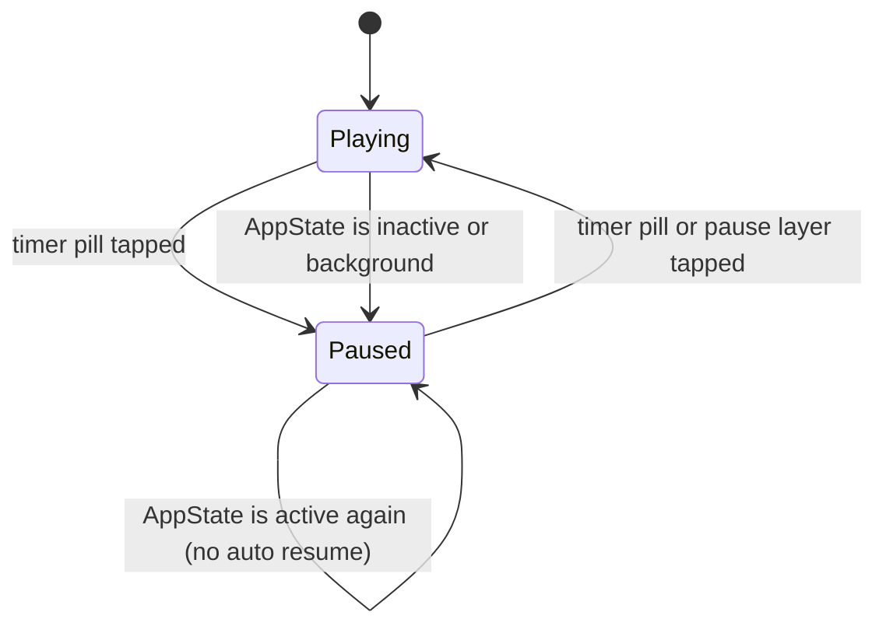

# Pause the game, also when the app leaves the foreground: implementation plan

> For the implementer: work test-first, task by task. Each task ends with a commit. Do not push or open
> the pull request until the developer asks.

**Goal:** The player can pause and resume the game from the timer pill. A paused grid hides its
digits and notes behind a "Paused / Tap to resume" layer. The game also pauses when the app leaves the
foreground. Time in the background or in a pause never counts as play time.

**Architecture:** The core already holds the pause (`pause`, `resume`, `tick` refuse or ignore time
while `status` is `paused`). `session.utils.ts` already has the `pause` and `resume` session actions,
and `GameActions` already exposes them. `cell.utils.ts` already hides every digit, note and shade
while the game is paused. `Tools` and `Keypad` already fade and disable themselves when the status is
not `playing`. So this issue adds only the screen side:

1. `useGameSession` subscribes to `AppState` and dispatches `pause` when the state is not `active`.
   It does not resume on return: the player taps to resume.
2. `useGameClock` caps one report at `MAX_ELAPSED_MS` (2 s). iOS can suspend JavaScript before the
   interval is cleared. The first report after the return then holds the suspended time. The cap
   bounds that error.
3. `TimerPill` becomes a button while the game is not over. Playing: tap pauses. Paused: an accent
   pill with a play icon, tap resumes. Lost or won: no action, as today.
4. A new component `PauseLayer` lies over the grid inside `Board`. It renders nothing unless the
   game is paused. A tap on it resumes the game. `Board` itself reads no game state, so a move does
   not render `Board` again.



**Tech Stack:** Expo SDK 57 (`expo ~57.0.27`), React Native 0.86.3, React 19.2.3,
`react-native-unistyles` (ADR-015), `@shopify/react-native-skia` icons, Jest (`jest-expo`) and
`@testing-library/react-native`.

**AppState facts (read from the React Native docs, https://reactnative.dev/docs/appstate, and
`react-native/Libraries/AppState/AppState.d.ts` 0.86.3; the Expo 57 docs link to React Native for
this API and have no page of their own):**

- States: `active`, `background`, `inactive`. `inactive` is iOS only. It fires on the way to the
  background, on the app switcher, on Notification Center and on an incoming call.
- `AppState.addEventListener('change', listener)` returns a subscription. Call `subscription.remove()`
  on unmount.
- The Jest preset mocks `AppState`: `addEventListener` returns `{ remove: jest.fn() }`, and
  `currentState` is a `jest.fn`, not a string. So the code must not depend on `currentState`.
  The existing `CameraScreen` test shows how to drive the listener with `jest.spyOn`.

**Spec:** issue #39 and its acceptance criteria. The state table and the state diagram in
`docs/architecture/00-concepts/game-screen.md` (Paused row). The design canvas, `Main.dc.html`:

- Playing pill: border `line`, text `text`, pause icon, label "Pause, time 00:00".
- Paused pill: fill `accent`, text `onAccent`, play icon `M8 5l11 7-11 7z`, label
  "Resume, time 00:00".
- Pause layer over the grid: transparent, "Paused" (22, bold, `text`) above "Tap to resume" (14,
  `textMuted`), gap 6. A tap resumes.
- Controls: opacity .35, no action. `theme.opacity.locked` already does this in `Tools` and `Keypad`.


## Coordinator rulings (2026-10-12, binding; they override the tasks below where they differ)

- #39 owns `Icon/*` this wave and adds the play path and the `onAccent` tone. Others only import Icon.
- Merge order: #51 merges first. Your last task rebases on origin/develop after #51 merges and adapts to #51's `GameStart` type and routes. Until then, work on origin/develop as it is.
## Global Constraints

- Obey root `AGENTS.md` and `apps/mobile/AGENTS.md`: STE light prose and comments, the comment
  rules, the import rules (`@/` alias, folder `index.ts`, no `../`), the Unistyles rules (no colour
  literal outside `src/theme/`, do not spread a Unistyles style).
- Use the core `pause`, `resume` and `tick` only through the existing session actions. Do not change
  `session.utils.ts`, `cell.utils.ts`, `Tools`, `Keypad`, `GameProvider`, `Header`, `Grid` or
  `GameScreen`.
- SUD-04: the core never reads a clock. The app measures the elapsed time.
- SUD-02: nothing leaves the device. This issue sends nothing.
- No new dependency. No theme file changes: the paused pill uses the semantic tokens `accent` and
  `onAccent`, and the layer uses `text` and `textMuted`.
- Branch: `feature/39-pause` from `origin/develop`. Pull request against `develop` with
  `Closes #39`. Commits in Conventional Commits with `(#39)`.
- Run `just lint`, `just typecheck` and `just test-ts` before each commit.

## Review Focus

1. **No background time.** `useGameSession` pauses on `inactive` and on `background`. The clock
   effect stops because the status is no longer `playing`. The cap in `useGameClock` bounds a late
   report to 2 s.
2. **No auto resume.** Return to `active` leaves the game paused.
3. **Renders.** `Board` reads no game state. `PauseLayer` is the only new reader of the state.
   `GameScreen.renders.test.tsx` must still pass unchanged (one grid render per move, none per tick).
4. **VoiceOver.** The pause layer sets `accessibilityViewIsModal`, so VoiceOver skips the grid
   cells under it. The pill label says the action and the time.
5. **Ended game.** A lost or won game keeps the plain muted time with no action.

## Files owned

All paths are under `apps/mobile/src/game/`.

| File | Change |
| --- | --- |
| `hooks/useGameSession/useGameSession.ts` | AppState subscription that pauses |
| `hooks/useGameSession/useGameSession.test.tsx` | Tests for the AppState pause |
| `hooks/useGameClock/useGameClock.ts` | Cap one report at `MAX_ELAPSED_MS` |
| `hooks/useGameClock/useGameClock.constants.ts` | New: `MAX_ELAPSED_MS` |
| `hooks/useGameClock/useGameClock.test.tsx` | Test for the cap |
| `components/TimerPill/TimerPill.tsx` | Button: pause, resume, ended |
| `components/TimerPill/TimerPill.styles.ts` | `pausedPill`, `pausedTime` |
| `components/TimerPill/TimerPill.test.tsx` | Tests for the button |
| `components/PauseLayer/PauseLayer.tsx` | New |
| `components/PauseLayer/PauseLayer.styles.ts` | New |
| `components/PauseLayer/PauseLayer.test.tsx` | New |
| `components/PauseLayer/index.ts` | New |
| `components/Board/Board.tsx` | Mount `PauseLayer` over the grid |
| `components/Board/Board.test.tsx` | Test that the layer covers the grid |
| `components/Icon/Icon.constants.ts`, `components/Icon/Icon.tsx`, `components/Icon/Icon.test.tsx` | **Only if the lead approves Open question 1.** `play` path and `onAccent` tone |

No theme file, no docs file, no `jest.setup.ts`, no `package.json`.

## Task 1: cap one clock report

**Files:** `hooks/useGameClock/useGameClock.constants.ts` (new), `hooks/useGameClock/useGameClock.ts`,
`hooks/useGameClock/useGameClock.test.tsx`.

- [ ] Step 1. Add the failing test to the end of `useGameClock.test.tsx`:

```tsx
it('counts at most MAX_ELAPSED_MS for one report that comes late', () => {
  const onElapsed = jest.fn()
  renderHook(() => useGameClock(true, onElapsed))
  // The system clock jumps as it does when iOS suspends JavaScript in the background.
  jest.setSystemTime(Date.now() + 60_000)
  jest.advanceTimersByTime(1000)
  expect(onElapsed).toHaveBeenCalledTimes(1)
  expect(onElapsed).toHaveBeenLastCalledWith(MAX_ELAPSED_MS)
})
```

  Add the import at the top: `import { MAX_ELAPSED_MS } from './useGameClock.constants'`.

- [ ] Step 2. Run `pnpm --filter mobile exec jest src/game/hooks/useGameClock` (or `just test-ts`).
  Expect a failure: the module `./useGameClock.constants` does not exist.

- [ ] Step 3. Create `useGameClock.constants.ts`:

```ts
import { CLOCK_INTERVAL_MS } from '@/game/constants/game.constants'

/**
 * The most time that one clock report counts, in milliseconds. iOS can suspend JavaScript before
 * the pause on AppState stops the clock. The first report after the return then holds the suspended time.
 */
export const MAX_ELAPSED_MS = 2 * CLOCK_INTERVAL_MS
```

- [ ] Step 4. Change `useGameClock.ts`:

```ts
import { useEffect, useRef } from 'react'
import { CLOCK_INTERVAL_MS } from '@/game/constants/game.constants'
import { MAX_ELAPSED_MS } from './useGameClock.constants'

/**
 * Calls onElapsed with the milliseconds since its last call, about once a second, while running is true.
 * One call reports at most MAX_ELAPSED_MS.
 */
export function useGameClock(running: boolean, onElapsed: (ms: number) => void): void {
  const callback = useRef(onElapsed)
  useEffect(() => {
    callback.current = onElapsed
  })
  useEffect(() => {
    if (!running) return undefined
    let last = Date.now()
    const timer = setInterval(() => {
      const now = Date.now()
      callback.current(Math.min(now - last, MAX_ELAPSED_MS))
      last = now
    }, CLOCK_INTERVAL_MS)
    return () => clearInterval(timer)
  }, [running])
}
```

- [ ] Step 5. Run the tests again. Expect all three `useGameClock` tests to pass.
- [ ] Step 6. Run `just lint`, `just typecheck`, `just test-ts`.
- [ ] Step 7. Commit: `feat(game): cap one clock report at two seconds (#39)`.

## Task 2: pause when the app leaves the foreground

**Files:** `hooks/useGameSession/useGameSession.ts`, `hooks/useGameSession/useGameSession.test.tsx`.

- [ ] Step 1. Add the failing tests to `useGameSession.test.tsx`. Change the imports at the top:

```tsx
import { act, renderHook } from '@testing-library/react-native'
import { AppState, type AppStateStatus } from 'react-native'
import { sampleStart } from '@/game/utils/sample.utils'
import { useGameSession } from './useGameSession'
```

  Change the `afterEach` to restore the spies:

```tsx
afterEach(() => {
  jest.restoreAllMocks()
  jest.useRealTimers()
})
```

  Add this helper and these tests at the end of the file:

```tsx
function captureAppState() {
  const listener = { change: (_state: AppStateStatus) => undefined as void }
  const remove = jest.fn()
  jest.spyOn(AppState, 'addEventListener').mockImplementation((_type, handler) => {
    listener.change = handler as (state: AppStateStatus) => void
    return { remove }
  })
  return { listener, remove }
}

it.each<AppStateStatus>(['inactive', 'background'])('pauses the game when the app becomes %s', (state) => {
  const { listener } = captureAppState()
  const { result } = renderHook(() => useGameSession(sampleStart()))
  act(() => jest.advanceTimersByTime(2000))
  act(() => listener.change(state))
  expect(result.current.state.board.status).toBe('paused')
  act(() => jest.advanceTimersByTime(60_000))
  expect(result.current.playedMs).toBe(2000)
})

it('stays paused when the app comes back, until the player resumes', () => {
  const { listener } = captureAppState()
  const { result } = renderHook(() => useGameSession(sampleStart()))
  act(() => listener.change('background'))
  act(() => listener.change('active'))
  act(() => jest.advanceTimersByTime(5000))
  expect(result.current.state.board.status).toBe('paused')
  expect(result.current.playedMs).toBe(0)
  act(() => result.current.actions.resume())
  act(() => jest.advanceTimersByTime(1000))
  expect(result.current.playedMs).toBe(1000)
})

it('stops the AppState subscription on unmount', () => {
  const { remove } = captureAppState()
  const { unmount } = renderHook(() => useGameSession(sampleStart()))
  unmount()
  expect(remove).toHaveBeenCalledTimes(1)
})
```

  If TypeScript refuses `return { remove }` as a `NativeEventSubscription`, write
  `return { remove } as unknown as ReturnType<typeof AppState.addEventListener>`. The CameraScreen
  test returns `{ remove }` without a cast, so try that first.

- [ ] Step 2. Run the `useGameSession` tests. Expect the three new tests to fail: the status stays
  `playing`, and `remove` is never called.

- [ ] Step 3. Change `useGameSession.ts`:

```ts
import { useCallback, useEffect, useMemo, useReducer } from 'react'
import { AppState } from 'react-native'
import type { NewGame } from '@sudoku/core'
import type { GameActions } from '@/game/hooks/useGameActions'
import { useGameClock } from '@/game/hooks/useGameClock'
import type { GameState } from '@/game/hooks/useGameState'
import { useMoveHaptics } from '@/game/hooks/useMoveHaptics'
import { reduceSession, startSession } from '@/game/utils/session.utils'

/** The three parts of a game session. Each part keeps its identity until its own content changes. */
export type GameSession = { state: GameState; playedMs: number; actions: GameActions }

/**
 * One game in progress. start is read once, when the hook mounts.
 * The game pauses when the app is not active, and stays paused until the player resumes it.
 */
export function useGameSession(start: NewGame): GameSession {
  const [session, dispatch] = useReducer(reduceSession, start, startSession)
  const onElapsed = useCallback((elapsedMs: number) => dispatch({ type: 'tick', elapsedMs }), [])
  useGameClock(session.game.status === 'playing', onElapsed)
  useMoveHaptics(session.move)
  useEffect(() => {
    const subscription = AppState.addEventListener('change', (next) => {
      if (next !== 'active') dispatch({ type: 'pause' })
    })
    return () => subscription.remove()
  }, [])
  const { board, notesMode, move } = session
  const state = useMemo<GameState>(() => ({ board, notesMode, move }), [board, notesMode, move])
  const actions = useMemo<GameActions>(
    () => ({
      select: (cell) => dispatch({ type: 'select', cell }),
      digit: (digit) => dispatch({ type: 'digit', digit }),
      erase: () => dispatch({ type: 'erase' }),
      undo: () => dispatch({ type: 'undo' }),
      hint: () => dispatch({ type: 'hint', random: Math.random }),
      toggleNotesMode: () => dispatch({ type: 'toggleNotesMode' }),
      pause: () => dispatch({ type: 'pause' }),
      resume: () => dispatch({ type: 'resume' }),
    }),
    [],
  )
  return { state, playedMs: session.game.playedMs, actions }
}
```

  The core `pause` returns the same game for a lost or won game, so the session does not change then.

- [ ] Step 4. Run the tests. Expect all `useGameSession` tests to pass. Run
  `GameScreen.renders.test.tsx` too: it must pass unchanged.
- [ ] Step 5. Run `just lint`, `just typecheck`, `just test-ts`.
- [ ] Step 6. Commit: `feat(game): pause the game when the app leaves the foreground (#39)`.

## Task 3: the play icon and the onAccent tone (only after the lead approves Open question 1)

**Files:** `components/Icon/Icon.constants.ts`, `components/Icon/Icon.tsx`, `components/Icon/Icon.test.tsx`.

If the lead refuses, skip this task. Then Task 4 draws the paused pill without an icon: delete the
`<Icon …>` line in the paused branch and the `play` assertion in its test.

- [ ] Step 1. Add the failing test to `Icon.test.tsx`:

```tsx
it('draws the play icon in the colour on the accent', () => {
  render(<Icon name="play" tone="onAccent" size={16} />)
  const path = screen.getByTestId('skia-path')
  expect(path.props.path).toBe('M8 5l11 7-11 7z')
  expect(path.props.color).toBe(daylight.colors.onAccent)
})
```

- [ ] Step 2. Run `just typecheck`. Expect type errors: `play` is not an `IconName`, `onAccent` is not
  an `IconTone`.
- [ ] Step 3. In `Icon.constants.ts`, add after `pause`: `play: 'M8 5l11 7-11 7z',`
- [ ] Step 4. In `Icon.tsx`, change the tone type: `export type IconTone = 'text' | 'accent' | 'onAccent'`
- [ ] Step 5. Run the tests. Expect the Icon tests to pass.
- [ ] Step 6. Run `just lint`, `just typecheck`, `just test-ts`.
- [ ] Step 7. Commit: `feat(game): add the play icon and the onAccent icon tone (#39)`.

## Task 4: the timer pill pauses and resumes

**Files:** `components/TimerPill/TimerPill.tsx`, `components/TimerPill/TimerPill.styles.ts`,
`components/TimerPill/TimerPill.test.tsx`.

- [ ] Step 1. Replace the test `reads the time for VoiceOver in an area of 44 pt that has no action`
  and add new tests. The full new `TimerPill.test.tsx`:

```tsx
import { act, fireEvent, render, screen } from '@testing-library/react-native'
import type { ReactElement } from 'react'
import { Pressable, StyleSheet } from 'react-native'
import { GameProvider } from '@/game/components/GameProvider'
import { useGameActions } from '@/game/hooks/useGameActions'
import { sampleStart } from '@/game/utils/sample.utils'
import { daylight } from '@/theme/themes/daylight'
import { TimerPill } from './TimerPill'

const renderInGame = (ui: ReactElement) => render(<GameProvider start={sampleStart()}>{ui}</GameProvider>)

// Three wrong numbers in cell 2, whose solution is 4, lose the game.
function LoseButton() {
  const { select, digit } = useGameActions()
  const lose = () => {
    select(2)
    for (const wrong of [5, 6, 7] as const) digit(wrong)
  }
  return <Pressable testID="lose" onPress={lose} />
}

beforeEach(() => jest.useFakeTimers())
afterEach(() => jest.useRealTimers())

it('shows the time played', () => {
  renderInGame(<TimerPill />)
  expect(screen.getByText('00:00')).toBeTruthy()
  act(() => jest.advanceTimersByTime(65_000))
  expect(screen.getByText('01:05')).toBeTruthy()
})

it('is a button of 44 pt that pauses the game', () => {
  renderInGame(<TimerPill />)
  const button = screen.getByRole('button', { name: 'Pause, time 00:00' })
  expect(StyleSheet.flatten(button.props.style)).toMatchObject({ minHeight: 44 })
  fireEvent.press(button)
  expect(screen.getByRole('button', { name: 'Resume, time 00:00' })).toBeTruthy()
})

it('stops the time during a pause and counts again after resume', () => {
  renderInGame(<TimerPill />)
  act(() => jest.advanceTimersByTime(2000))
  fireEvent.press(screen.getByRole('button', { name: 'Pause, time 00:02' }))
  act(() => jest.advanceTimersByTime(30_000))
  expect(screen.getByText('00:02')).toBeTruthy()
  fireEvent.press(screen.getByRole('button', { name: 'Resume, time 00:02' }))
  act(() => jest.advanceTimersByTime(1000))
  expect(screen.getByText('00:03')).toBeTruthy()
})

it('fills the pill with the accent and shows the play icon during a pause', () => {
  renderInGame(<TimerPill />)
  fireEvent.press(screen.getByRole('button', { name: 'Pause, time 00:00' }))
  expect(StyleSheet.flatten(screen.getByTestId('timer-pill').props.style)).toMatchObject({
    backgroundColor: daylight.colors.accent,
  })
  expect(StyleSheet.flatten(screen.getByText('00:00').props.style)).toMatchObject({
    color: daylight.colors.onAccent,
  })
  expect(screen.getByTestId('skia-path').props.path).toBe('M8 5l11 7-11 7z')
})

it('draws the pill border and the pause icon while the game is playing', () => {
  renderInGame(<TimerPill />)
  expect(StyleSheet.flatten(screen.getByTestId('timer-pill').props.style)).toMatchObject({
    borderColor: daylight.colors.line,
  })
  expect(screen.getByTestId('skia-path').props.path).toBe('M9 5v14M15 5v14')
})

it('mutes the time, drops the icon and has no action when the game ends', () => {
  renderInGame(
    <>
      <TimerPill />
      <LoseButton />
    </>,
  )
  fireEvent.press(screen.getByTestId('lose'))
  expect(screen.queryByTestId('skia-path')).toBeNull()
  expect(screen.queryByRole('button', { name: /time/ })).toBeNull()
  const area = screen.getByLabelText('Time 00:00')
  expect(area.props.accessible).toBe(true)
  expect(StyleSheet.flatten(area.props.style)).toMatchObject({ minHeight: 44 })
  expect(StyleSheet.flatten(screen.getByText('00:00').props.style)).toMatchObject({
    color: daylight.colors.textMuted,
  })
  const pill = StyleSheet.flatten(screen.getByTestId('timer-pill').props.style)
  expect(pill.borderWidth ?? 0).toBe(0)
})
```

- [ ] Step 2. Run the TimerPill tests. Expect the new button tests to fail: the pill has no role and
  no action.

- [ ] Step 3. Replace `TimerPill.tsx`:

```tsx
import { Pressable, Text, View } from 'react-native'
import { Icon } from '@/game/components/Icon'
import { useGameActions } from '@/game/hooks/useGameActions'
import { useGameState } from '@/game/hooks/useGameState'
import { useGameTime } from '@/game/hooks/useGameTime'
import { formatClock } from '@/game/utils/time.utils'
import { styles } from './TimerPill.styles'

/** The time played. It is also the pause button, until the game ends. */
export function TimerPill() {
  const playedMs = useGameTime()
  const { status } = useGameState().board
  const { pause, resume } = useGameActions()
  const time = formatClock(playedMs)
  if (status === 'lost' || status === 'won') {
    return (
      <View style={styles.area} accessible accessibilityLabel={`Time ${time}`}>
        <View testID="timer-pill" style={styles.endedPill}>
          <Text style={styles.endedTime}>{time}</Text>
        </View>
      </View>
    )
  }
  const paused = status === 'paused'
  return (
    <Pressable
      style={styles.area}
      accessibilityRole="button"
      accessibilityLabel={`${paused ? 'Resume' : 'Pause'}, time ${time}`}
      onPress={paused ? resume : pause}
    >
      <View testID="timer-pill" style={paused ? styles.pausedPill : styles.pill}>
        <Text style={paused ? styles.pausedTime : styles.time}>{time}</Text>
        <Icon name={paused ? 'play' : 'pause'} tone={paused ? 'onAccent' : 'text'} size={16} />
      </View>
    </Pressable>
  )
}
```

- [ ] Step 4. In `TimerPill.styles.ts`, add these two entries after `pill` and after `time`:

```ts
  // The border takes the accent, so the paused pill keeps the size of the playing pill.
  pausedPill: {
    height: theme.size.pill.height,
    paddingHorizontal: theme.size.pill.paddingHorizontal,
    flexDirection: 'row',
    alignItems: 'center',
    gap: theme.space.sm,
    borderWidth: theme.shape.stroke.thin,
    borderColor: theme.colors.accent,
    borderRadius: theme.shape.radius.pill,
    backgroundColor: theme.colors.accent,
  },
```

```ts
  pausedTime: {
    ...roleFont(theme.type.timer),
    fontSize: theme.type.timer.scale,
    color: theme.colors.onAccent,
    fontVariant: ['tabular-nums'],
  },
```

- [ ] Step 5. Run the tests. Expect all TimerPill tests to pass.
- [ ] Step 6. Run `just lint`, `just typecheck`, `just test-ts`.
- [ ] Step 7. Commit: `feat(game): pause and resume the game from the timer pill (#39)`.

## Task 5: the pause layer over the grid

**Files:** `components/PauseLayer/PauseLayer.tsx`, `components/PauseLayer/PauseLayer.styles.ts`,
`components/PauseLayer/PauseLayer.test.tsx`, `components/PauseLayer/index.ts` (all new),
`components/Board/Board.tsx`, `components/Board/Board.test.tsx`.

- [ ] Step 1. Create the failing test `PauseLayer.test.tsx`:

```tsx
import { fireEvent, render, screen } from '@testing-library/react-native'
import { Pressable } from 'react-native'
import { GameProvider } from '@/game/components/GameProvider'
import { Keypad } from '@/game/components/Keypad'
import { Tools } from '@/game/components/Tools'
import { useGameActions } from '@/game/hooks/useGameActions'
import { sampleStart } from '@/game/utils/sample.utils'
import { PauseLayer } from './PauseLayer'

function PauseButton() {
  const { pause } = useGameActions()
  return <Pressable testID="pause" onPress={pause} />
}

function renderGame() {
  render(
    <GameProvider start={sampleStart()}>
      <PauseLayer />
      <PauseButton />
      <Tools />
      <Keypad />
    </GameProvider>,
  )
}

beforeEach(() => jest.useFakeTimers())
afterEach(() => jest.useRealTimers())

it('shows nothing while the game is playing', () => {
  renderGame()
  expect(screen.queryByText('Paused')).toBeNull()
})

it('says the game is paused and resumes it on a tap', () => {
  renderGame()
  fireEvent.press(screen.getByTestId('pause'))
  expect(screen.getByText('Paused')).toBeTruthy()
  expect(screen.getByText('Tap to resume')).toBeTruthy()
  fireEvent.press(screen.getByRole('button', { name: 'Paused, tap to resume' }))
  expect(screen.queryByText('Paused')).toBeNull()
})

it('hides the grid from VoiceOver while it covers it', () => {
  renderGame()
  fireEvent.press(screen.getByTestId('pause'))
  expect(screen.getByRole('button', { name: 'Paused, tap to resume' }).props.accessibilityViewIsModal).toBe(true)
})

it('leaves the tools and the keys disabled during a pause', () => {
  renderGame()
  fireEvent.press(screen.getByTestId('pause'))
  expect(screen.getByRole('button', { name: 'Hint' })).toBeDisabled()
  expect(screen.getByRole('button', { name: 'Notes' })).toBeDisabled()
  expect(screen.getByRole('button', { name: 'Enter 5' })).toBeDisabled()
})
```

  If `toBeDisabled` is not available in this Testing Library setup, assert
  `props.accessibilityState).toMatchObject({ disabled: true })` instead.

- [ ] Step 2. Run the test. Expect a failure: `./PauseLayer` does not exist.

- [ ] Step 3. Create `PauseLayer.styles.ts`:

```ts
import { StyleSheet } from 'react-native-unistyles'
import { roleFont } from '@/theme/typography'

// The layer is transparent: the cells under it already show empty while the game is paused.
export const styles = StyleSheet.create((theme) => ({
  layer: {
    position: 'absolute',
    top: 0,
    right: 0,
    bottom: 0,
    left: 0,
    alignItems: 'center',
    justifyContent: 'center',
    gap: theme.space.xs,
  },
  title: { ...roleFont(theme.type.title), fontSize: theme.type.title.scale, color: theme.colors.text },
  hint: { ...roleFont(theme.type.body), fontSize: theme.type.body.scale, color: theme.colors.textMuted },
}))
```

- [ ] Step 4. Create `PauseLayer.tsx`:

```tsx
import { Pressable, Text } from 'react-native'
import { useGameActions } from '@/game/hooks/useGameActions'
import { useGameState } from '@/game/hooks/useGameState'
import { styles } from './PauseLayer.styles'

/**
 * Covers the grid while the game is paused. A tap resumes the game.
 * accessibilityViewIsModal makes VoiceOver skip the sibling grid.
 */
export function PauseLayer() {
  const { status } = useGameState().board
  const { resume } = useGameActions()
  if (status !== 'paused') return null
  return (
    <Pressable
      style={styles.layer}
      accessibilityRole="button"
      accessibilityLabel="Paused, tap to resume"
      accessibilityViewIsModal
      onPress={resume}
    >
      <Text style={styles.title}>Paused</Text>
      <Text style={styles.hint}>Tap to resume</Text>
    </Pressable>
  )
}
```

- [ ] Step 5. Create `index.ts`: `export { PauseLayer } from './PauseLayer'`
- [ ] Step 6. Run the PauseLayer tests. Expect them to pass.

- [ ] Step 7. Add the failing Board test to `Board.test.tsx`. Add the imports
  `import { Pressable } from 'react-native'` (merge with the existing `StyleSheet` import) and
  `import { useGameActions } from '@/game/hooks/useGameActions'`, then:

```tsx
function PauseButton() {
  const { pause } = useGameActions()
  return <Pressable testID="pause" onPress={pause} />
}

it('lays the pause layer over the grid during a pause', () => {
  render(
    <GameProvider start={sampleStart()}>
      <Board />
      <PauseButton />
    </GameProvider>,
  )
  fireEvent(screen.getByTestId('board'), 'layout', { nativeEvent: { layout: { width: 358, height: 358 } } })
  fireEvent.press(screen.getByTestId('pause'))
  const layer = screen.getByRole('button', { name: 'Paused, tap to resume' })
  expect(screen.getByTestId('board-square')).toContainElement(layer)
  expect(screen.getByTestId('cell-2')).toBeTruthy()
})
```

- [ ] Step 8. Run the Board tests. Expect the new test to fail: no layer.

- [ ] Step 9. Change `Board.tsx`:

```tsx
import { useState } from 'react'
import { View, type LayoutChangeEvent } from 'react-native'
import { Grid } from '@/game/components/Grid'
import { PauseLayer } from '@/game/components/PauseLayer'
import { styles } from './Board.styles'

/**
 * The space between the header and the tools. The grid takes the largest square that fits.
 * Board reads no game state, so a move renders only the grid and the pause layer.
 */
export function Board() {
  const [side, setSide] = useState(0)
  const measure = ({ nativeEvent }: LayoutChangeEvent) =>
    setSide(Math.floor(Math.min(nativeEvent.layout.width, nativeEvent.layout.height)))
  return (
    <View testID="board" style={styles.board} onLayout={measure}>
      <View testID="board-square" style={{ width: side, height: side }}>
        {side > 0 && <Grid />}
        {side > 0 && <PauseLayer />}
      </View>
    </View>
  )
}
```

- [ ] Step 10. Run the tests. Expect the Board, PauseLayer and `GameScreen.renders` tests to pass.
- [ ] Step 11. Run `just lint`, `just typecheck`, `just test-ts`. `just lint` runs dependency-cruiser:
  check that `PauseLayer` creates no cycle.
- [ ] Step 12. Commit: `feat(game): cover the grid with a pause layer that resumes on a tap (#39)`.

## Task 6: pull request

- [ ] Tick the four acceptance criteria in issue #39 when the tests and the iPhone steps pass.
- [ ] Push `feature/39-pause` and open the pull request against `develop` only when the developer asks.
  Body: a summary, the result lines of `just lint`, `just typecheck`, `just test-ts`, the iPhone steps
  below, and `Closes #39`.
- [ ] A second agent reviews the pull request without this session's context before merge.

No navigation route is needed: the pause lives inside the game screen. This plan does not depend on #51.

## iPhone steps for the developer

Run the development build (`just app`). The game screen opens with the sample puzzle.

1. Wait about five seconds. Tap the timer pill. Check: the pill turns blue with a play icon, the time
   stops, the grid shows empty cells with "Paused / Tap to resume", the tools and the keys fade.
2. Tap a key and a tool. Check: nothing happens.
3. Tap the grid. Check: the digits and notes come back, and the time counts again from where it stopped.
4. Tap the pill, then tap the pill again. Check: the game resumes from the pill too.
5. Note the time. Swipe up to the home screen and wait 30 seconds. Open the app. Check: the game is
   paused and the time did not grow.
6. Pull down Notification Center during play, then close it. Check: the game is paused.
7. Open the app switcher during play. Check: the game is paused. Tap to resume.
8. With VoiceOver on, pause the game. Check: VoiceOver reads "Paused, tap to resume" and does not
   reach the grid cells. The pill reads "Resume, time …".
9. Switch to the Midnight theme and repeat step 1. Check: the paused pill and the layer text read well.
10. Lose a game (three wrong numbers). Check: the pill shows the muted time and a tap does nothing.

## Open questions

1. **The Icon component is frozen for wave 4, but the paused pill needs a play icon in the onAccent
   colour.** The game-screen plan lists `components/Icon/*` as unchanged by every wave 4 issue. The
   canvas draws the paused pill with a play triangle on the accent fill.
   **Recommended:** let #39 own `components/Icon/*` for Task 3. The change is one path and one tone.
   No other wave issue touches Icon. If refused, the paused pill shows only the time.
2. **Glossary term "pause layer".** #51 owns the glossary in this wave. Proposed row:
   `| Pause layer | The layer over the grid while the game is paused. It says "Paused, tap to resume". A tap on it resumes the game |`.
   **Recommended:** #51 adds it. Nothing in this plan blocks on it.
3. **Pause on `inactive` as well as `background`?** `inactive` also fires for Notification Center,
   the app switcher and an incoming call. **Recommended:** yes, pause on every state other than
   `active`. It matches the canvas (`document.hidden`) and the camera screen, and the player cannot
   think on a covered puzzle. The cost is one tap to resume after a glance at Notification Center.
4. **The time between the last clock report and the pause does not count (up to 1 s per pause).**
   The core ignores a tick on a paused game, so the clock cannot flush the last part after the pause.
   **Recommended:** accept it. A fix would need a new session action, and `session.utils.ts` is frozen.
5. **Saving on background (QR-11).** A save when the app leaves the foreground belongs to the saving
   work, not to this issue. **Recommended:** no change here. The session already pauses first, so a
   later save stores a paused game.
