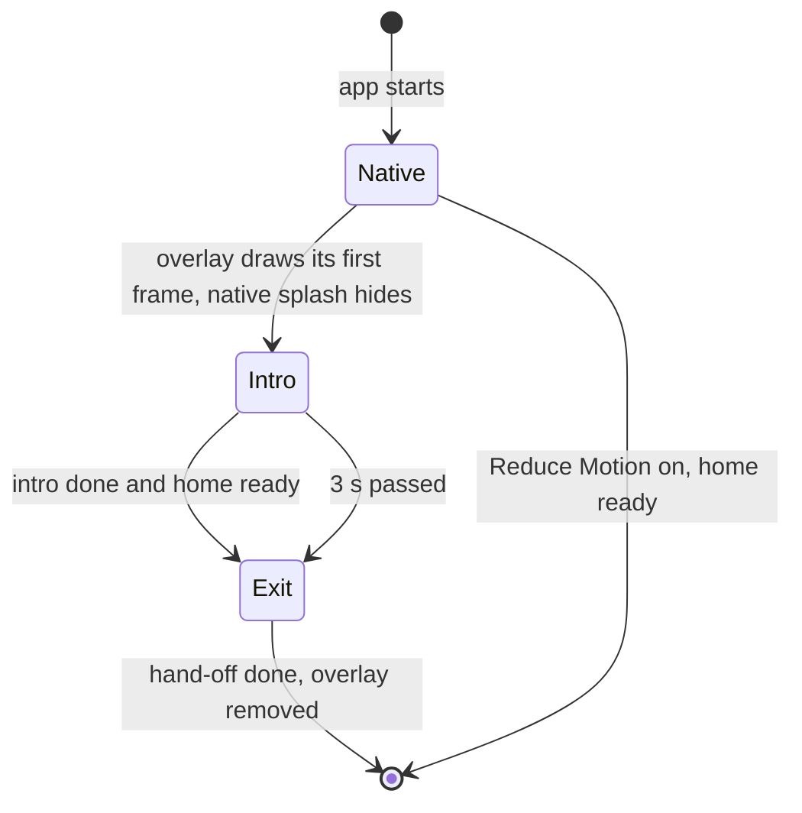

# Animated Splash Implementation Plan

> **For agentic workers:** REQUIRED SUB-SKILL: Use superpowers:subagent-driven-development (recommended) or superpowers:executing-plans to implement this plan task-by-task. Steps use checkbox (`- [ ]`) syntax for tracking.

**Goal:** Replace the still splash with the approved animation "Soft wave, softer": the letters of "Sudoku" rise in, a soft wave of grid cells rises from the bottom, and the word glides into the title of the home screen.

**Architecture:** The native splash shows only a plain ground colour (white in light mode, near black in dark mode). A `SplashOverlay` at the top of `RootLayout` draws the same ground, so its first frame equals the native splash. The overlay draws the cells in one Skia `Picture` and the letters as Reanimated text. Two clocks drive it: an intro that runs at once and an exit that starts when the intro is done and the home reports that it is ready. The overlay never takes a touch. With Reduce Motion on, there is no overlay.

**Tech Stack:** Expo SDK 57 (`expo-splash-screen` 57.0.9), React Native 0.86, Reanimated 4.5.1, Skia 2.6.2, Unistyles 3.5, Jest with `@testing-library/react-native` 13.3.

**Spec:** GitHub issue [#93](https://github.com/vandemaelefelix/sudoku/issues/93) (animate the splash screen). The approved design is "Soft wave, softer" in the design study artifact `https://claude.ai/artifact/74zFDfn8cnVjL39nQ4MX1x` (private to the developer). Task 1 writes the design into `docs/architecture/00-concepts/splash-screen.md` and `docs/architecture/adr/adr-023-animated-splash.md`, so the repository keeps it.

## Global Constraints

- Rules in `AGENTS.md` and `apps/mobile/AGENTS.md` apply: folder layout, `@/` imports, `index.ts` re-exports only, no `../`.
- Obey the lint rules in `.dependency-cruiser.cjs`: a `*.utils.ts` and a `*.constants.ts` file import no React, no React Native, no component, no hook and no screen. A `*.constants.ts` file imports only other constants and types. A `*.styles.ts` file imports only `react-native`, `react-native-unistyles` and `src/theme/`.
- Write no colour value outside `src/theme/` (ADR-015). Hex values go in `src/theme/splash.colors.ts`.
- A worklet captures its outside values when it is defined. Put each helper above the worklet that uses it. An imported value is always safe.
- Do not edit `ios/` or `android/` (ADR-002). Native config goes in `app.json`.
- `expo-splash-screen` for SDK 57: call `SplashScreen.preventAutoHideAsync()` in the global scope, without awaiting. Hide with `SplashScreen.hide()`.
- `tsconfig.base.json` sets `noUncheckedIndexedAccess` and `exactOptionalPropertyTypes`. An optional prop that can receive `undefined` is typed `x?: T | undefined`.
- Comments, docs and commit messages follow the Simplified Technical English rules in `AGENTS.md`. A comment names the reason. It points to `ADR-023` or the concept, never to an issue.
- Commits: Conventional Commits with `(#93)`. Do not push or open a pull request until the developer asks.
- Branch: from `origin/develop`, named `feature/93-animated-splash`.
- Before done: `just lint`, `just typecheck`, `just test-ts` and `just docs-check` pass.

## Review Focus

1. **The home is late, or never signals.** The exit must start after `MAX_WAIT_MS` (3000 ms) even when no screen calls `useSplashReady`. A deep link opens a screen other than the home. Task 4 tests the time limit. Task 6 signals ready for every route other than `/`.
2. **Reduce Motion is on.** No overlay shows. The native splash hides when the first screen is ready. Task 4 tests the provider. Task 5 tests that the overlay renders nothing.
3. **The system is in dark mode.** The native splash ground and the overlay ground must be the same colour, or the first frame jumps. Task 3 tests that `app.json` uses the `SPLASH_COLORS` values.
4. **The player chose a theme with another title font and size.** The word must end exactly on the home title. Progressive has a 26 pt bold serif. Daylight has a 22 pt system font. Task 5 tests that the letters use the title role of the theme. Task 2 tests that the title origin equals the place that `HomeMenu` uses.
5. **A tap during the splash.** The overlay must pass touches to the home. Task 5 tests `pointerEvents="none"`.
6. **Other screen sizes.** The cell grid must cover a 375 × 667, a 390 × 844 and a 430 × 932 window, and every cell under the title must clear before the hand-off. Task 2 tests these three sizes.

---

## File Structure

| File | Change | Responsibility |
| --- | --- | --- |
| `docs/architecture/00-concepts/splash-screen.md` | Create | The concept: why, what, diagram, open questions, constraints |
| `docs/architecture/adr/adr-023-animated-splash.md` | Create | The decision. Supersedes decision 5 of ADR-022 |
| `docs/architecture/00-DECISIONS.md`, `09-architecture-decisions.md`, `12-glossary.md` | Modify | Index rows and glossary terms |
| `apps/mobile/AGENTS.md` | Modify | Add `src/splash/` to the feature folders |
| `apps/mobile/src/utils/motion.utils.ts` | Modify | Add `easeInOut` |
| `apps/mobile/src/splash/constants/splash.constants.ts` | Create | Every time and size of the splash |
| `apps/mobile/src/splash/utils/splash.utils.ts` | Create | The pure functions: grid, glow, letter rise, glide, fades |
| `apps/mobile/src/theme/splash.colors.ts` | Create | The splash colours for light and dark mode |
| `apps/mobile/app.json`, `app.config.test.ts` | Modify | Plain native splash. Test that it matches `SPLASH_COLORS` |
| `scripts/icons/icons.mjs`, `scripts/icons/icons.test.mjs`, `justfile` | Modify | Stop generating `splash-light.png` |
| `apps/mobile/assets/icons/splash/splash-light.png` | Delete | No longer used |
| `apps/mobile/jest.setup.ts` | Modify | Mock `expo-splash-screen` |
| `apps/mobile/src/splash/hooks/useSplash/` | Create | The context, `useSplash` and `useSplashReady` |
| `apps/mobile/src/splash/components/SplashProvider/` | Create | The timers and the phase |
| `apps/mobile/src/splash/components/SplashCells/` | Create | The Skia picture of the cells |
| `apps/mobile/src/splash/components/SplashWord/` | Create | The letters and the glide |
| `apps/mobile/src/splash/components/SplashOverlay/` | Create | The overlay: ground, cells, word. Hides the native splash |
| `apps/mobile/src/splash/components/SplashRouteReady/` | Create | Signals ready outside the home route |
| `apps/mobile/src/app/_layout.tsx` | Modify | Mount the provider and the overlay |
| `apps/mobile/src/home/components/HomeMenu/HomeMenu.tsx` | Modify | Signal ready |

---

### Task 1: Write the concept and the ADR

**Files:**
- Create: `docs/architecture/00-concepts/splash-screen.md`
- Create: `docs/architecture/adr/adr-023-animated-splash.md`
- Modify: `docs/architecture/00-DECISIONS.md`, `docs/architecture/09-architecture-decisions.md`, `docs/architecture/12-glossary.md`, `apps/mobile/AGENTS.md`

**Interfaces:**
- Consumes: nothing.
- Produces: the names that the code uses: **splash overlay**, **splash ground**, **hand-off**, **intro**, **exit**. Later tasks cite `ADR-023` and the concept.

- [ ] **Step 1: Create the branch**

```bash
git fetch origin
git switch -c feature/93-animated-splash origin/develop
```

Expected: `Switched to a new branch 'feature/93-animated-splash'`.

- [ ] **Step 2: Write the concept**

Create `docs/architecture/00-concepts/splash-screen.md`:

````markdown
---
status: DRAFT
concept: splash-screen
---

# Splash screen

## Why

The splash screen is the first thing the player sees. The old splash was a still image of the app
icon. It looked like a logo, and it ended with a jump to the home screen. The new splash is a short
animation in the style of the app. It ends on the home screen without a jump.

## What

The native splash shows only the **splash ground**: white in light mode, near black in dark mode.
The native layer cannot read the saved theme, so the splash ground follows the system appearance.

A **splash overlay** above the app draws the same ground. Its first frame equals the native splash.
The overlay then plays the animation "Soft wave, softer".

| Part | Time | What the player sees |
| --- | --- | --- |
| Hold | 0 to 250 ms | The plain ground |
| Letters | 250 to 925 ms | The six letters of "Sudoku" rise in, 45 ms apart, in the title font of the theme |
| Wave | exit 0 to about 1320 ms | A wave of aligned cells rises from the bottom row to the top row. A cell glows for 600 ms and then clears. The start of each cell is up to 120 ms off its row |
| Glide | exit 150 to 900 ms | The word glides up and shrinks to half its size, onto the title of the home screen. Its colour changes to the title colour of the theme |
| Ground | exit 100 to 800 ms | The ground fades and shows the home screen |
| Hand-off | exit 1350 to 1450 ms | The word fades out. The real title is under it, at the same place |

The **intro** is the hold and the letters. It runs at once. The **exit** is the wave, the glide, the
ground fade and the hand-off. It starts when the intro is done and the home screen is ready. It also
starts after 3 seconds if no screen is ready. The overlay passes every touch to the screen below.

The cells are the cells of the game grid: 9 columns across the width of the window. A cell has the
tint of the finish pulse and the pale cell lines. It has no box lines.



With Reduce Motion on, the app draws no overlay. The native splash hides when the first screen is
ready.

## Open questions

| Question | Decided by |
| --- | --- |
| The intro adds about 0.9 s on a fast phone. Is that acceptable? The hold of 250 ms is the first part to cut | The developer, after the iPhone check of #93 |
| Android 12 and later draw the app icon on a splash with no image. A transparent image may be needed | The first Android build |
| Should the menu items rise one by one as the wave passes? The menu fades in today | The developer, after the iPhone check of #93 |

## Constraints

| ID | Constraint |
| --- | --- |
| Never holds back | The overlay MUST NOT take a touch. The exit MUST start after 3 s without the home. |
| Reduce Motion | With Reduce Motion on, the app MUST show no splash animation. |
| First frame | The first frame of the overlay MUST equal the native splash. |
| Colour | A colour value MUST live in `src/theme/` (ADR-015). |
````

- [ ] **Step 3: Write the ADR**

Create `docs/architecture/adr/adr-023-animated-splash.md`:

````markdown
---
status: DRAFT
---

# ADR-023: An animated splash from the system appearance

| Field | Value |
| --- | --- |
| Project | Sudoku |
| Status | Proposed |
| Date | 2026-10-14 |
| Contact | Felix |
| Supersedes | Decision 5 of ADR-022 |

## Context

ADR-022 decision 5 keeps a still image of the app mark as the splash until #93. The developer does
not want the splash to look like a logo. A native splash is a static image. It cannot animate.
The JavaScript runtime needs time to start, and the player can save a theme that the native layer
cannot read.

## Alternatives Evaluated

| Option | For | Against |
| --- | --- | --- |
| The still mark of ADR-022 | No work | It looks like a logo. It ends with a jump |
| A Lottie file | The animation is data | A new dependency. The title font of the theme cannot match. A design tool is needed |
| Reanimated views for the cells | The same tool as the game grid | 189 animated views change on every frame |
| **A Skia picture for the cells and Reanimated text for the word** | One draw for all cells. The word is real text, so the font matches the home title. Both libraries are in the app | The cell drawing is code and not a design file |
| A native splash that follows the saved theme | The colours match the theme | The native config is fixed at build time |

## Decision

1. The native splash shows only a ground colour: `#ffffff` in light mode and `#0f1116` in dark
   mode. It has no image. The values live in `src/theme/splash.colors.ts`.
2. A `SplashOverlay` in `RootLayout` draws the same ground, then the animation "Soft wave, softer"
   (the splash concept).
3. The intro runs at once. The exit starts when the intro is done and the home reports ready, or
   after 3 seconds.
4. The overlay has `pointerEvents="none"`.
5. With Reduce Motion on, the app draws no overlay. The native splash hides when the home is ready.
6. The splash colours follow the system appearance. The word uses the title font of the saved theme.
   Its colour changes to the title colour during the glide.
7. This ADR supersedes decision 5 of ADR-022.

## Consequences

- The splash image `assets/icons/splash/splash-light.png` and its line in `scripts/icons/icons.mjs`
  go away. The icon and the favicon stay.
- The change needs a new native build, because `app.json` changes. `just ios-dev` and
  `just ios-release` run `expo prebuild --clean`.
- On a fast phone the intro adds about 0.9 s before the home is fully visible. The home is ready
  and takes touches earlier, because the overlay passes touches through.
- A light splash opens a Midnight home with a white-to-dark change during the wave. This is by
  design.
- Android is not built yet. Android 12 and later may draw the app icon on a splash with no image.

## Reassessment Triggers

- The first Android build draws the app icon on the splash: add a transparent splash image.
- The app needs more than 3 seconds to show the home on a normal phone.
- A fifth theme puts the title in another place than the top left corner.
- The developer finds the intro too slow: cut the hold, then shorten the letters.
````

- [ ] **Step 4: Update the indexes and the glossary**

In `docs/architecture/09-architecture-decisions.md`, add this row after the ADR-022 row. Add the words `Splash: ADR-023.` to the end of the ADR-022 decision text.

```markdown
| ADR-023 | An animated splash. The native splash is a plain ground. An overlay draws the cells with Skia and the letters with Reanimated, then hands off to the home title. Supersedes decision 5 of ADR-022 | Proposed | 2026-10-14 | [ADR-023](./adr/adr-023-animated-splash.md) |
```

In `docs/architecture/00-DECISIONS.md`, add this row after the ADR-022 row:

```markdown
| ADR-023 | An animated splash. The native splash is a plain ground, white or near black by the system appearance. A `SplashOverlay` plays "Soft wave, softer" and hands off to the home title. No overlay with Reduce Motion. Supersedes decision 5 of ADR-022. | Concept | 2026-10-14 | Felix | [ADR-023](adr/adr-023-animated-splash.md) |
```

In `docs/architecture/12-glossary.md`, add these rows at the end of the table:

```markdown
| Splash ground | The plain colour of the native splash and of the first frame of the splash overlay. White in light mode, near black in dark mode. It follows the system appearance, not the saved theme (ADR-023) |
| Splash overlay | The view at the top of `RootLayout` that draws the splash animation over the app. It passes every touch to the screen below (ADR-023) |
| Hand-off | The moment when the word of the splash overlay fades out and the real title of the home screen shows at the same place |
```

In `apps/mobile/AGENTS.md`, in the **Rules** list, add `` `src/splash/` (the animated splash) `` after `` `src/storage/` (game storage) ``. In the table row text under **Layout inside a feature**, add `src/splash/` to the list of feature folders.

- [ ] **Step 5: Check the links**

Run: `just docs-check`
Expected: `0 broken link(s)`

- [ ] **Step 6: Commit**

```bash
git add docs apps/mobile/AGENTS.md
git commit -m "docs(splash): add the splash concept and ADR-023 (#93)"
```

---

### Task 2: The splash constants and the pure functions

**Files:**
- Modify: `apps/mobile/src/utils/motion.utils.ts`, `apps/mobile/src/utils/motion.utils.test.ts`
- Create: `apps/mobile/src/splash/constants/splash.constants.ts`
- Create: `apps/mobile/src/splash/utils/splash.utils.ts`
- Test: `apps/mobile/src/splash/utils/splash.utils.test.ts`

**Interfaces:**
- Consumes: `easeOut(t)` from `@/utils/motion.utils`.
- Produces: `easeInOut(t)` in `motion.utils.ts`. In `splash.constants.ts`: `HOLD_MS`, `LETTER_COUNT`, `LETTER_STEP_MS`, `LETTER_RISE_MS`, `LETTER_RISE_BY`, `INTRO_END_MS`, `WORD`, `WORD_SCALE`, `GRID_COLUMNS`, `ROW_STEP_MS`, `JITTER_MS`, `GLOW_MS`, `GLOW_PEAK_AT`, `TINT_ALPHA`, `LINE_ALPHA`, `GROUND_FADE_START_MS`, `GROUND_FADE_END_MS`, `GLIDE_START_MS`, `GLIDE_MS`, `HANDOFF_AT_MS`, `HANDOFF_MS`, `EXIT_END_MS`, `MAX_WAIT_MS`. In `splash.utils.ts`: `cellJitter(i, j): number`, `splashGrid(width, height): SplashGrid`, `glow(sinceMs): number`, `letterRise(introMs, index): { opacity: number; translateY: number }`, `glide(exitMs): number`, `groundOpacity(exitMs): number`, `wordOpacity(exitMs): number`, `titleOrigin(space, insetsTop): { x: number; y: number }`, and the types `SplashCell` and `SplashGrid`.

- [ ] **Step 1: Write the failing test for `easeInOut`**

Append to `apps/mobile/src/utils/motion.utils.test.ts`, and add `easeInOut` to the import on line 1:

```ts
describe('easeInOut', () => {
  it('starts at 0, ends at 1 and passes 0.5 in the middle', () => {
    expect(easeInOut(0)).toBe(0)
    expect(easeInOut(1)).toBe(1)
    expect(easeInOut(0.5)).toBeCloseTo(0.5, 12)
  })

  it('is slow at the start and at the end', () => {
    expect(easeInOut(0.25)).toBeCloseTo(0.0625, 12)
    expect(easeInOut(0.75)).toBeCloseTo(0.9375, 12)
  })
})
```

- [ ] **Step 2: Run the test and see it fail**

Run (from `apps/mobile`): `pnpm exec jest src/utils/motion.utils.test.ts`
Expected: FAIL, `easeInOut is not a function`.

- [ ] **Step 3: Add `easeInOut`**

In `apps/mobile/src/utils/motion.utils.ts`, after `easeIn`:

```ts
/** The curve of a move across the screen: slow at the start and at the end. t and the result are 0..1. */
export function easeInOut(t: number): number {
  'worklet'
  return t < 0.5 ? 4 * t ** 3 : 1 - (-2 * t + 2) ** 3 / 2
}
```

- [ ] **Step 4: Run the test and see it pass**

Run: `pnpm exec jest src/utils/motion.utils.test.ts`
Expected: PASS.

- [ ] **Step 5: Write the constants**

Create `apps/mobile/src/splash/constants/splash.constants.ts`:

```ts
// The timing and the sizes of the splash. Times are in milliseconds. The design is in ADR-023 and the splash concept.
// The intro times count from the mount of the overlay. The exit times count from the start of the exit.

/** The plain ground before the first letter. */
export const HOLD_MS = 250

export const WORD = 'Sudoku'
export const LETTER_COUNT = 6
export const LETTER_STEP_MS = 45
export const LETTER_RISE_MS = 450

/** Points that a letter rises while it fades in, at the size of the splash word. */
export const LETTER_RISE_BY = 36

/** The intro ends when the last letter is at rest. */
export const INTRO_END_MS = HOLD_MS + (LETTER_COUNT - 1) * LETTER_STEP_MS + LETTER_RISE_MS

/** The splash word is this many times the size of the home title. */
export const WORD_SCALE = 2

export const GRID_COLUMNS = 9
export const ROW_STEP_MS = 30
export const JITTER_MS = 120
export const GLOW_MS = 600

/** The part of GLOW_MS at which a cell glows most. */
export const GLOW_PEAK_AT = 0.3
export const TINT_ALPHA = 0.28
export const LINE_ALPHA = 0.9

export const GROUND_FADE_START_MS = 100
export const GROUND_FADE_END_MS = 800
export const GLIDE_START_MS = 150
export const GLIDE_MS = 750

/** The word fades out here. Every cell under the title has cleared by then. */
export const HANDOFF_AT_MS = 1350
export const HANDOFF_MS = 100

/** The last frame of the exit. */
export const EXIT_END_MS = 1500

/** The exit starts after this time even when no screen is ready. */
export const MAX_WAIT_MS = 3000
```

- [ ] **Step 6: Write the failing tests for the pure functions**

Create `apps/mobile/src/splash/utils/splash.utils.test.ts`:

```ts
import { styles as menuStyles } from '@/home/components/HomeMenu/HomeMenu.styles'
import { daylight } from '@/theme/themes/daylight'
import {
  EXIT_END_MS,
  GLIDE_MS,
  GLIDE_START_MS,
  GLOW_MS,
  GROUND_FADE_END_MS,
  GROUND_FADE_START_MS,
  HANDOFF_AT_MS,
  HANDOFF_MS,
  HOLD_MS,
  INTRO_END_MS,
  LETTER_RISE_BY,
  LETTER_RISE_MS,
  LETTER_STEP_MS,
} from '@/splash/constants/splash.constants'
import {
  cellJitter,
  glide,
  glow,
  groundOpacity,
  letterRise,
  splashGrid,
  titleOrigin,
  wordOpacity,
} from './splash.utils'

describe('timing', () => {
  it('ends the intro when the last letter is at rest', () => {
    expect(INTRO_END_MS).toBe(925)
  })

  it('hands off after the glide and ends after the hand-off', () => {
    expect(GLIDE_START_MS + GLIDE_MS).toBeLessThan(HANDOFF_AT_MS)
    expect(HANDOFF_AT_MS + HANDOFF_MS).toBeLessThanOrEqual(EXIT_END_MS)
  })
})

describe('cellJitter', () => {
  it('gives the same value for the same cell, on every call', () => {
    expect(cellJitter(0, 0)).toBe(cellJitter(0, 0))
    expect(cellJitter(0, 0)).toBeCloseTo(0.6472863, 6)
    expect(cellJitter(1, 2)).toBeCloseTo(0.8430697, 6)
  })

  it('stays from 0 up to, not including, 1', () => {
    for (let j = -12; j <= 12; j++) {
      for (let i = -4; i <= 4; i++) {
        expect(cellJitter(i, j)).toBeGreaterThanOrEqual(0)
        expect(cellJitter(i, j)).toBeLessThan(1)
      }
    }
  })
})

describe('splashGrid', () => {
  it('fills a 390 × 844 window with 9 columns and 21 rows around the centre', () => {
    const { size, cells } = splashGrid(390, 844)
    expect(size).toBeCloseTo(43.3333, 4)
    expect(cells).toHaveLength(9 * 21)
    expect(Math.min(...cells.map((cell) => cell.i))).toBe(-4)
    expect(Math.max(...cells.map((cell) => cell.i))).toBe(4)
    expect(Math.min(...cells.map((cell) => cell.j))).toBe(-10)
    expect(Math.max(...cells.map((cell) => cell.j))).toBe(10)
  })

  it('covers the window on the other sizes', () => {
    expect(splashGrid(375, 667).cells).toHaveLength(9 * 17)
    expect(splashGrid(430, 932).cells).toHaveLength(9 * 21)
    for (const [width, height] of [
      [375, 667],
      [390, 844],
      [430, 932],
    ] as const) {
      const { size, cells } = splashGrid(width, height)
      const top = Math.min(...cells.map((cell) => height / 2 + (cell.j - 0.5) * size))
      const bottom = Math.max(...cells.map((cell) => height / 2 + (cell.j + 0.5) * size))
      expect(top).toBeLessThanOrEqual(0)
      expect(bottom).toBeGreaterThanOrEqual(height)
    }
  })

  it('starts the bottom row first and the top row last, with a jitter of up to 120 ms', () => {
    const { cells } = splashGrid(390, 844)
    const bottom = cells.filter((cell) => cell.j === 10).map((cell) => cell.delayMs)
    const top = cells.filter((cell) => cell.j === -10).map((cell) => cell.delayMs)
    expect(Math.max(...bottom)).toBeLessThan(120)
    expect(Math.min(...top)).toBeGreaterThanOrEqual(600)
    expect(Math.max(...top)).toBeLessThan(720)
  })

  it('gives the centre cell a fixed delay', () => {
    const centre = splashGrid(390, 844).cells.find((cell) => cell.i === 0 && cell.j === 0)
    expect(centre?.delayMs).toBeCloseTo(30 * 10 + 120 * 0.6472863, 3)
  })

  it('ends every cell before the exit ends, on every size', () => {
    for (const [width, height] of [
      [375, 667],
      [390, 844],
      [430, 932],
    ] as const) {
      const last = Math.max(...splashGrid(width, height).cells.map((cell) => cell.delayMs))
      expect(last + GLOW_MS).toBeLessThan(EXIT_END_MS)
    }
  })

  it('clears every cell under the title before the hand-off, on every size', () => {
    for (const [width, height, insetTop] of [
      [375, 667, 20],
      [390, 844, 59],
      [430, 932, 59],
    ] as const) {
      const { size, cells } = splashGrid(width, height)
      const titleTop = insetTop + 32
      const titleBottom = titleTop + 34
      const under = cells.filter((cell) => {
        const centre = height / 2 + cell.j * size
        return centre + size / 2 > titleTop && centre - size / 2 < titleBottom
      })
      expect(under.length).toBeGreaterThan(0)
      expect(Math.max(...under.map((cell) => cell.delayMs + GLOW_MS))).toBeLessThan(HANDOFF_AT_MS)
    }
  })
})

describe('glow', () => {
  it('is 0 before the start and after the end', () => {
    expect(glow(-5)).toBe(0)
    expect(glow(0)).toBe(0)
    expect(glow(GLOW_MS)).toBe(0)
    expect(glow(GLOW_MS + 100)).toBe(0)
  })

  it('peaks at 30 % of the time and falls on both sides', () => {
    expect(glow(GLOW_MS * 0.3)).toBeCloseTo(1, 12)
    expect(glow(GLOW_MS * 0.15)).toBeCloseTo(Math.SQRT1_2, 12)
    expect(glow(GLOW_MS * 0.65)).toBeCloseTo(Math.SQRT1_2, 12)
  })
})

describe('letterRise', () => {
  it('keeps a letter hidden and low until its turn', () => {
    expect(letterRise(0, 0)).toEqual({ opacity: 0, translateY: LETTER_RISE_BY })
    expect(letterRise(HOLD_MS + 5 * LETTER_STEP_MS, 5)).toEqual({ opacity: 0, translateY: LETTER_RISE_BY })
  })

  it('puts every letter at rest when the intro ends', () => {
    for (let index = 0; index < 6; index++) {
      expect(letterRise(INTRO_END_MS, index)).toEqual({ opacity: 1, translateY: 0 })
    }
  })

  it('moves a letter most of the way in half of its time', () => {
    const half = letterRise(HOLD_MS + LETTER_RISE_MS / 2, 0)
    expect(half.opacity).toBeCloseTo(0.96875, 12)
    expect(half.translateY).toBeCloseTo(LETTER_RISE_BY * 0.03125, 12)
  })

  it('starts each letter 45 ms after the one before it', () => {
    expect(letterRise(HOLD_MS + LETTER_STEP_MS, 1).opacity).toBe(0)
    expect(letterRise(HOLD_MS + LETTER_STEP_MS + 1, 1).opacity).toBeGreaterThan(0)
  })
})

describe('glide, groundOpacity and wordOpacity', () => {
  it('holds the word in the middle until the glide starts and at the title after it ends', () => {
    expect(glide(0)).toBe(0)
    expect(glide(GLIDE_START_MS)).toBe(0)
    expect(glide(GLIDE_START_MS + GLIDE_MS / 2)).toBeCloseTo(0.5, 12)
    expect(glide(GLIDE_START_MS + GLIDE_MS)).toBe(1)
    expect(glide(EXIT_END_MS)).toBe(1)
  })

  it('fades the ground from 100 ms to 800 ms', () => {
    expect(groundOpacity(0)).toBe(1)
    expect(groundOpacity(GROUND_FADE_START_MS)).toBe(1)
    expect(groundOpacity((GROUND_FADE_START_MS + GROUND_FADE_END_MS) / 2)).toBeCloseTo(0.5, 12)
    expect(groundOpacity(GROUND_FADE_END_MS)).toBe(0)
  })

  it('fades the word out in the 100 ms of the hand-off', () => {
    expect(wordOpacity(HANDOFF_AT_MS)).toBe(1)
    expect(wordOpacity(HANDOFF_AT_MS + HANDOFF_MS / 2)).toBeCloseTo(0.5, 12)
    expect(wordOpacity(HANDOFF_AT_MS + HANDOFF_MS)).toBe(0)
  })
})

describe('titleOrigin', () => {
  it('puts the title at the left space and below the top inset', () => {
    expect(titleOrigin(daylight.space, 59)).toEqual({ x: 16, y: 59 + 32 })
  })

  it('matches the place of the title in the home menu', () => {
    // The Unistyles mock reports zero insets.
    const origin = titleOrigin(daylight.space, 0)
    expect(menuStyles.screen).toMatchObject({ paddingTop: origin.y, paddingHorizontal: origin.x })
  })
})
```

- [ ] **Step 7: Run the tests and see them fail**

Run: `pnpm exec jest src/splash/utils/splash.utils.test.ts`
Expected: FAIL, `Cannot find module './splash.utils'`.

- [ ] **Step 8: Write the pure functions**

Create `apps/mobile/src/splash/utils/splash.utils.ts`:

```ts
import {
  GLIDE_MS,
  GLIDE_START_MS,
  GLOW_MS,
  GLOW_PEAK_AT,
  GRID_COLUMNS,
  GROUND_FADE_END_MS,
  GROUND_FADE_START_MS,
  HANDOFF_AT_MS,
  HANDOFF_MS,
  HOLD_MS,
  JITTER_MS,
  LETTER_RISE_BY,
  LETTER_RISE_MS,
  LETTER_STEP_MS,
  ROW_STEP_MS,
} from '@/splash/constants/splash.constants'
import type { Theme } from '@/theme/theme.types'
import { easeInOut, easeOut } from '@/utils/motion.utils'

/** 0..1: how far ms is from `from` to `to`. */
function ramp(ms: number, from: number, to: number): number {
  'worklet'
  return Math.min(1, Math.max(0, (ms - from) / (to - from)))
}

/** 0 up to, not including, 1. The same cell gets the same value on every launch, so the wave looks the same. */
export function cellJitter(i: number, j: number): number {
  'worklet'
  let h = Math.imul(i, 374761393) ^ Math.imul(j, 668265263) ^ Math.imul(10, 2246822519)
  h = Math.imul(h ^ (h >>> 13), 1274126177)
  h ^= h >>> 16
  return (h >>> 0) / 4294967296
}

/** i: columns from the centre cell. j: rows from the centre cell, down is positive. delayMs: when the cell starts to glow, after the start of the exit. */
export type SplashCell = { i: number; j: number; delayMs: number }

/** size: the side of a cell in points. */
export type SplashGrid = { size: number; cells: readonly SplashCell[] }

/**
 * Nine columns across the window. The centre cell is the middle of the window.
 * The wave starts at the bottom row and rises, so a lower row starts earlier.
 */
export function splashGrid(width: number, height: number): SplashGrid {
  const size = width / GRID_COLUMNS
  const half = Math.floor(GRID_COLUMNS / 2)
  const rows = Math.ceil(height / (2 * size) - 0.5)
  const cells: SplashCell[] = []
  for (let j = -rows; j <= rows; j++) {
    for (let i = -half; i <= half; i++) {
      cells.push({ i, j, delayMs: ROW_STEP_MS * (rows - j) + JITTER_MS * cellJitter(i, j) })
    }
  }
  return { size, cells }
}

/** 0..1: how much a cell glows, sinceMs after its start. It rises to a peak and falls to 0. The shape of the finish pulse. */
export function glow(sinceMs: number): number {
  'worklet'
  const u = sinceMs / GLOW_MS
  if (u <= 0 || u >= 1) return 0
  if (u < GLOW_PEAK_AT) return Math.sin((u / GLOW_PEAK_AT) * (Math.PI / 2))
  return Math.cos(((u - GLOW_PEAK_AT) / (1 - GLOW_PEAK_AT)) * (Math.PI / 2))
}

/** The opacity and the offset in points of one letter, introMs after the mount. index: 0 for the first letter. */
export function letterRise(introMs: number, index: number): { opacity: number; translateY: number } {
  'worklet'
  const start = HOLD_MS + index * LETTER_STEP_MS
  const t = easeOut(ramp(introMs, start, start + LETTER_RISE_MS))
  return { opacity: t, translateY: (1 - t) * LETTER_RISE_BY }
}

/** 0..1: the glide of the word from the middle of the window to the title. */
export function glide(exitMs: number): number {
  'worklet'
  return easeInOut(ramp(exitMs, GLIDE_START_MS, GLIDE_START_MS + GLIDE_MS))
}

/** 1 down to 0: the opacity of the splash ground. */
export function groundOpacity(exitMs: number): number {
  'worklet'
  return 1 - easeInOut(ramp(exitMs, GROUND_FADE_START_MS, GROUND_FADE_END_MS))
}

/** 1 down to 0: the opacity of the word in the hand-off. */
export function wordOpacity(exitMs: number): number {
  'worklet'
  return 1 - ramp(exitMs, HANDOFF_AT_MS, HANDOFF_AT_MS + HANDOFF_MS)
}

/** The top left corner of the home title. HomeMenu places the title here. A test keeps the two the same. */
export function titleOrigin(space: Theme['space'], insetsTop: number): { x: number; y: number } {
  return { x: space.lg, y: insetsTop + space.xxl }
}
```

- [ ] **Step 9: Run the tests and see them pass**

Run: `pnpm exec jest src/splash/utils/splash.utils.test.ts`
Expected: PASS, 18 tests. If the `titleOrigin` test for `menuStyles` fails because the mock reports other insets, change the test to use `menuStyles.screen.paddingTop - origin.y` equal to the inset that the mock gives, and keep `paddingHorizontal` equal to `origin.x`.

- [ ] **Step 10: Commit**

```bash
git add apps/mobile/src/utils apps/mobile/src/splash
git commit -m "feat(splash): add the splash timing and the pure functions (#93)"
```

---

### Task 3: The plain native splash

**Files:**
- Create: `apps/mobile/src/theme/splash.colors.ts`
- Modify: `apps/mobile/app.json`, `apps/mobile/app.config.test.ts`
- Modify: `scripts/icons/icons.mjs`, `scripts/icons/icons.test.mjs`, `justfile`
- Delete: `apps/mobile/assets/icons/splash/splash-light.png`

**Interfaces:**
- Consumes: nothing.
- Produces: `SPLASH_COLORS` and the type `SplashScheme` from `@/theme/splash.colors`. Shape: `{ light: { ground, word, tint, line }, dark: { ground, word, tint, line } }`, every value a hex string.

- [ ] **Step 1: Write the colours**

Create `apps/mobile/src/theme/splash.colors.ts`:

```ts
/**
 * The colours of the splash, in light and dark mode. The native layer cannot read the saved theme,
 * so the splash follows the system appearance (ADR-023). The values come from the Op-art and Midnight palettes.
 * ground is also the native splash colour in app.json: a test keeps the two the same.
 */
export const SPLASH_COLORS = {
  light: { ground: '#ffffff', word: '#0f1d5c', tint: '#1f3fd1', line: '#d3d9f7' },
  dark: { ground: '#0f1116', word: '#e7e9ef', tint: '#84a0ff', line: '#272b35' },
} as const

export type SplashScheme = keyof typeof SPLASH_COLORS
```

- [ ] **Step 2: Write the failing test**

In `apps/mobile/app.config.test.ts`, add the import `import { SPLASH_COLORS } from '@/theme/splash.colors'` below the other imports. Add this test inside `describe('variantConfig', …)`, before `it('stops when the base config has no bundle identifier'`:

```ts
  it('gives the native splash only a ground colour, the same as the splash overlay', () => {
    type SplashOptions = { backgroundColor?: string; image?: string; dark?: { backgroundColor?: string; image?: string } }
    const entry = (base.plugins ?? []).find((plugin) => Array.isArray(plugin) && plugin[0] === 'expo-splash-screen')
    const options = (entry as [string, SplashOptions] | undefined)?.[1]
    expect(options?.backgroundColor).toBe(SPLASH_COLORS.light.ground)
    expect(options?.dark?.backgroundColor).toBe(SPLASH_COLORS.dark.ground)
    expect(options?.image).toBeUndefined()
    expect(options?.dark?.image).toBeUndefined()
  })
```

- [ ] **Step 3: Run the test and see it fail**

Run (from `apps/mobile`): `pnpm exec jest app.config.test.ts`
Expected: FAIL on the new test. The `image` is still set and the dark colour is missing.

- [ ] **Step 4: Change `app.json`**

Replace the `expo-splash-screen` plugin entry with:

```json
      [
        "expo-splash-screen",
        {
          "backgroundColor": "#ffffff",
          "dark": {
            "backgroundColor": "#0f1116"
          }
        }
      ],
```

- [ ] **Step 5: Stop generating the splash image**

In `scripts/icons/icons.mjs`, delete the line that builds `splash/splash-light.png`. Change the doc comment above `buildIcons` to read `/** Every PNG of the app icon and the favicon (ADR-022). */`.

In `scripts/icons/icons.test.mjs`, delete the line `'splash/splash-light.png',` from `expected`.

In `justfile`, change the comment above `icons` to `# Render every app icon and favicon PNG into apps/mobile/assets/icons (ADR-022)`.

Delete the image:

```bash
git rm apps/mobile/assets/icons/splash/splash-light.png
```

- [ ] **Step 6: Run the tests and see them pass**

Run: `pnpm exec jest app.config.test.ts` (from `apps/mobile`)
Expected: PASS. The test `points every image of both variants at a file that exists` still passes, because no splash path is left.

Run: `node --test 'scripts/icons/*.test.mjs'` (from the repository root)
Expected: PASS.

- [ ] **Step 7: Commit**

```bash
git add apps/mobile/app.json apps/mobile/app.config.test.ts apps/mobile/src/theme/splash.colors.ts scripts/icons justfile
git commit -m "feat(splash): make the native splash a plain ground (#93)"
```

---

### Task 4: The splash state

**Files:**
- Modify: `apps/mobile/jest.setup.ts`
- Create: `apps/mobile/src/splash/hooks/useSplash/useSplash.ts`, `apps/mobile/src/splash/hooks/useSplash/index.ts`
- Create: `apps/mobile/src/splash/components/SplashProvider/SplashProvider.tsx`, `apps/mobile/src/splash/components/SplashProvider/index.ts`
- Test: `apps/mobile/src/splash/components/SplashProvider/SplashProvider.test.tsx`

**Interfaces:**
- Consumes: `INTRO_END_MS`, `EXIT_END_MS`, `MAX_WAIT_MS` from `@/splash/constants/splash.constants`. `useReducedMotion` from `react-native-reanimated`.
- Produces: `type SplashPhase = 'intro' | 'exit' | 'done'`. `type SplashState = { phase: SplashPhase; markReady(): void }`. `SplashContext`. `useSplash(): SplashState`. `useSplashReady(ready: boolean): void`. `<SplashProvider>{children}</SplashProvider>`.

- [ ] **Step 1: Mock `expo-splash-screen`**

In `apps/mobile/jest.setup.ts`, after the `expo-haptics` mock, add:

```ts
jest.mock('expo-splash-screen', () => ({
  preventAutoHideAsync: jest.fn(async () => true),
  hide: jest.fn(),
  hideAsync: jest.fn(async () => undefined),
}))
```

- [ ] **Step 2: Write the failing tests**

Create `apps/mobile/src/splash/components/SplashProvider/SplashProvider.test.tsx`:

```tsx
import { act, render, screen } from '@testing-library/react-native'
import * as SplashScreen from 'expo-splash-screen'
import { Text } from 'react-native'
import { useReducedMotion } from 'react-native-reanimated'
import { EXIT_END_MS, INTRO_END_MS, MAX_WAIT_MS } from '@/splash/constants/splash.constants'
import { useSplash, useSplashReady } from '@/splash/hooks/useSplash'
import { SplashProvider } from './SplashProvider'

function Probe({ ready }: { ready: boolean }) {
  useSplashReady(ready)
  return <Text testID="phase">{useSplash().phase}</Text>
}

const phase = () => screen.getByTestId('phase').props.children
const advance = (ms: number) =>
  act(() => {
    jest.advanceTimersByTime(ms)
  })

beforeEach(() => {
  jest.useFakeTimers()
  jest.mocked(useReducedMotion).mockReturnValue(false)
  jest.mocked(SplashScreen.hide).mockClear()
})

afterEach(() => {
  jest.useRealTimers()
})

it('stays in the intro after the intro is done while the home is not ready', () => {
  render(
    <SplashProvider>
      <Probe ready={false} />
    </SplashProvider>,
  )
  advance(INTRO_END_MS + 10)
  expect(phase()).toBe('intro')
})

it('starts the exit when the intro is done and the home is ready', () => {
  render(
    <SplashProvider>
      <Probe ready />
    </SplashProvider>,
  )
  advance(INTRO_END_MS - 1)
  expect(phase()).toBe('intro')
  advance(1)
  expect(phase()).toBe('exit')
})

it('starts the exit after the time limit when no screen is ready', () => {
  render(
    <SplashProvider>
      <Probe ready={false} />
    </SplashProvider>,
  )
  advance(MAX_WAIT_MS - 1)
  expect(phase()).toBe('intro')
  advance(1)
  expect(phase()).toBe('exit')
})

it('is done when the exit ends', () => {
  render(
    <SplashProvider>
      <Probe ready />
    </SplashProvider>,
  )
  advance(INTRO_END_MS)
  expect(phase()).toBe('exit')
  advance(EXIT_END_MS)
  expect(phase()).toBe('done')
})

it('with Reduce Motion, is done at once and hides the native splash when the home is ready', () => {
  jest.mocked(useReducedMotion).mockReturnValue(true)
  const { rerender } = render(
    <SplashProvider>
      <Probe ready={false} />
    </SplashProvider>,
  )
  expect(phase()).toBe('done')
  expect(SplashScreen.hide).not.toHaveBeenCalled()
  rerender(
    <SplashProvider>
      <Probe ready />
    </SplashProvider>,
  )
  expect(SplashScreen.hide).toHaveBeenCalledTimes(1)
})
```

- [ ] **Step 3: Run the tests and see them fail**

Run (from `apps/mobile`): `pnpm exec jest src/splash/components/SplashProvider`
Expected: FAIL, `Cannot find module '@/splash/hooks/useSplash'`.

- [ ] **Step 4: Write the context and the hooks**

Create `apps/mobile/src/splash/hooks/useSplash/useSplash.ts`:

```ts
import { createContext, use, useEffect } from 'react'

export type SplashPhase = 'intro' | 'exit' | 'done'

export type SplashState = { phase: SplashPhase; markReady(): void }

// Without a provider, in a test for example, the splash is done and ignores the signal.
export const SplashContext = createContext<SplashState>({ phase: 'done', markReady: () => undefined })

export function useSplash(): SplashState {
  return use(SplashContext)
}

/** Tell the splash that the first screen is ready. The exit of the splash waits for this. */
export function useSplashReady(ready: boolean): void {
  const { markReady } = useSplash()
  useEffect(() => {
    if (ready) markReady()
  }, [ready, markReady])
}
```

Create `apps/mobile/src/splash/hooks/useSplash/index.ts`:

```ts
export { SplashContext, useSplash, useSplashReady, type SplashPhase, type SplashState } from './useSplash'
```

- [ ] **Step 5: Write the provider**

Create `apps/mobile/src/splash/components/SplashProvider/SplashProvider.tsx`:

```tsx
import * as SplashScreen from 'expo-splash-screen'
import { useCallback, useEffect, useMemo, useState, type ReactNode } from 'react'
import { useReducedMotion } from 'react-native-reanimated'
import { EXIT_END_MS, INTRO_END_MS, MAX_WAIT_MS } from '@/splash/constants/splash.constants'
import { SplashContext, type SplashPhase } from '@/splash/hooks/useSplash'

// Expo wants this call in the global scope, before the first render. It keeps the native splash until the overlay hides it.
SplashScreen.preventAutoHideAsync().catch(() => undefined)

/**
 * Owns the phase of the splash: the intro runs at once. The exit starts when the intro is done and a screen calls
 * markReady, or after MAX_WAIT_MS. With Reduce Motion the phase is done from the start (ADR-023).
 */
export function SplashProvider({ children }: { children: ReactNode }) {
  const reduced = useReducedMotion()
  const [ready, setReady] = useState(false)
  const [introDone, setIntroDone] = useState(false)
  const [finished, setFinished] = useState(false)
  const markReady = useCallback(() => setReady(true), [])

  useEffect(() => {
    const id = setTimeout(markReady, MAX_WAIT_MS)
    return () => clearTimeout(id)
  }, [markReady])

  useEffect(() => {
    const id = setTimeout(() => setIntroDone(true), INTRO_END_MS)
    return () => clearTimeout(id)
  }, [])

  const phase: SplashPhase = reduced || finished ? 'done' : ready && introDone ? 'exit' : 'intro'

  useEffect(() => {
    if (phase !== 'exit') return
    const id = setTimeout(() => setFinished(true), EXIT_END_MS)
    return () => clearTimeout(id)
  }, [phase])

  // There is no overlay to hide the native splash, so the first screen does it.
  useEffect(() => {
    if (reduced && ready) SplashScreen.hide()
  }, [reduced, ready])

  const value = useMemo(() => ({ phase, markReady }), [phase, markReady])
  return <SplashContext value={value}>{children}</SplashContext>
}
```

Create `apps/mobile/src/splash/components/SplashProvider/index.ts`:

```ts
export { SplashProvider } from './SplashProvider'
```

- [ ] **Step 6: Run the tests and see them pass**

Run: `pnpm exec jest src/splash/components/SplashProvider`
Expected: PASS, 5 tests.

- [ ] **Step 7: Commit**

```bash
git add apps/mobile/jest.setup.ts apps/mobile/src/splash
git commit -m "feat(splash): add the splash phase and the ready signal (#93)"
```

---

### Task 5: The overlay

**Files:**
- Create: `apps/mobile/src/splash/components/SplashCells/SplashCells.tsx`, `index.ts`, `SplashCells.test.tsx`
- Create: `apps/mobile/src/splash/components/SplashWord/SplashWord.tsx`, `SplashWord.styles.ts`, `index.ts`, `SplashWord.test.tsx`
- Create: `apps/mobile/src/splash/components/SplashOverlay/SplashOverlay.tsx`, `index.ts`, `SplashOverlay.test.tsx`

**Interfaces:**
- Consumes: `glow`, `splashGrid`, `letterRise`, `glide`, `groundOpacity`, `wordOpacity`, `titleOrigin` from `@/splash/utils/splash.utils`. All constants from `@/splash/constants/splash.constants`. `SPLASH_COLORS` from `@/theme/splash.colors`. `useSplash` from `@/splash/hooks/useSplash`. `roleText` from `@/theme/typography`.
- Produces: `<SplashCells exit width height tint line />`, `<SplashWord intro exit origin view color />`, `<SplashOverlay />`.

- [ ] **Step 1: Write the failing test for the cells**

Create `apps/mobile/src/splash/components/SplashCells/SplashCells.test.tsx`:

```tsx
import { createPicture } from '@shopify/react-native-skia'
import { render, screen } from '@testing-library/react-native'
import { useSharedValue } from 'react-native-reanimated'
import { SplashCells } from './SplashCells'

function Cells() {
  const exit = useSharedValue(500)
  return <SplashCells exit={exit} width={390} height={844} tint="#1f3fd1" line="#d3d9f7" />
}

it('draws the cells in one Skia picture that does not take touches', () => {
  render(<Cells />)
  expect(screen.getByTestId('skia-canvas').props.pointerEvents).toBe('none')
  expect(screen.getByTestId('skia-picture')).toBeTruthy()
  expect(createPicture).toHaveBeenCalled()
})
```

- [ ] **Step 2: Run the test and see it fail**

Run (from `apps/mobile`): `pnpm exec jest src/splash/components/SplashCells`
Expected: FAIL, `Cannot find module './SplashCells'`.

- [ ] **Step 3: Write the cells**

Create `apps/mobile/src/splash/components/SplashCells/SplashCells.tsx`:

```tsx
import { Canvas, PaintStyle, Picture, Skia, createPicture, type SkCanvas } from '@shopify/react-native-skia'
import { useMemo } from 'react'
import { StyleSheet } from 'react-native'
import { useDerivedValue, type SharedValue } from 'react-native-reanimated'
import { LINE_ALPHA, TINT_ALPHA } from '@/splash/constants/splash.constants'
import { glow, splashGrid } from '@/splash/utils/splash.utils'

type SplashCellsProps = {
  /** Milliseconds since the start of the exit. */
  exit: SharedValue<number>
  width: number
  height: number
  tint: string
  line: string
}

/** The wave of cells: a tint and the two pale lines of each cell, in one picture that the UI thread redraws on each frame. */
export function SplashCells({ exit, width, height, tint, line }: SplashCellsProps) {
  const grid = useMemo(() => splashGrid(width, height), [width, height])
  // A picture records a copy of a paint at each draw call, so one paint per layer is enough.
  const paints = useMemo(() => {
    const fill = Skia.Paint()
    fill.setColor(Skia.Color(tint))
    const stroke = Skia.Paint()
    stroke.setColor(Skia.Color(line))
    stroke.setStyle(PaintStyle.Stroke)
    stroke.setStrokeWidth(1)
    return { fill, stroke }
  }, [tint, line])

  const picture = useDerivedValue(() => {
    const ms = exit.get()
    return createPicture((canvas: SkCanvas) => {
      'worklet'
      for (const { i, j, delayMs } of grid.cells) {
        const k = glow(ms - delayMs)
        if (k < 0.004) continue
        const x = width / 2 + (i - 0.5) * grid.size
        const y = height / 2 + (j - 0.5) * grid.size
        paints.fill.setAlphaf(TINT_ALPHA * k)
        canvas.drawRect(Skia.XYWHRect(x + 0.5, y + 0.5, grid.size - 1, grid.size - 1), paints.fill)
        paints.stroke.setAlphaf(LINE_ALPHA * k)
        canvas.drawLine(x, y, x + grid.size, y, paints.stroke)
        canvas.drawLine(x, y, x, y + grid.size, paints.stroke)
      }
    })
  })

  return (
    <Canvas style={StyleSheet.absoluteFill} pointerEvents="none">
      <Picture picture={picture} />
    </Canvas>
  )
}
```

Create `apps/mobile/src/splash/components/SplashCells/index.ts`:

```ts
export { SplashCells } from './SplashCells'
```

- [ ] **Step 4: Run the test and see it pass**

Run: `pnpm exec jest src/splash/components/SplashCells`
Expected: PASS.

- [ ] **Step 5: Write the failing test for the word**

Create `apps/mobile/src/splash/components/SplashWord/SplashWord.test.tsx`:

```tsx
import { render, screen } from '@testing-library/react-native'
import { StyleSheet } from 'react-native'
import { useSharedValue } from 'react-native-reanimated'
import { daylight } from '@/theme/themes/daylight'
import { SplashWord } from './SplashWord'

function Word() {
  const intro = useSharedValue(925)
  const exit = useSharedValue(0)
  return (
    <SplashWord intro={intro} exit={exit} origin={{ x: 16, y: 91 }} view={{ width: 390, height: 844 }} color="#0f1d5c" />
  )
}

it('draws the six letters of the word', () => {
  render(<Word />)
  for (const letter of ['S', 'd', 'o', 'k']) expect(screen.getAllByText(letter)).toHaveLength(1)
  expect(screen.getAllByText('u')).toHaveLength(2)
})

it('sets each letter in the title role of the theme, so the word ends on the home title', () => {
  render(<Word />)
  const style = StyleSheet.flatten(screen.getByText('S').props.style)
  expect(style).toMatchObject({ fontFamily: daylight.type.title.family, fontSize: daylight.type.title.scale })
})
```

- [ ] **Step 6: Run the test and see it fail**

Run: `pnpm exec jest src/splash/components/SplashWord`
Expected: FAIL, `Cannot find module './SplashWord'`.

- [ ] **Step 7: Write the word**

Create `apps/mobile/src/splash/components/SplashWord/SplashWord.styles.ts`:

```ts
import { StyleSheet } from 'react-native-unistyles'
import { roleText } from '@/theme/typography'

export const styles = StyleSheet.create((theme) => ({
  // The scale grows from the top left corner, which is the place of the home title.
  word: { position: 'absolute', flexDirection: 'row', transformOrigin: 'left top' },
  letter: roleText(theme.type.title),
}))
```

Create `apps/mobile/src/splash/components/SplashWord/SplashWord.tsx`:

```tsx
import { useState } from 'react'
import type { LayoutChangeEvent } from 'react-native'
import Animated, { interpolateColor, useAnimatedStyle, type SharedValue } from 'react-native-reanimated'
import { useUnistyles } from 'react-native-unistyles'
import { WORD, WORD_SCALE } from '@/splash/constants/splash.constants'
import { glide, letterRise, wordOpacity } from '@/splash/utils/splash.utils'
import { styles } from './SplashWord.styles'

type SplashWordProps = {
  /** Milliseconds since the mount of the overlay. */
  intro: SharedValue<number>
  /** Milliseconds since the start of the exit. */
  exit: SharedValue<number>
  /** The top left corner of the home title. */
  origin: { x: number; y: number }
  /** The size of the window in points. */
  view: { width: number; height: number }
  /** The colour of the word before the glide. It changes to the title colour of the theme. */
  color: string
}

function Letter({
  char,
  index,
  intro,
  exit,
  from,
  to,
}: {
  char: string
  index: number
  intro: SharedValue<number>
  exit: SharedValue<number>
  from: string
  to: string
}) {
  const style = useAnimatedStyle(() => {
    const { opacity, translateY } = letterRise(intro.get(), index)
    return { opacity, color: interpolateColor(glide(exit.get()), [0, 1], [from, to]), transform: [{ translateY }] }
  })
  return <Animated.Text style={[styles.letter, style]}>{char}</Animated.Text>
}

/**
 * The word, in the title font of the theme at WORD_SCALE times the size. It rises in letter by letter. In the exit it glides to the home title,
 * shrinks to the size of the title and changes its colour. Each letter is one Text, so a letter can rise alone.
 * A measure of the row places it, so the word starts in the middle of the window.
 */
export function SplashWord({ intro, exit, origin, view, color }: SplashWordProps) {
  const { theme } = useUnistyles()
  const [size, setSize] = useState<{ w: number; h: number } | null>(null)
  const onLayout = (event: LayoutChangeEvent) => {
    const { width, height } = event.nativeEvent.layout
    setSize({ w: width, h: height })
  }
  const wordStyle = useAnimatedStyle(() => {
    // Hidden until the row is measured. The intro starts with a hold, so the measure is done before the first letter.
    if (size == null) return { opacity: 0 }
    const g = glide(exit.get())
    return {
      opacity: wordOpacity(exit.get()),
      transform: [
        { translateX: (view.width / 2 - origin.x - size.w) * (1 - g) },
        { translateY: (view.height / 2 - origin.y - size.h) * (1 - g) },
        { scale: 1 + (WORD_SCALE - 1) * (1 - g) },
      ],
    }
  })
  return (
    <Animated.View testID="splash-word" onLayout={onLayout} style={[styles.word, { left: origin.x, top: origin.y }, wordStyle]}>
      {WORD.split('').map((char, index) => (
        <Letter
          // The letters of the word never change, so the index is a stable key.
          key={`${char}${index}`}
          char={char}
          index={index}
          intro={intro}
          exit={exit}
          from={color}
          to={theme.colors.text}
        />
      ))}
    </Animated.View>
  )
}
```

Create `apps/mobile/src/splash/components/SplashWord/index.ts`:

```ts
export { SplashWord } from './SplashWord'
```

- [ ] **Step 8: Run the test and see it pass**

Run: `pnpm exec jest src/splash/components/SplashWord`
Expected: PASS. If `toMatchObject` fails because the Unistyles mock resolves `styles.letter` for the first registered theme, the first theme is Daylight, so `daylight` is the right value to compare.

- [ ] **Step 9: Write the failing test for the overlay**

Create `apps/mobile/src/splash/components/SplashOverlay/SplashOverlay.test.tsx`:

```tsx
import { act, fireEvent, render, screen } from '@testing-library/react-native'
import * as SplashScreen from 'expo-splash-screen'
import { SplashContext, type SplashPhase } from '@/splash/hooks/useSplash'
import { SplashOverlay } from './SplashOverlay'

function renderIn(phase: SplashPhase) {
  return render(
    <SplashContext value={{ phase, markReady: jest.fn() }}>
      <SplashOverlay />
    </SplashContext>,
  )
}

beforeEach(() => {
  jest.useFakeTimers()
  jest.mocked(SplashScreen.hide).mockClear()
})

afterEach(() => {
  jest.useRealTimers()
})

it('draws nothing when the splash is done', () => {
  renderIn('done')
  expect(screen.queryByTestId('splash-overlay')).toBeNull()
})

it('draws the ground, the cells and the word during the intro', () => {
  renderIn('intro')
  expect(screen.getByTestId('splash-overlay')).toBeTruthy()
  expect(screen.getByTestId('skia-canvas')).toBeTruthy()
  expect(screen.getByTestId('splash-word')).toBeTruthy()
})

it('passes every touch to the screen below', () => {
  renderIn('exit')
  expect(screen.getByTestId('splash-overlay').props.pointerEvents).toBe('none')
})

it('hides the native splash once, after the first layout', () => {
  renderIn('intro')
  const overlay = screen.getByTestId('splash-overlay')
  fireEvent(overlay, 'layout')
  fireEvent(overlay, 'layout')
  act(() => {
    jest.runAllTimers()
  })
  expect(SplashScreen.hide).toHaveBeenCalledTimes(1)
})
```

- [ ] **Step 10: Run the test and see it fail**

Run: `pnpm exec jest src/splash/components/SplashOverlay`
Expected: FAIL, `Cannot find module './SplashOverlay'`.

- [ ] **Step 11: Write the overlay**

Create `apps/mobile/src/splash/components/SplashOverlay/SplashOverlay.tsx`:

```tsx
import * as SplashScreen from 'expo-splash-screen'
import { useEffect, useRef } from 'react'
import { StyleSheet, useWindowDimensions, View } from 'react-native'
import Animated, { Easing, ReduceMotion, useAnimatedStyle, useSharedValue, withTiming } from 'react-native-reanimated'
import { useUnistyles } from 'react-native-unistyles'
import { SplashCells } from '@/splash/components/SplashCells'
import { SplashWord } from '@/splash/components/SplashWord'
import { EXIT_END_MS, INTRO_END_MS } from '@/splash/constants/splash.constants'
import { useSplash } from '@/splash/hooks/useSplash'
import { groundOpacity, titleOrigin } from '@/splash/utils/splash.utils'
import { SPLASH_COLORS } from '@/theme/splash.colors'

// Linear time: every part applies its own delay and curve. Never: with Reduce Motion the provider draws no overlay.
const linear = (to: number) => withTiming(to, { duration: to, easing: Easing.linear, reduceMotion: ReduceMotion.Never })

/**
 * The splash animation (ADR-023). It draws the splash ground first, so its first frame equals the native splash.
 * The intro clock starts at the mount. The exit clock starts when the provider says exit. The overlay takes no touch.
 */
export function SplashOverlay() {
  const { phase } = useSplash()
  const { theme, rt } = useUnistyles()
  const { width, height } = useWindowDimensions()
  const colors = SPLASH_COLORS[rt.colorScheme === 'dark' ? 'dark' : 'light']
  const intro = useSharedValue(0)
  const exit = useSharedValue(0)
  const hidden = useRef(false)

  useEffect(() => {
    intro.set(linear(INTRO_END_MS))
  }, [intro])

  useEffect(() => {
    if (phase === 'exit') exit.set(linear(EXIT_END_MS))
  }, [phase, exit])

  const groundStyle = useAnimatedStyle(() => ({ opacity: groundOpacity(exit.get()) }))

  // The first layout means the ground is on screen, so the native splash can go. A second frame is enough for Skia.
  const onLayout = () => {
    if (hidden.current) return
    hidden.current = true
    requestAnimationFrame(() => SplashScreen.hide())
  }

  if (phase === 'done') return null
  return (
    <View testID="splash-overlay" pointerEvents="none" style={StyleSheet.absoluteFill} onLayout={onLayout}>
      <Animated.View style={[StyleSheet.absoluteFill, { backgroundColor: colors.ground }, groundStyle]} />
      <SplashCells exit={exit} width={width} height={height} tint={colors.tint} line={colors.line} />
      <SplashWord
        intro={intro}
        exit={exit}
        origin={titleOrigin(theme.space, rt.insets.top)}
        view={{ width, height }}
        color={colors.word}
      />
    </View>
  )
}
```

Create `apps/mobile/src/splash/components/SplashOverlay/index.ts`:

```ts
export { SplashOverlay } from './SplashOverlay'
```

- [ ] **Step 12: Run the tests and see them pass**

Run: `pnpm exec jest src/splash`
Expected: PASS for every splash test file. If `rt.colorScheme` or `rt.insets` is not on the Unistyles mock runtime, the test run says so. Read it from `UnistylesRuntime` instead, the same way `useGridIntro` does with `UnistylesRuntime.getTheme()`.

- [ ] **Step 13: Typecheck**

Run (from the repository root): `just typecheck`
Expected: no errors.

- [ ] **Step 14: Commit**

```bash
git add apps/mobile/src/splash
git commit -m "feat(splash): add the splash overlay with the cells and the word (#93)"
```

---

### Task 6: Wire the overlay into the app

**Files:**
- Create: `apps/mobile/src/splash/components/SplashRouteReady/SplashRouteReady.tsx`, `index.ts`, `SplashRouteReady.test.tsx`
- Modify: `apps/mobile/src/app/_layout.tsx`
- Modify: `apps/mobile/src/home/components/HomeMenu/HomeMenu.tsx`
- Test: `apps/mobile/src/home/components/HomeMenu/HomeMenu.test.tsx`

**Interfaces:**
- Consumes: `SplashProvider`, `SplashOverlay`, `useSplashReady`, `SplashContext`.
- Produces: `<SplashRouteReady />`: renders nothing. It signals ready on every route except `/`.

- [ ] **Step 1: Write the failing test for the route signal**

Create `apps/mobile/src/splash/components/SplashRouteReady/SplashRouteReady.test.tsx`:

```tsx
import { render } from '@testing-library/react-native'
import { usePathname } from 'expo-router'
import { SplashContext } from '@/splash/hooks/useSplash'
import { SplashRouteReady } from './SplashRouteReady'

jest.mock('expo-router', () => ({ usePathname: jest.fn() }))

function renderAt(pathname: string) {
  jest.mocked(usePathname).mockReturnValue(pathname)
  const markReady = jest.fn()
  render(
    <SplashContext value={{ phase: 'intro', markReady }}>
      <SplashRouteReady />
    </SplashContext>,
  )
  return markReady
}

it('waits for the home menu on the home route', () => {
  expect(renderAt('/')).not.toHaveBeenCalled()
})

it('signals ready at once on any other route, for example after a link to a game', () => {
  expect(renderAt('/game')).toHaveBeenCalledTimes(1)
})
```

- [ ] **Step 2: Run the test and see it fail**

Run (from `apps/mobile`): `pnpm exec jest src/splash/components/SplashRouteReady`
Expected: FAIL, `Cannot find module './SplashRouteReady'`.

- [ ] **Step 3: Write the route signal**

Create `apps/mobile/src/splash/components/SplashRouteReady/SplashRouteReady.tsx`:

```tsx
import { usePathname } from 'expo-router'
import { useSplashReady } from '@/splash/hooks/useSplash'

/** The home menu tells the splash when it is ready. A link can open another screen first, and that screen has no such signal. */
export function SplashRouteReady() {
  useSplashReady(usePathname() !== '/')
  return null
}
```

Create `apps/mobile/src/splash/components/SplashRouteReady/index.ts`:

```ts
export { SplashRouteReady } from './SplashRouteReady'
```

- [ ] **Step 4: Run the test and see it pass**

Run: `pnpm exec jest src/splash/components/SplashRouteReady`
Expected: PASS.

- [ ] **Step 5: Write the failing test for the home signal**

Add to `apps/mobile/src/home/components/HomeMenu/HomeMenu.test.tsx`. Add the imports `import { SplashContext } from '@/splash/hooks/useSplash'` at the top, and this test at the end:

```tsx
it('tells the splash that it is ready when the store has answered, and not before', () => {
  const markReady = jest.fn()
  const props = { onNewGame: jest.fn(), onContinue: jest.fn(), onScan: jest.fn(), onSettings: jest.fn() }
  const { rerender } = render(
    <SplashContext value={{ phase: 'intro', markReady }}>
      <HomeMenu {...props} continueLevel={undefined} />
    </SplashContext>,
  )
  expect(markReady).not.toHaveBeenCalled()
  rerender(
    <SplashContext value={{ phase: 'intro', markReady }}>
      <HomeMenu {...props} continueLevel={null} />
    </SplashContext>,
  )
  expect(markReady).toHaveBeenCalledTimes(1)
})
```

- [ ] **Step 6: Run the test and see it fail**

Run: `pnpm exec jest src/home/components/HomeMenu`
Expected: FAIL on the new test. `markReady` is never called.

- [ ] **Step 7: Signal ready from the home menu**

In `apps/mobile/src/home/components/HomeMenu/HomeMenu.tsx`, add the import `import { useSplashReady } from '@/splash/hooks/useSplash'` with the other `@/` imports. In `HomeMenu`, add this line below `const menuStyle = …`:

```tsx
  // The menu shows once the store answers. The splash ends its exit when this is true.
  useSplashReady(continueLevel !== undefined)
```

- [ ] **Step 8: Run the tests and see them pass**

Run: `pnpm exec jest src/home src/splash`
Expected: PASS.

- [ ] **Step 9: Mount the provider and the overlay**

Replace `apps/mobile/src/app/_layout.tsx` with:

```tsx
import { Stack } from 'expo-router'
import { SplashOverlay } from '@/splash/components/SplashOverlay'
import { SplashProvider } from '@/splash/components/SplashProvider'
import { SplashRouteReady } from '@/splash/components/SplashRouteReady'
import { GameStorageProvider } from '@/storage/components/GameStorageProvider'

/**
 * Each screen draws its own themed header and background, so the stack shows no native header (ADR-016).
 * The splash overlay is outside the storage provider: it draws at once, before the storage opens (ADR-023).
 */
export default function RootLayout() {
  return (
    <SplashProvider>
      <GameStorageProvider>
        <SplashRouteReady />
        <Stack screenOptions={{ headerShown: false }} />
      </GameStorageProvider>
      <SplashOverlay />
    </SplashProvider>
  )
}
```

- [ ] **Step 10: Run every check**

Run (from the repository root): `just lint && just typecheck && just test-ts`
Expected: all pass. `just lint` includes the dependency rules. If a rule fails, read its comment in `.dependency-cruiser.cjs` and move the code to the folder that the rule names.

- [ ] **Step 11: Commit**

```bash
git add apps/mobile/src
git commit -m "feat(splash): play the splash over the app and end it when the home is ready (#93)"
```

---

### Task 7: Check on the iPhone and finish

**Files:**
- Modify: `docs/architecture/00-concepts/splash-screen.md` (Open questions), `docs/architecture/adr/adr-023-animated-splash.md` (Status)

**Interfaces:**
- Consumes: everything above.
- Produces: the proof that the acceptance criteria of #93 are met.

- [ ] **Step 1: Build the development app on the iPhone**

Run (from `apps/mobile`): `just ios-dev <UDID>`
Expected: the "Sudoku Dev" app installs. The recipe runs `expo prebuild --clean`, which picks up the new splash config. Metro port 8081 must be free of another worktree.

- [ ] **Step 2: Check the cold start in light mode**

Force-quit the app and open it. Watch the start with a screen recording: Control Center, Screen Recording. Check each item:

- The first frame after the native splash is plain white. No image shows, and nothing jumps.
- The letters rise one after another.
- The wave rises from the bottom. The word glides to the home title and ends on it with no jump or double image.
- The home menu is ready and takes a tap before the animation ends. A tap on "Easy" at about 1.5 s starts a game.

- [ ] **Step 3: Check dark mode**

Settings, Display, Dark. Open the app. Check that the native splash and the overlay ground are the same near black, and that the word is light. With the saved theme set to Daylight, check that the word ends on the Daylight title in its colour.

- [ ] **Step 4: Check the four themes**

In the app, Settings, choose Op-art, Progressive, Daylight and Midnight in turn. Force-quit and reopen for each. Check that the word ends on the title with the right font and size, with no jump at the hand-off.

- [ ] **Step 5: Check Reduce Motion**

Settings, Accessibility, Motion, Reduce Motion on. Open the app. Check that no overlay shows: the plain ground shows, then the home appears.

- [ ] **Step 6: Check a slow start**

In `HomeScreen`, temporarily wait 4 s before `puzzles.current()` resolves. Check that the overlay ends its exit after 3 s, and that the app takes taps. Remove the wait.

- [ ] **Step 7: Check a link to another screen**

Run: `xcrun simctl openurl booted sudoku-dev://game` on a simulator, or open the link in Safari on the iPhone. Check that the splash does not hold the game screen for 3 s.

- [ ] **Step 8: Write the results into the docs**

In `docs/architecture/00-concepts/splash-screen.md`, change each Open question that the checks answered into a decided line: say what the developer chose about the 0.9 s intro and about rising menu items. Leave the Android question open until an Android build exists. Change the `status` of the ADR to `ACCEPTED` only when the developer says the check passed.

- [ ] **Step 9: Run every check**

Run: `just lint && just typecheck && just test-ts && just docs-check`
Expected: all pass.

- [ ] **Step 10: Commit and ask for the review**

```bash
git add docs
git commit -m "docs(splash): record the result of the iPhone check (#93)"
```

Do not push. Tell the developer that the checks pass and which of the acceptance criteria of #93 are met. Tick each met criterion in the issue. Say that the criterion "The native splash screen shows the still mark" changed: the native splash is now a plain ground, so the animation continues from it without a jump. Propose a comment for the issue. Do not post it without approval. A second agent reviews the pull request without this session's context before the merge (`AGENTS.md`, Work tracking, rule 10).

---

## Self-Review

**Spec coverage** (issue #93):

| Criterion | Task |
| --- | --- |
| A design, approved before the build | The developer approved "Soft wave, softer". Task 1 records it |
| The animation continues from the native splash without a jump | Task 3 (plain ground, same colours), Task 5 (the overlay draws the ground first), Task 7 steps 2 and 3 |
| The animation ends when the first screen is ready and never holds the app back | Task 4 (ready signal, time limit), Task 5 (`pointerEvents="none"`), Task 6 (home and route signals) |
| With Reduce Motion, no animation | Task 4 (phase `done`), Task 5 (no overlay), Task 7 step 5 |
| Works on iOS and Android, in light and dark mode | Tasks 3 and 5 and Task 7 steps 2 to 4. Android is not built yet. The concept lists it as an open question |
| The open question: Skia, Reanimated or Lottie | Task 1, ADR-023, Alternatives Evaluated |

**Placeholder scan:** no TBD or TODO. Each code step has the code.

**Type consistency:** `SplashPhase`, `SplashState`, `SplashContext`, `useSplash`, `useSplashReady` are defined in Task 4 and used the same way in Tasks 5 and 6. `splashGrid`, `glow`, `letterRise`, `glide`, `groundOpacity`, `wordOpacity`, `titleOrigin` are defined in Task 2 and used the same way in Task 5. `SPLASH_COLORS` keys `ground`, `word`, `tint` and `line` match in Tasks 3 and 5.

**Known differences from the design study:** the exit starts when the intro is done (925 ms) and not at 850 ms, so the wave starts 75 ms later. The menu fades in as it does today and does not rise item by item. Both are in the concept as open questions.
