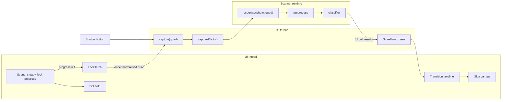

# Capture flow design

| Field | Value |
| --- | --- |
| Status | Draft, for review |
| Date | 2026-10-11 |
| Prototype | [Scan flow studies](https://claude.ai/artifact/QcWFdfZ8nQASvLDieeEcZV), sections 1d, 2 and 3 |
| Related | [Scan experience design](2026-10-11-scan-experience-design.md), [scan pipeline](../../architecture/00-concepts/scan-pipeline.md), [model contract](../../architecture/00-concepts/model-contract.md), ADR-002, ADR-005, ADR-007, ADR-013, F-04, QR-07 |
| Issues | [#5](https://github.com/vandemaelefelix/sudoku/issues/5) (model on the iPhone), [#6](https://github.com/vandemaelefelix/sudoku/issues/6) (capture and recognise), [#19](https://github.com/vandemaelefelix/sudoku/issues/19) (transition into the correction screen) |

## Goal

Close the loop from the camera to the correction screen. The app locks on to a steady grid, takes
a photo, recognises the 81 cells on the device, and plays the transition into the correction
screen. The scan experience design defines how the stages look. This spec defines how the app
builds them.

## Decisions

| Topic | Decision | Rejected options |
| --- | --- | --- |
| Lock-on | Automatic when the grid is steady for `LOCK_DWELL` (0.7 s to start). A shutter button always captures | Lock-on only by the shutter. Lock-on after N frames (depends on the frame rate) |
| Lock-on progress | The gathered dots settle and brighten: wobble and twinkle go to 0, opacity goes from 80 % to 100 % | A sweep from the centre. Box corners first |
| Haptic | A light haptic at lock-on, with `expo-haptics` | No haptic |
| Thread of `recognise()` | A dedicated worklet runtime, the **scanner runtime** | A Swift plugin for the whole capture step (fallback for one failing step only, ADR-002). The JS thread |
| Model file in M0 | The real-cells model stays out of git. `just install-model` copies it into the app folder. The manifest and the reference outputs are in git | A synthetic-only model in git. The real-cells model in git (breaks ADR-013 point 4) |
| Screens | A `ScanFlow` component with three phases, without a router | Expo Router (needs an ADR, `apps/mobile/AGENTS.md`) |

## Scope

In scope:

- #5: the model, its manifest and its reference outputs in the app, the preprocessing, the
  classifier and an on-device parity check.
- #6: the lock-on rule, the shutter, the photo and `recognise()` with a rough flatten.
- #19: the transition, the correction screen with its cell styles, Retake and Reduce Motion.

Out of scope:

- The 100 intersections and the per-cell flatten (M2). In this spec, `recognise()` flattens from
  the 4 corners only.
- The gated `just promote-model` (M3, SUD-06). M0 uses `just install-model`.
- How the player fixes a digit (F-06). "Play this puzzle" shows, but it is disabled until the
  game exists.
- The grid choice on pages with several grids (#21). The capture flow protects itself against
  the wrong grid, see "Re-detection".

## Architecture

| Concern | Rule |
| --- | --- |
| Scanner boundary | The app reaches the preprocessing, the classifier and `recognise()` only through `src/scanner/index.ts` (SUD-05) |
| Corners on the JS thread | Live corners never pass through the JS thread. At lock-on, one normalised quad goes to the JS thread once, to start the capture |
| Scanner runtime | Created once with `createWorkletRuntime`. `recognise()` runs on it through `runOnRuntimeAsync`. The model loads on it once |
| Coordinates | The locked quad is normalised to the upright frame, as in the live stage. The photo uses the same aspect ratio as the video frames (16:9), so the quad maps to the photo directly |

## #5: the model on the iPhone

### Files

| File | In git | Written by |
| --- | --- | --- |
| `apps/mobile/assets/models/cell-classifier.tflite` | No, git-ignored | `just install-model <run>` |
| `apps/mobile/assets/models/manifest.json` | Yes | `just install-model <run>` |
| `apps/mobile/assets/models/reference-outputs.json` | Yes | `just export`, copied by `just install-model` |

- `just export <run>` also writes `reference-outputs.json` into the run folder. It holds the
  PyTorch probabilities of both heads for the 81 reference cells in `fixtures/preprocess/`. These
  cells are synthetic, so the file may be published.
- `just install-model <run>` refuses a run whose contract major version the scanner does not
  implement (SUD-09). It copies the three files.
- Metro needs a static `require()`. A clone without the model file does not bundle. The error
  message names `just install-model`. Jest maps `.tflite` to a stub. The CI bundle step uses an
  empty placeholder file.

### Code

| Unit | Purpose |
| --- | --- |
| `src/scanner/preprocess.ts` | 81 cell images (64 × 64 RGB) to one `Float32Array` of `[81, 32, 32, 1]`: grayscale (BT.601, float32), crop `[6, 58)`, exact area average with a precomputed 32 × 52 matrix, `x = 1 − gray / 255`. Plain TypeScript. Worklet-safe |
| `src/scanner/classifier.ts` | Loads the model through fast-tflite with the CPU delegate. Checks the manifest contract against `SUPPORTED_CONTRACTS`. Reads the outputs by the manifest index. Checks the shapes `[81, 10]` and `[81, 4]`. Copies the outputs before the next call. Returns 81 cell results |
| Cell result | `{ digit: 0..9, kind: 'none' \| 'printed' \| 'handwritten' \| 'notes', confidence: 0..1, validPair: boolean }`. `digit` 0 means empty. The confidence is the lower top probability of the two heads |
| Parity runner | Development builds only. At start, it runs the 81 reference cells through the real model and logs the result, like the fast-opencv probe |

On a contract mismatch at runtime, the classifier refuses to load. The scan then shows a message
instead of digits (model contract, "Versioning").

### Pass criteria

- The preprocessing matches every pair in `fixtures/preprocess/` within `1/255` (Jest).
- On the iPhone: the same top class on both heads for all 81 reference cells, and probabilities
  within `1e-3` of `reference-outputs.json`.
- On the iPhone: the median of 20 batched calls is 100 ms or less. The number goes into #5.

## #6: lock-on, capture and recognise

### The lock-on rule

| Rule | Value |
| --- | --- |
| Steady | The existing scene rule: a grid is present and `motion < STEADY_MOTION`, with `STEADY_SPEED` = 30 pt/s. These two values become the lock-on threshold. Tune them on the device |
| Progress | `(t − steadyAt) / LOCK_DWELL` while steady, else 0. Clamped to 0..1 |
| Dwell | `LOCK_DWELL` = 1.0 s (was 0.7 s; added 2026-10-11, developer). The dwell counts from the latest of `steadyAt`, `foundAt`, the end of the settle time and the time the grid became big enough |
| Re-arm | The first scene after the app opens is armed. A scene after a Retake starts not armed. It arms when the grid jumps to another place, or after `REARM_LOST` = 0.5 s without a grid. That time counts from the end of the settle time at the earliest, so camera start-up frames do not arm it. While not armed, the progress stays 0 (added 2026-10-11, developer) |
| Settle time | No lock-on in the first `WARMUP` = 1.0 s after the first frame of the scene. The progress stays 0 (added 2026-10-11, developer) |
| Minimum size | The grid width (the mean of the top and bottom edges) is at least `MIN_GRID_WIDTH` = 0.35 of the view width. While smaller, the progress stays 0 (added 2026-10-11, developer) |
| Reset | The progress goes to 0 when the grid is lost, found again or jumps to another grid |
| Latch | At progress 1, the scene sets `lockedAt` once. From then on, it ignores new detections. The dots stay on the locked quad |
| Shutter | Captures at any time. It uses the current outline quad, or `null` when there is no grid |

The progress and `lockedAt` are fields of the scene. They replace the approximation in
`effects/common/lock.ts`, so every effect reads the real values.

The dot field shows the progress. Over the progress, the leftover wobble of the gathered dots
goes from 15 % to 0, their twinkle goes to 0, and their opacity goes from 80 % to 100 %.

### Capture

1. At lock-on, the UI thread calls `scheduleOnRN(capture, quad)` once. A press on the shutter
   calls `capture` too.
2. `capture` plays the haptic.
3. `capture` calls `capturePhoto()` on a photo output with `UHD_16_9` and speed priority.
4. `capture` hands the photo and the quad to `recognise()` on the scanner runtime.

### `recognise(photo, quad)`

1. `photo.toImage()` applies the EXIF orientation. `toRawPixelData()` gives the pixels for a
   Mat. Check the row stride. Convert RGBA to RGB.
2. **Re-detection.** Map the quad to photo pixels. On a downscaled grayscale copy, find
   4-corner contours only inside the quad's bounding box, enlarged by 10 %. Accept a candidate
   only when each corner lies within 4 % of the grid side from its mapped corner. Otherwise keep
   the mapped quad.
3. With `quad = null` (shutter, no grid), search the whole downscaled photo with the live
   detector's rule. When it finds no grid, return a failure.
4. Rough flatten: `warpPerspective` to 576 × 576 px. Slice 81 cell images of 64 × 64 RGB.
5. Preprocess and classify the 81 cells in one call (#5).
6. Return `{ ok: true, cells, quad, timings }` or `{ ok: false, reason }`.

The cell image is 64 × 64 RGB (model contract, "Input"). The preprocessing turns it into the
32 × 32 model input. Issue #6 says 64 × 64 for the cell image, and the model input is
`[81, 32, 32, 1]`. The two sizes do not conflict.

### The wrong grid

On a page with several equal grids, the detector can switch grids between frames (#21). The
capture flow protects itself in two ways:

- A switch is a jump. A jump resets the lock-on progress, so fast switching never locks on.
- The re-detection accepts only a grid next to the locked quad. The photo can never give
  another grid than the one the dots were on. At worst it falls back to the locked quad.

### Result view

#6 shows a plain 9 × 9 grid with the digit and the kind (P or H) per cell, and a Retake button.
#19 replaces it with the correction screen.

### Pass criteria

- fast-opencv covers every step: `cvtColor`, `adaptiveThreshold`, `findContours`,
  `approxPolyDP`, `getPerspectiveTransform` and `warpPerspective`. If one fails, #6 names it.
- During `recognise()`, a test animation on the UI thread stays at 60 fps (frame-rate log).
- A `[scan]` log gives the time of each step.

## #19: the transition and the correction screen

### Screens

`ScanFlow` in `src/scan/` holds one phase: `live`, `transition` or `review`. `App` renders
`ScanFlow`. The correction screen is `src/scan/CorrectionScreen.tsx`. The game does not depend on
it (SUD-03).

A pure function `correctionLayout(view, insets)` returns the rectangles of the title, the grid
square and the bottom panel. The transition and the correction screen both use it, so the
transition ends exactly on the screen.

### The timeline

A pure function `transitionAt(t, gates)` returns the value of each channel at time `t`. The
times are the ones in the scan experience design, stage 2.

| Channel | Time (s) |
| --- | --- |
| Flash (25 % to 0) | 0.00–0.25 |
| Pulse of the gathered dots (1.6 × radius) | 0.00–0.25 |
| Flatten of the photo and the gathered dots | 0.05–0.50 |
| Free dots drift 40 pt outward and fade | 0.05–0.45 |
| Dim to background | 0.05–0.50 |
| Dots white to ink | 0.15–0.45 |
| Cell area to white | 0.30–0.55 |
| Lines grow | 0.35–0.70 |
| Photo fades out | 0.50–0.80 |
| Dots shrink into the crossings | 0.65–0.95 |
| Digits, diagonal sweep: 28 ms per step, 150 ms fade | 0.55–1.20 |
| Rings on uncertain cells | 1.20–1.40 |
| Panel slides up | 1.20–1.50 |

As built (2026-10-11):

- The title fades in at 0.20–0.50 s. This follows the prototype. The table has no title row.
- The digit sweep, the rings and the panel shift later by the wait for the results: shift = max(0,
  the clock time when the results arrived − 0.55 s).
- The cross-fade path has no movement. It runs with Reduce Motion, after a shutter press without a
  grid, and when the photo conversion fails.

The timeline has two gates. At a closed gate, the clock holds.

| Gate | At (s) | Opens when | While closed |
| --- | --- | --- | --- |
| Photo | 0.05 | The photo is a Skia image | The live preview stays visible under the flash |
| Results | 0.70 | `recognise()` returns | A spinner shows after 1 s. On `ok: false`, the gate stays closed. The panel says that the scan failed and offers Retake |

When the photo draws, the camera stops (`isActive = false`).

### Drawing

- The transition canvas draws on the UI thread: the background, the photo, the dots and the
  lines. The photo is warped by a homography from the locked quad to a quad that moves into the
  grid square. The gathered dots ride on the same quad. The engine gets a capture phase for this.
- The correction screen draws its board with the same Skia `GridBoard` component. In the
  transition, the board grows its lines. On the screen, the lines are complete.
- The digits, the rings and the panel are React Native views. Their opacity comes from the same
  timeline shared value.
- At 1.5 s the phase becomes `review` and the transition canvas unmounts. The two boards are the
  same, so the change is not visible.

### Cell styles

| Cell | Style |
| --- | --- |
| Given (`printed`) | Text colour, weight 600 |
| Entry (`handwritten`) | Accent blue, weight 500 |
| Uncertain | A dashed amber ring, 1.5 pt, in addition to the digit style. Uncertain means `confidence < REVIEW_CONFIDENCE` or an invalid pair |
| Empty or `notes` | Empty |

- `REVIEW_CONFIDENCE` = 0.9 is provisional. The model contract leaves the threshold open until the
  first real fixture set.
- The colours are tokens in `src/theme/colors.ts`. Each token has a light and a dark value.
  `app.json` stays light only until the developer decides on dark mode.

### The panel

- It shows the number of cells to check.
- "Play this puzzle" shows, disabled, until the game exists.
- "Retake" goes back to `live` with a new scene.

### Reduce Motion

When `useReducedMotion()` is true, a cross-fade of 0.3 s from the frozen view to the correction
screen replaces the flatten. All digits show at the end of the fade. The gates still apply.

### Pass criteria

- Lock-on to a filled correction screen takes 1.5 s or less (QR-07). A `[scan]` log gives the
  time.
- The UI thread stays at 60 fps during the transition (frame-rate log).

## Error cases

| Case | Behaviour |
| --- | --- |
| The model file is missing at build time | `just bundle` stops. The message names `just install-model` |
| The manifest contract is not supported | The classifier refuses to load. The scan shows a message instead of digits |
| The output shapes are wrong | The classifier refuses the output. `recognise()` returns a failure |
| No grid in the photo (shutter without a grid) | `recognise()` returns a failure. The panel offers Retake |
| `recognise()` throws | Same as a failure |
| `recognise()` is slow | The results gate holds the timeline. A spinner shows after 1 s |

## Testing

| Layer | What |
| --- | --- |
| Jest | Preprocessing against the 81 reference pairs. Manifest guard (SUD-09). Output decoding: index map, shapes, invalid pair, confidence |
| Jest | Lock-on rule: dwell, resets, latch. Quad to photo pixels for each orientation. Corner acceptance. Cell slice indexes |
| Jest | `transitionAt` at chosen times: normal, photo gate held, results gate held, failure, Reduce Motion. `correctionLayout`. Cell style mapping. Correction screen render with Retake after a failure |
| iPhone | Parity and speed of the model (#5). Frame rate during `recognise()` (#6). Time from lock-on to the filled screen, and frame rate during the transition (#19) |

## Documentation changes

| Change | Issue |
| --- | --- |
| Amend ADR-007: a model trained on data that may not be published stays out of git. The manifest and the reference outputs are in git. Update `00-DECISIONS.md` and `09-architecture-decisions.md` | #5 |
| Model contract: add `reference-outputs.json` to "Model file" | #5 |
| Scan-pipeline concept: the lock-on rule, the scanner runtime, the one quad on the JS thread | This spec, then values from the device in #6 |
| Scan experience design, stage 1: the lock-on progress and the shutter | This spec |
| Glossary: lock-on progress, shutter, scanner runtime, correction screen, transition gate | This spec |
| ADR-002: record the scanner runtime and which capture steps fast-opencv covers | #6 |

## Open questions

| Question | Decided by |
| --- | --- |
| `LOCK_DWELL`, `STEADY_SPEED` and `STEADY_MOTION` final values | Decided in #6: 0.7 s, 30 pt/s and 0.5. No tuning was needed |
| The photo and the video frames have the same field of view at 16:9 | Decided in #6: yes. The re-detection found the corners within 0.5 to 3.4 % of the grid side. No crop mapping is needed |
| Nitro objects (the photo, the image) can pass into the scanner runtime | Decided in #6: yes. The photo, the image and the model pass as plain arguments of `runOnRuntimeAsync` |
| `REVIEW_CONFIDENCE` final value | The first real fixture set |
| Dark-mode colours of the correction screen | The developer |
| QR-07 budget (1.5 s) against the time to the photo gate: the photo takes about 120 ms, and the conversion follows | The developer, after the iPhone measure: a faster photo path, a compressed timeline, or a revised budget |

## Delivery

One branch and one pull request per issue, in this order:

1. **#5** `feature/5-model-on-iphone`: model files, preprocessing, classifier, parity runner,
   ADR-007 amendment. This spec and its documentation changes go into this pull request.
2. **#6** `feature/6-capture-and-recognise`: lock-on rule, shutter, haptic, photo, scanner
   runtime, `recognise()`, result view.
3. **#19** `feature/19-capture-transition`: `ScanFlow`, timeline, transition canvas, correction
   screen, theme tokens, Reduce Motion.

Each plan gets the developer's approval before the build starts.
