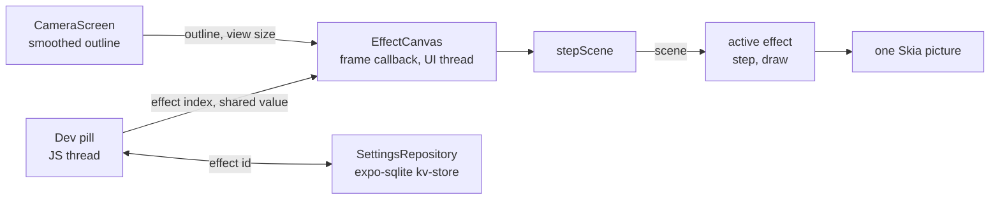

# Effect lab design

| Field | Value |
| --- | --- |
| Status | Approved |
| Date | 2026-10-11 |
| Issue | [#20](https://github.com/vandemaelefelix/sudoku/issues/20) (effect lab) |
| Prototype | [Scan flow studies](https://claude.ai/artifact/QcWFdfZ8nQASvLDieeEcZV), sections 1, 1b, 1c and 1d |
| Related | [Scan experience design](2026-10-11-scan-experience-design.md), [Scan pipeline](../../architecture/00-concepts/scan-pipeline.md), [ADR-012](../../architecture/adr/adr-012-local-persistence.md), SUD-05, QR-06 |
| Depends on | [#18](https://github.com/vandemaelefelix/sudoku/issues/18) (dot field overlay) |

## Goal

The developer wants to judge the live overlay effects of the prototype on the real camera, not
only in a browser. The app gets an effect lab: in a development build, the developer switches
between overlay effects on the camera screen. The effects share one engine and one scene, so an
effect is easy to add and easy to remove.

The effect lab is a tool for the developer. Players never see it.

## Decisions

These decisions come from the design review of this spec.

| Topic | Decision | Rejected options |
| --- | --- | --- |
| Purpose | A design lab in development builds only | A user setting that ships. A lab now and a user setting later |
| First scope | The framework and one effect per family: 4 effects | All 21 effects at once. Only some families |
| Switching | A dev pill on the camera screen that opens a list | Swipe between effects. Items in the React Native dev menu |
| Memory | The app remembers the last effect across reloads | Each reload starts on the default effect |
| Architecture | Effect modules on one shared engine and one scene | One React component per effect. One shader with an effect index |

## Scope

In scope:

- The scene, the effect interface, the engine and the registry.
- The dev pill and the saved choice of effect.
- Four effects: Gathering dots, Spotlight and brackets, Grid lattice and Ripples.
- ADR-014 and the documentation changes.

Out of scope:

- The other 17 effects of the prototype. A later issue ports them.
- The capture transition and its variants (#19).
- The lock-on rule (#6). Effects react to the steady state until lock-on exists.
- A settings screen for players.

## The effects

The prototype has 21 live effects in four families. The families need different drawing methods.

| Family | Effects in the prototype | How it draws | First effect |
| --- | --- | --- | --- |
| Path | Green line, Spotlight, Corner brackets, Veil, Glow, Spotlight and brackets | Skia paths and the dim. No state | Spotlight and brackets |
| Shader | Grid lattice, Edge light, Intersection dots, Stardust, Nebula, Galaxy, Constellation, Halftone | One Skia runtime shader in grid coordinates | Grid lattice |
| Screen | Dot screen, Paper dots, Ripples, Dotted outline, Intersection dots, Dot orbit | A shader background and dots calculated from time and the grid | Ripples |
| Simulation | Gathering dots | Stored state, stepped every frame | Gathering dots |

The prototype is the reference for every value of an effect: sizes, opacities, colours and speeds.
The implementation plan copies the values and names the prototype section of each value.

### Gathering dots

The dot field of #18, moved onto the scene. All behaviour and all tests of #18 stay. Gathering
dots is the default effect.

### Spotlight and brackets

The prototype, section 1, "Spotlight and brackets". A black dim outside the grid, as in #18, and a
corner bracket on each of the four grid corners. In the steady state the brackets grow from 12 % to 50 % of each edge and the dim deepens from 30 % to 52 %. The bracket opacity follows presence.

### Grid lattice

The prototype, section 1b, "Grid lattice" (shader kind 0). Faint cell lines and box lines on the
paper, with a light band that sweeps over the grid. Ported from GLSL to a Skia runtime shader.

### Ripples

The prototype, section 1c, "Ripples" (background kind 3). A fixed screen of dots over the view.
When a grid is found, the dots swell in waves that move out from the grid.

### Lock-on and Reduce Motion

- The prototype shows a lock-on burst. Lock-on does not exist before #6. Each effect shows its
  lock-on reaction in the steady state instead.
- With Reduce Motion on, a shader effect and a screen effect stop their time. A path effect has no
  motion. Gathering dots keeps the Reduce Motion rule of the scan experience design.

## Architecture



### The scene

`stepScene` runs once per frame on the UI thread, before the active effect. It turns the smoothed
outline into the facts that every effect needs. Effects read the scene. They never change it.

| Field | Meaning |
| --- | --- |
| `t`, `dt` | Seconds. `dt` is clamped to 0.1 s, so a long pause does not make an effect jump |
| `width`, `height` | The view size in points |
| `reduceMotion` | The system setting |
| `quad` | The grid of this frame in view points, or null. A degenerate quad counts as null |
| `lastQuad` | The last usable grid, for fades after a loss |
| `m`, `inverse` | The homography from the unit square to the view, and its inverse |
| `event` | `found`, `lost` or `none`, for this frame only. A jump to another grid gives `lost` and `found` in one frame |
| `foundAt`, `lostAt` | The time of the last `found` and the last `lost` |
| `presence` | 0..1. It moves to 1 in 0.4 s while a grid is found, and back to 0 when the grid is lost |
| `motion` | 0..1. The corner speed relative to the steady speed, measured only when a new quad arrives |
| `steady` | True while `motion` is below the steady threshold |

The scene takes these rules from the dot field of #18 without a change: the jump test, the speed
per detection, the step clamp and the degenerate quad. The dot field keeps only the dot simulation.

### The effect interface

```ts
type Effect<S> = {
  id: string
  name: string
  family: 'path' | 'shader' | 'screen' | 'simulation'
  create(scene: Scene): S
  step(state: S, scene: Scene): S
  draw(canvas: SkCanvas, state: S, scene: Scene, kit: DrawKit): void
}
```

- `id` is stable. The saved choice uses it.
- `create` runs on the first frame, when the view size changes and when the developer switches to
  the effect.
- `step` may change the state and return it. An effect without state returns the state unchanged.
- `draw` draws one frame. It may not allocate a shader, an image or a paint that it can reuse.
- Every function of an effect is a worklet. Its helpers come above the functions that call them.

`DrawKit` holds the resources that the engine makes once on the JS thread: the star sprite, the
compiled runtime shaders and the reusable paints. Shared drawing helpers live in
`effects/common/`: the dim with and without a hole, the quad path, the grid matrix as a shader
uniform and the 100 intersections. The geometry, layout, assignment and push-apart modules of #18
move to `effects/common/` without a change.

### Files

| File | Responsibility |
| --- | --- |
| `src/scan/effects/scene.ts` | `Scene`, `createScene`, `stepScene` |
| `src/scan/effects/types.ts` | `Effect`, `DrawKit` |
| `src/scan/effects/common/` | Geometry, dims, quad path, shader matrix, intersections, dot layout, assignment, push-apart |
| `src/scan/effects/<id>/` | One folder per effect, with its tests |
| `src/scan/effects/index.ts` | `EFFECTS`, `DEFAULT_EFFECT`, `findEffect(id)` |
| `src/scan/effects/EffectCanvas.tsx` | The engine: frame callback, scene, active effect, picture, timing log |
| `src/scan/effects/EffectPicker.tsx` | The dev pill and the list |
| `src/settings/SettingsRepository.ts` | `get(key)` and `set(key, value)` on expo-sqlite kv-store |

To add an effect, add a folder and one line in `effects/index.ts`. To remove an effect, delete its
folder and its line.

### The engine

- `CameraScreen` renders `<EffectCanvas outline={outline} view={viewSize} />` in place of
  `<DotField … />`.
- One frame callback steps the scene, steps the active effect and records one Skia picture.
- The active effect is a shared value that holds the effect index. The JS thread writes it only
  when the developer picks an effect. On the next frame the engine sees the new index and calls
  `create`. The scene keeps its state across a switch.
- The development timing log names the effect: `[fx] gathering-dots 120.0 fps, overlay 2.80 ms`.

### The dev pill

- The pill shows only in a development build (`__DEV__`). It sits at the top of the camera screen
  and shows the name of the active effect.
- A tap opens a list of the effects, grouped by family. A tap on an effect switches to it at once
  and closes the list.
- The pill saves the effect id through `SettingsRepository`. On start it reads the id back. An
  unknown id, for example of a deleted effect, gives the default effect.
- A release build has no pill and reads no setting. It runs `DEFAULT_EFFECT` only.

### Rules

| Concern | Rule |
| --- | --- |
| Thread | The scene and the effects run on the UI thread. No corner and no dot position goes through the JS thread. Only the effect index crosses from the JS thread |
| Scanner boundary | The engine gets corners only from `CameraScreen` and types only through `src/scanner/index.ts` (SUD-05) |
| Frame budget | The scene and one effect take at most 4 ms per frame on the UI thread |
| Storage | The saved choice uses expo-sqlite behind `SettingsRepository` (ADR-012) |
| Release | A release build contains only the default effect's behaviour. The spec's product decision for the live overlay stays |

## Shader effects in Skia

Skia runtime shaders (SkSL) have no `fwidth`. The prototype's shaders use `fwidth` for the size of
one pixel in grid coordinates. The ported shaders calculate it from the Jacobian of the inverse
homography at the pixel instead. The scene gives the shader the inverse homography as one 3 × 3
matrix uniform.

## Error cases

| Case | Behaviour |
| --- | --- |
| A runtime shader does not compile | The effect draws nothing, and a development log names the effect and the error. The pill still works |
| The saved id is unknown | The default effect runs |
| The settings store fails | The default effect runs. A development log names the error |
| The view size is still 0 × 0 | The engine waits. It calls `create` when the size is known |

## Testing

- **Unit tests (Jest):**
  - the scene: found, lost, jump, motion per detection, presence, long pause and degenerate quad;
  - the registry: unique ids, the default exists, an unknown id gives the default;
  - each effect: `create`, `step` and `draw` on a fake canvas;
  - the engine: `create` on a switch and on a size change;
  - the dev pill: it lists the effects, switches, saves the choice and restores it, and it is not
    rendered in a release build;
  - `SettingsRepository` with an in-memory fake (ADR-012).
- **Device check** on the iPhone, for each of the four effects:
  - the `[fx]` log shows 4 ms or less;
  - the UI stays at the display rate;
  - a switch shows the new effect at once and leaves nothing of the old one.

## Documentation changes

- ADR-014: scan overlay effects as plug-in modules, with an effect lab in development builds. Add
  it to `00-DECISIONS.md` and `09-architecture-decisions.md` in the same change.
- Add these terms to the glossary:
  - **effect:** one way to draw the live overlay on the camera screen;
  - **scene:** the facts about the grid that the engine gives to every effect in each frame;
  - **effect lab:** the switch between effects in a development build.
- Update the scan-pipeline concept: the live overlay is the active effect.

## Open questions

| Question | Decided by |
| --- | --- |
| Which effects the developer keeps after the lab | The developer, after the device check |
| Whether a kept effect becomes a player setting | A later spec and ADR |
| The values of the steady threshold and the lock-on reaction | Issue #6 |

## Delivery

1. **[#20](https://github.com/vandemaelefelix/sudoku/issues/20) Effect lab.** This spec. It depends
   on #18. Its branch `feature/20-effect-lab` starts on top of `feature/18-dot-field`.
2. **Later issue: the other 17 effects.** It ports them into the lab, one family at a time.
