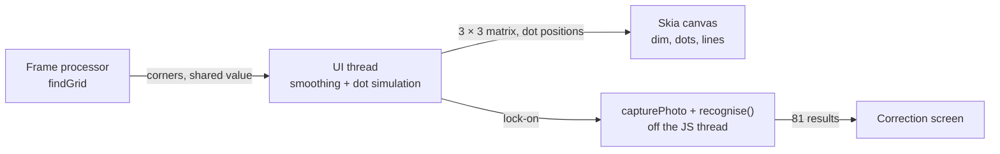

# Scan experience design

| Field | Value |
| --- | --- |
| Status | Draft, for review |
| Date | 2026-10-11 |
| Prototype | [Scan flow studies](https://claude.ai/artifact/QcWFdfZ8nQASvLDieeEcZV), section 1d "Gathering dots" and section 3 |
| Related | [Scan pipeline](../../architecture/00-concepts/scan-pipeline.md), [ADR-002](../../architecture/adr/adr-002-react-native-and-scanner-engine.md), F-04, F-06, QR-05, QR-06, QR-07 |
| Issues | [#18](https://github.com/vandemaelefelix/sudoku/issues/18) (dot field overlay), [#19](https://github.com/vandemaelefelix/sudoku/issues/19) (capture transition) |

## Goal

A scan has three stages: find the grid, capture it, and check the result. This spec defines how each
stage looks and how one stage turns into the next. The scan must feel calm and precise, like a good
tool. It must not feel like a gimmick.

## Decisions

These decisions come from the review of the prototype.

| Topic | Decision | Rejected options |
| --- | --- | --- |
| Live grid indication | A field of faint, star-like white dots. When a grid is found, the closest dots gather on its 100 intersections | Green line, spotlight, corner brackets, veil, glow, grid-lattice shader, nebula and other space effects, dot screens |
| Digit recognition | Once, after capture. The digits appear in their final place on the clean grid | Live digits over the camera image (they lag and flicker). Hint dots before capture |
| Printed and handwritten digits | Colour only: printed digits in the text colour, handwritten digits in the accent blue | A handwriting typeface for entries. Shaded cells for givens |

## Scope

In scope:

- The live overlay on the camera screen, from the first frame to lock-on.
- The transition from lock-on to a filled correction screen.
- How the correction screen shows givens, entries and uncertain cells.

Out of scope:

- The lock-on rule (N frames and the movement threshold). Issue #6 decides it.
- How the player fixes a digit on the correction screen (F-06). This spec only defines how cells look.
- The recognition pipeline itself. The scan-pipeline concept defines it.

## Stage 1: find the grid

### States

| State | Starts when | What the player sees |
| --- | --- | --- |
| Searching | The camera starts | The camera image under a black dim of 30 %. All dots float freely |
| Found | The first frame with a grid | The closest dots fly to the grid intersections. The free dots spread out and leave the grid clear. The dim outside the grid goes to 45 %. Inside the grid the dim goes to 0 % |
| Steady | The corners move less than the lock-on threshold | The gathered dots stop their small wobble and sit exactly on the intersections |
| Lock-on | The lock-on rule is met | Stage 2 starts |

### The dots

- 312 dots, one per cell of a 12 × 26 layout over the view, each moved by up to 30 % of a cell at random. On another screen size, keep the same dot density per area.
- Each dot moves all the time. It circles around its home position on two sine waves per axis, with an amplitude of 5–9 pt and a frequency of 0.5–1.1 rad/s.
- Each dot is star-like: a small bright core and a soft white halo. The halo diameter is 9 × the dot radius. The radius is 0.75–1.25 pt, different per dot.
- Each dot twinkles: its opacity changes by ± 28 % at 1.2–3.4 rad/s, different per dot.
- A free dot has an opacity of 32 %. A gathered dot goes from 40 % to 80 % while it flies.
- The background is only the black dim. There is no sky, no colour and no glow beyond the dot halo.

### Gathering

When the first grid is found, the overlay does these steps:

1. It projects the 100 intersections (10 × 10) from the grid corners into screen points.
2. It pairs every intersection with one dot. The shortest dot-to-intersection pair goes first, until every intersection has a dot (greedy nearest assignment).
3. Each paired dot flies to its intersection in 0.7 s on a slight curve. The flight starts after a delay of up to 0.35 s. A dot that is closer to the grid starts sooner.
4. A gathered dot grows to 1.25 × its radius. On the 16 box corners, it grows to 1.7 ×.
5. A gathered dot follows its intersection in every frame. While the corners still move, it keeps 15 % of its wobble. In the Steady state the wobble goes to 0.

### Free dots

- The free dots push each other apart, so they fill the gaps that the gathered dots left.
- No free dot may come within 8 % of the grid size of the grid. A free dot that comes too close moves to the nearest point outside that margin.
- A free dot moves to its new place in 1.0 s.

### When the grid is lost

- The outline holds for 0.25 s after the last detection, as the smoothing filter does today (`HOLD`).
- After that, the gathered dots go free again. They return to free movement in 0.5 s.
- When a grid is found again, the overlay does a new assignment.

### Only the largest grid

The detector already returns only the largest plausible grid. A smaller grid on the same page, such as last week's solution, gets no dots.

## Stage 2: capture and transition

The transition starts at lock-on (t = 0). It ends with a filled correction screen at t = 1.5 s, which is the QR-07 budget. `recognise()` runs off the JS thread during the transition (scan-pipeline concept).

| Time (s) | Step |
| --- | --- |
| 0.00 | The camera image freezes. A white flash of 25 % fades out in 0.25 s. The gathered dots pulse to 1.6 × their radius and shrink back |
| 0.05–0.50 | The photo flattens into the grid square of the correction screen. The gathered dots stay on their intersections, so they ride along |
| 0.05–0.45 | The free dots drift 40 pt outward from the grid centre and fade out |
| 0.05–0.50 | The black dim turns into the light background of the correction screen |
| 0.15–0.45 | The gathered dots turn from white to ink (the colour of the thick grid lines) |
| 0.30–0.55 | The cell area turns white |
| 0.35–0.70 | The 20 grid lines grow out from the middle of each row and column, through the dots. Box lines are 2 pt in ink. Cell lines are 1 pt in the line colour |
| 0.50–0.80 | The photo fades out |
| 0.65–0.95 | The dots shrink into the line crossings and disappear |
| 0.55–1.20 | The digits appear in a diagonal sweep. Each cell starts 28 ms after its neighbour toward the top-left, and fades in for 150 ms |
| 1.20–1.40 | Dashed rings appear on the uncertain cells |
| 1.20–1.50 | The bottom panel slides up, with the number of cells to check and the "Play this puzzle" button |

When `recognise()` takes longer than the lines step, the transition holds after the lines and waits. The digits appear when the results arrive. The overlay does not show a spinner unless the wait is longer than 1 s.

## Stage 3: the correction screen

| Cell | Style |
| --- | --- |
| Given (`printed`) | The digit in the text colour, weight 600. Locked during play |
| Entry (`handwritten`) | The digit in the accent blue, weight 500. Editable during play |
| Uncertain | A dashed amber ring inside the cell, 1.5 pt, in addition to the digit style |
| Empty, `notes` | Empty |

- The colours are theme tokens: the text colour, the accent and the warning colour. Each has a light and a dark value.
- The same colours stay in the game after loading, so a player always sees their own digits in blue.
- Tapping a digit belongs to F-06 and is not defined here. The prototype toggles printed and handwritten as one possible interaction.

## Architecture

| Concern | Rule |
| --- | --- |
| Thread | The dot simulation runs on the UI thread in a Reanimated worklet, next to the smoothing. No corner and no dot position goes through the JS thread |
| Geometry | One 3 × 3 matrix per frame maps grid coordinates (0–1) to screen points. It comes from the four smoothed corners |
| State | The dot positions, the assignment and the free-dot targets live in shared values on the UI thread |
| Assignment cost | 100 × 312 distances, once per new grid |
| Free-dot spreading | A few push-apart steps per frame over the free dots, only near the grid |
| Drawing | One Skia canvas: the dim as a path with a hole, the dots as images of a pre-drawn star sprite, and the lines in stage 2 |
| Frame budget | The overlay takes at most 4 ms per frame on the UI thread, so the UI stays at 60 fps |
| Scanner boundary | The overlay gets corners only through `src/scanner/index.ts` (SUD-05) |

The live dots sit on intersections projected from the four corners. On a curved page, the real intersections can differ from these points. Capture finds the real intersections. The live stage does not.

## Accessibility

When the system setting "Reduce Motion" is on:

- The dots do not wander, do not twinkle and do not fly. The gathered dots fade in on their intersections in 0.2 s.
- The transition replaces the flatten step with a cross-fade to the correction screen in 0.3 s.

## Error cases

| Case | Behaviour |
| --- | --- |
| No grid for a long time | The dots keep floating. Stage 1 shows no extra message in this spec |
| The detected grid jumps to another grid | The new grid counts as lost and found again, so the overlay does a new assignment |
| `recognise()` fails | The transition stops after the lines. The correction screen says that the scan failed and offers "Retake" |
| The givens have no unique solution | The correction screen says so and does not load the puzzle (scan-pipeline concept, QR-04) |

## Testing

- **Unit tests (Jest)**, for the pure functions:
  - the intersection projection;
  - the greedy assignment (each intersection gets exactly one dot, and the shortest pairs win);
  - one push-apart step (free dots stay outside the margin);
  - the transition timeline (the state at a given time).
- **Device check:** the UI thread stays at 60 fps during stage 1 and stage 2. Measure with the frame-rate log.
- **QR-07:** the time from lock-on to the filled correction screen is 1.5 s or less.
- **Design check:** compare a screen recording with the prototype, section 1d.

## Documentation changes

When this design is built:

- Replace the "The transition" section of the scan-pipeline concept with a short summary and a link to this spec.
- Add these terms to the glossary:
  - **dot field:** the live overlay of floating dots;
  - **gathered dot:** a dot that sits on a grid intersection;
  - **free dot:** a dot that floats.
- F-04 asks for "a visible lock-on". The Steady state (the wobble stops) and the capture pulse meet it.

## Open questions

| Question | Decided by |
| --- | --- |
| Lock-on rule: N frames and the movement threshold | Issue #6 |
| A light haptic at lock-on | The developer, during the build |
| Dark-mode colours of the correction screen | The developer, during the build |

## Delivery

Two issues deliver this spec:

1. **[#18](https://github.com/vandemaelefelix/sudoku/issues/18) Dot field overlay.** Replace the green outline with stage 1, up to lock-on. It depends on #3 (live grid detection).
2. **[#19](https://github.com/vandemaelefelix/sudoku/issues/19) Capture transition.** Stage 2 and the cell styles of stage 3. It depends on #6 (capture and recognise) and #18, and connects to F-06.
